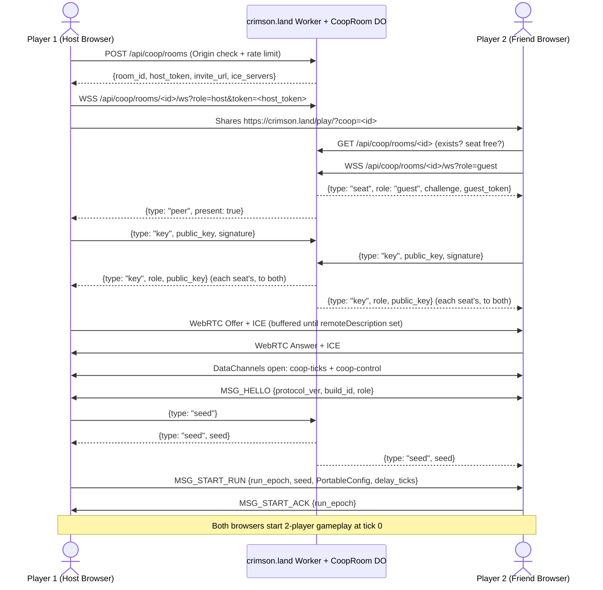

---
tags:
  - rewrite
  - contracts
---

# Network co-op specification

Design and feasibility specification for two-player online co-op
([issue #632](https://github.com/banteg/crimson/issues/632)): open `/play/`,
send a link (`https://crimson.land/play/?coop=<room>`), and play 2-player
Crimsonland together in the same arena.

---

## 1. Executive summary & architectural decision

Two-player online co-op is feasible on the `crimson-core` WASM game module
(`crimson-core/PORT.md`) without rewriting gameplay or streaming world state.
Both browsers run the same `game.wasm` binary at fixed 60 Hz simulation ticks
(`portable_step_many`) and exchange per-player `PortableInput` tuples.

Because [issue #632](https://github.com/banteg/crimson/issues/632) is a research
and prototype track, cross-browser determinism, rollback frame budgets, terrain
commit overhead, and WAN feel are treated as **explicit hypotheses gated by
automated milestones (`M0a`, `M0b`, `M1`, `M2`)** before committing to 4-player
scope. Two-player online co-op records standard replays and ranks under the
site's [ranked rules](ranked-rules.md) on its own boards (Section 5.3, `M3`).

### Verdict (`M2`)

The measurements (Section 3.1) bear the architecture out. Late in a long
2-player Survival run a tick through the rollback engine costs about 0.14 ms
(0.23 ms p99) in `game.wasm`, the same in Chrome as under node; the hard cap's
12-tick rollback costs 1.8 ms (2.4 ms p99), a seventh of a 60 Hz frame, and at
the depths a 60 ± 20 ms partner brings (1–3 ticks) a frame's ticks take under
1 ms. State capture and restore are memcpys of about
0.01 ms; the state hash is the engine's largest cost per tick. Input delay 2
with window 8, narrowing to 4 late in Survival, absorbs the simulated networks
without a desync, and the late-game frame never comes near its budget, so
streaming state from an authoritative host is not needed. What the local
numbers cannot show, real paths over TURN and the room's relay, the sessions'
telemetry reports once deployed (Section 6.2, "Telemetry").

Four players look feasible on these costs, with caveats. A tick's cost is
dominated by the creature pool, which stays at 384, so four players should cost
well under twice two players' tick; even at twice, a 12-tick rollback stays near
5 ms p99 on this machine, within a 60 Hz frame. Rollback depth would follow the
worst of three links rather than one, so deep rollbacks get more frequent, and
a device several times slower than this one would have little room left at the
cap. The original keeps two player tables (`player_state_table[2]`) and
`PortableConfig.players` takes 1 or 2, so four players also mean widening the
game's state, and each peer would carry three partners' records and hashes. A
4-player step needs measuring before that scope is committed to.

### Historical lesson (`status.md`)

An earlier lockstep, rollback, and relay stack was removed (`bc45c5b6a`)
**because it never restored full state** ([status](status.md#intentional-differences)).
In `crimson-core`, `crimson-core/host/keyframes.inc` (`game_run_spans` +
`KeyframeHost` + `game_effect_overflow`) and `crimson-core/checks/game_seek.mjs` /
`crimson-core/checks/game_practice.mjs` establish single-player seek and branch
restore, but **existing `portable_snapshot()` (`crimson-core/schema.json`) does
not cover all state that affects future 2-player ticks** (see Section 4.1).
Therefore, **Milestones `M0a` and `M0b` (`checks/game_coop.mjs`)** gate all
networking work on proving:

1. **2-player deterministic stepping (`M0a`)**: All 2-player undefined behavior
   (such as uninitialized `alternate_distance` in `creature_update_all.cpp`),
   input/camera seams, and presentation-coupled RNG draws are fixed and
   verified.

2. **Full rollback-state & side-effect equivalence (`M0b`)**: Restoring a
   2-player rollback slot and resimulating with corrected inputs in `game.wasm`
   matches a straight `game.wasm` run bit-for-bit across the **extended
   canonical rollback snapshot** (base `portable_snapshot` + `KeyframeHost` +
   `telekinetic_bonus_hover_timer_ms` + normalized `game_effect_overflow` pool)
   and the committed bake log / terrain digest, even when the two instances run
   at different frame rates and presentation settings.

### Core architectural choices

1. **Simulation model — Adaptive-Delay Lockstep (`M1`) $\to$ Bounded Rollback Hybrid (`M2`) over 60 Hz `portable_step_many`**:

   - **Decoupled input production and simulation frontiers**: A 60 Hz input
     clock samples local hardware input into immutable tick-indexed records at
     `input_produced_tick = sim_tick + D`, independent of whether simulation
     execution is temporarily stalled waiting on the network.

   - **Base input delay**: **2 ticks (33.3 ms)** at $\text{RTT} \le 60\text{ ms}$
     (adaptive 1–8 ticks in `M1` lockstep, changed only at negotiated epoch
     boundaries). Mouse aim (`aim_scheme == 0`) converts the local screen cursor
     to world coordinates at input-sampling time and records the world point into
     `PortableInput`.

   - **Rollback window (`M2`)**: Up to **8 speculative ticks (133.3 ms)** (hard
     cap **12 ticks / 200 ms**, enforced **before every individual tick step**)
     using an uncompressed 16-slot ring buffer (`RollbackSlot[16]`). Beyond 12
     ticks of unconfirmed remote input, simulation execution pauses (lockstep
     wait) while the network/input pump continues.

   - **Why not an authoritative host streaming state?** A single tick touches up
     to 384 creatures, 96 projectiles, 64 secondary projectiles, 128 particles,
     384 sprites, 2,559 effects, and 192 terrain decals/corpses (~229 KiB raw /
     ~55 KiB `zstd`). Streaming delta snapshots at 60 Hz requires custom entity
     interpolation and makes client-side hit and blood feedback lag for the guest.

2. **State & terrain rollback boundary — Uncompressed RAM ring + "Bake on Confirm" terrain**:

   - Each `RollbackSlot` holds the run's raw state as keyframes hold it
     (`game_run_spans`, `KeyframeHost`, and the active prefix of
     `game_effect_overflow.entries`, up to `2,048 × 188 B` = **385,024 B**, with
     its queued decals) plus the music volume and fade tables. Sound cooldowns
     and DirectSound buffers stay out of rollback. The ring is allocated at the
     first co-op start and kept, with no per-tick `zstd` compression and without
     `string_arena`, which is asserted invariant after `portable_init`
     (Section 4.1).

   - **Terrain render target (`terrain_render_target`, 1024×1024 RGBA8) — "Bake on Confirm"**:
     A tick that runs on both players' real inputs right after the last
     confirmed one bakes into the terrain inside the tick, as a 1P run does. A
     speculative tick moves its decal and corpse queues into a per-tick
     `CoopBake[tick % 16]` record without drawing; once `confirmed_through`
     reaches it, the record is drawn into `terrain_render_target` in order
     (Section 4.2).

3. **Signalling, transport & deployment — Cloudflare Worker + `CoopRoom` Durable Object + WebRTC DataChannels + Cloudflare TURN**:

   - **One `CoopRoom` Durable Object** handles room creation, host/guest
     capability tokens, `?coop=<room>` join handshakes, and WebRTC SDP/ICE
     signalling.

   - **Two WebRTC DataChannels on one `RTCPeerConnection`**:

     - `coop-ticks` (`ordered: false, maxRetransmits: 0`): 60 Hz unreliable
       packets carrying up to 8 unacknowledged ticks of local `PortableInput` +
       per-tick 4-bit perk command nibbles (`OPEN` / `PICK`), ping/echo timing,
       and confirmed state hashes.

     - `coop-control` (`ordered: true`, reliable): control messages
       (`MSG_START_RUN`, `MSG_INPUT_REPAIR`, `MSG_PAUSE`, `MSG_DESYNC`) and
       automatic gap repair whenever unacknowledged input age exceeds the 8-tick
       unreliable window.

   - **NAT traversal**: The Worker issues **Cloudflare Realtime TURN**
     credentials with a one-day TTL, refreshed over the room socket with
     `{type: "ice"}` (`turn:turn.cloudflare.com:3478?transport=udp` and
     `turn:turn.cloudflare.com:443?transport=udp` preferred for true UDP without
     TCP head-of-line blocking; `turns:turn.cloudflare.com:443?transport=tcp` and
     `CoopRoom` WebSocket relay retained as reachability fallbacks with
     explicitly qualified latency).

---

## 2. Research question 1: Two-player determinism & seam audit

### 2.1 Cross-instance determinism in `wasm32`

Can two-player simulation reproduce bit-exact state across browser/native
instances with synchronized per-player inputs? **Hypothesis: Yes, once the
undefined auto-target read (Section 2.2.1), presentation-coupled music latch
(Section 2.2.3), between-tick world-render mutations (Section 2.2.5), and
2-player input/perk seams are patched.**

What `crimson-core` already provides across Chrome V8, Firefox SpiderMonkey,
Safari JSC, Wasmtime, and native `wasm2c`:

- **Identical 32-bit memory layout**: `game_data()` (`crimson-core/game.py`)
  places `crimsonland.exe` and `grim.dll` globals at their exact original offsets
  inside `game_image_exe` and `game_image_grim`. *(Add `-ffp-contract=off` to
  `crimson-core/client/build.py` when compiling `wasm2c` output natively so its
  flags match `crimson-core/build.py`.)*

- **Pinned transcendental & x87 PC24 math**: `crimson-core/host/musl/src/math`
  and `crimson-core/host/math.c` (`portable_round_pc24`, `D3DXVec2Normalize`,
  `portable_crt_pow_pc24`) plus `crimson-core/adapter.py`'s `x87()` pass
  eliminate host FPU/libm differences.

- **MSVC evaluation order**: `msvc_argument_order()` in `crimson-core/game.py`
  hoists multi-draw `crt_rand()` call arguments right-to-left.

- **Presentation isolation**: `SessionGrim` (`crimson-core/host/game.inc`) routes
  input/time queries during `game_ticking = 1` to `HeadlessGrim`
  (`crimson-core/host/grim.inc`). `crt_rand_stream()` (`crimson-core/host/host.cpp`)
  routes between-tick menu/frame RNG draws to a separate `presentation` stream.

### 2.2 Mandatory determinism, UB & crash fixes for 2-player sessions (`M0a`)

#### 1. Uninitialized `alternate_distance` in 2-player creature targeting (`creature_update_all.cpp`) — C++ UB & determinism bug

- **Problem**: In `decomp/1.9/crimsonland/crimsonland/creature_update_all.cpp:112-127`,
  `float alternate_distance;` is declared as an uninitialized stack variable:

  - On non-70th ticks (`creature_update_tick % 70 != 0`), when
    `config_player_count == 2` (`:198`), `alternate_distance` is assigned **only**
    inside `if (player_state_table[1 - target_player_index].health > 0.0f)`
    (`:199-208`).

  - At `:218-223`, `if (alternate_distance < vec2_distance(...))` reads
    `alternate_distance` unconditionally.

  - **Concrete failure**: If Player 1 is dead (`health <= 0.0f`) and the first
    active creature targets Player 0 on a non-70th tick, C++ evaluates an
    uninitialized stack local (`alternate_distance`), or on later creatures
    reuses stale stack residue from a previous creature iteration.

- **Fix (mandatory in `M0a`, porting [original bug 19](original-bugs.md#19-co-op-auto-target-replacement-reuses-mismatched-player-distances))**:
  Patch `creature_update_all.cpp` so 2-player target reevaluation and
  `auto_target` replacement always initialize candidate distances from the
  evaluated player's position and compare both the candidate creature and current
  `auto_target` against the final targeted player's own position (matching
  `src/crimson/creatures/runtime.py:446-470`). Also ensure
  `config_blob.player_count = 2` is set **before** `gameplay_reset_state()` in
  `portable_init` so `creature_pool[i].target_player = i % config_blob.player_count`
  (`decomp/1.9/crimsonland/gameplay/gameplay_reset_state.cpp:301-305`)
  initializes round-robin targets at run start.

#### 2. Perk command alive gate checks player 0 only (`crimson-core/host/host.cpp`, `crimson-core/host/session.inc`) — run-ending bug

- **Problem**: `portable_step_many` (`crimson-core/host/host.cpp:601`) refuses
  perk commands when `player_state_table[0].health <= 0`, and
  `live_perk_command_valid()` (`crimson-core/host/session.inc:346`) checks
  `player_state_table[0].health > 0`. Meanwhile, the recovered engine
  (`decomp/1.9/crimsonland/game/gameplay_update_and_render.cpp:235-237`) and
  Python (`src/crimson/sim/sessions.py:181`) allow opening and picking perks as
  long as **any** player is alive. If Player 0 dies in 2P co-op and surviving
  Player 1 opens or picks a perk, `crimson-core/host/host.cpp:601` calls
  `refuse()`, setting `ready = false` and aborting the session.

- **Fix**: Check `any_alive` across `0..config_blob.player_count - 1` in both
  `crimson-core/host/host.cpp:601` and `crimson-core/host/session.inc:346`.

#### 3. First-hit music latch & playback-gated RNG draw (`music_play_exclusive.cpp`, `music_fade_out_all.cpp`) — desync hazard

- **Problem**: Projectile hits outside Rush read `music_playlist_randomized_latch`
  directly (`decomp/1.9/crimsonland/crimsonland/projectile_update.cpp:610-612, 848-850`):
  while it is `0`, the hit calls `music_play_exclusive(music_track_game_playlist)`
  **instead of** playing the hit sound, which skips the hit sound's
  `crt_rand() % 6` draw. The latch therefore gates an RNG draw on every hit, not
  only the playlist pick:

  1. `decomp/1.9/crimsonland/audio/music_play_exclusive.cpp:8-10` returns early
     before touching RNG if `!music_ready || config_blob.music_disabled || config_blob.sound_disabled`.

  2. At `:14-21`, if `sfx_id == music_track_game_playlist`, it returns early if
     `music_playlist_randomized_latch || music_playlist_entry_count == 0`;
     otherwise it draws `crt_rand() % music_playlist_entry_count` and sets
     `music_playlist_randomized_latch = 1`.

  3. At `:27-30`, `music_play_exclusive` loops over all 128 tracks: if any track
     `i != sfx_id` satisfies `music_track_is_playing(i)` (`music_fade_out_flags[i] == 0`
     and `music_track_volume[i] > 0`), it calls `music_fade_out_all(i)`.

  4. `decomp/1.9/crimsonland/audio/music_fade_out_all.cpp:12` **unconditionally
     clears `music_playlist_randomized_latch = 0`** after its audio-enabled gate!

  5. Because `music_fade_out_flags` and `music_track_volume` match `^music_` in
     `SESSION_KEEPS` (`crimson-core/game.py:322`), they lie outside
     `game_run_spans`. If a speculative tick starts track $A$, and a rollback
     resimulates the first hit picking track $B \ne A$ while `music_fade_out_flags[A] == 0`
     and `music_track_volume[A] > 0`, `music_play_exclusive(B)` calls
     `music_fade_out_all(A)`, clearing `music_playlist_randomized_latch = 0` so
     the *next* projectile hit draws `crt_rand()` a second time! Likewise, any
     other call to `music_fade_out_all` or a peer with `music_disabled` /
     `sound_disabled` / `music_playlist_entry_count == 0` diverges on the RNG
     stream.

- **Fix (deliberate patch to original behavior — split music calls into a
  simulation half and a playback half)**:
  Keep `music_playlist_randomized_latch` as the latch. It is already simulation
  state: `KeyframeHost::music_latch` (`crimson-core/host/keyframes.inc:71`) and a
  `schema.json` field, so rollback restores it and the canonical hash covers it.
  The verifier already keeps the gate open (`portable_init` sets `music_ready = 1`,
  all fade flags, and a 6-entry playlist, `crimson-core/host/host.cpp:512-524`),
  matching `src/crimson/sim/world_state.py:87-94`. In a co-op session, inside
  `game_ticking`, `music_play_exclusive` becomes:

  - **Simulation half (identical on every peer, reads no audio state)**: for
    `music_track_game_playlist`, if the latch is clear, draw `crt_rand()` once
    and set the latch, regardless of `music_ready`, `music_disabled`,
    `sound_disabled`, or `music_playlist_entry_count`; for any other track
    (`shortie_monk`, `crimsonquest`), clear the latch as the original's `else`
    branch does. Inside a co-op tick `music_fade_out_all` only clears the
    latch, as the original's does with the verifier's music on and ready
    (Section 4.3); its fade waits for the tick's confirmation.

  - **Playback half (local, gated by the peer's own audio settings)**: start the
    in-game tune the first time the simulation half sets the latch; an in-game
    tune already playing keeps playing. Whether one is playing is read from the
    music tables in `SESSION_KEEPS` (`watch_playing()` in
    `crimson-core/host/watch.inc`), which rollback never restores. In a co-op
    tick every playback waits for the tick's confirmation (Section 4.3), so a
    rollback that undoes and replays the first hit starts nothing twice.

  - **Track ids (landed, every session)**: an original started with sound or
    music off loads no music, so all its track ids are `0` and the end tunes
    would pose as the in-game tune's request. Ticks run with the verifier's
    distinct ids (`GameMusic` in `LiveSettings`, `crimson-core/host/game.inc`);
    the playback half and the quest's in-tick volume write map them to the
    original's loaded tracks (`game_shell_track`), and play them with the
    original's own ids in place (`GameShellMusic`): the original's
    `music_play_exclusive` takes a track equal to the in-game tune's request for
    the request and draws a tune, and with seven in-game tunes loaded the
    original's `crimsonquest` is the verifier's request.
    `crimson-core/checks/game_session.mjs --silent` plays a run with both off,
    and `--tunes` a quest with seven tunes loaded.

#### 4. Complete 2-player input, camera & replay seams (`host.cpp`, `grim.inc`, `game.inc`, `session.inc`, `replay.inc`)

- **Per-player virtual input codes & schemes**:

  - Keep `PortableInput in[2]` at `portable_input()` and add
    `portable_set_player_count(uint32_t count)` (or encode `player_count` in the
    co-op start handshake). Audit and update every `sizeof in` caller in
    `crimson-core/host/`.

  - In `portable_init` (`crimson-core/host/host.cpp:436-451, 487-497`), set
    `config_blob.player_count = player_count` **before** `gameplay_reset_state()`
    and initialize virtual controls for both players:

    - **Player 0**: `fire_key = 100`, `axis_move_x = 0`, `axis_move_y = 1`,
      `move_key_forward..aim_key_right = 0x100..0x105`.

    - **Player 1**: `fire_key = 200`, `axis_move_x = 2`, `axis_move_y = 3`,
      `move_key_forward..aim_key_right = 0x110..0x115`.

  - In `portable_step_many` (`crimson-core/host/host.cpp:564-582`), validate
    `in[p]` and install `config_blob.movement_schemes[p]` and
    `config_blob.aim_schemes[p]` for all $p \in [0, \text{player\_count})$.

  - For queries called inside `player_update()` (`config_key_reload = 101`,
    `0x22` G-key, `portable_aim_x/y()`, `portable_move_x/y()`,
    `portable_aim_turn_left/right()`, and `input_primary_just_pressed()` in both
    `crimson-core/host/host.cpp:161` and `crimson-core/host/game.inc:129-130`),
    assert that the call occurs while `0 <= current_player_index && current_player_index < config_blob.player_count`
    and read `in[current_player_index]`.

  - **Controls travel with every input**: peers exchange the replay's
    normalized per-tick input (`PortableInput`: move axes, the aim point the
    [replay format](../formats/replay.md#tick) defines per scheme, and the flag
    word), never raw device events. The flag word already carries each player's
    movement mode and aim scheme (`MOVE_MODE_PRESENT_FLAG`,
    `AIM_SCHEME_PRESENT_FLAG`, `src/crimson/replay/types.py`), so the Host
    learns the Guest's controls from its inputs with no setup handshake. Key
    bindings, pad profiles, dead zones and cursor-to-world conversion stay on
    the sampling peer, which converts against the camera its own simulation
    left, exactly as a 1P recorder does. Co-op accepts every human scheme the
    ranked rules accept.

  - **Per-player cursor for mouse-relative aim**: `portable_step_many` writes
    `ui_mouse_x/y` once per tick from player 0's input, choosing cursor or
    world form by `aim_schemes[0]` (`crimson-core/host/host.cpp:636-639`), and
    `player_update` copies `ui_mouse_x/y` into
    `player_aim_screen_x[current_player_index * 2]` for every player
    (`decomp/1.9/crimsonland/gameplay/player_update_heading.cpp:255, 262`).
    `seams/mouse-aim.patch` and `seams/pad-aim.patch` bypass that copy for aim
    schemes `0` and `4`, but mouse-relative aim (`aim_scheme == 3`, `:1048-1070`)
    reads it directly, so player 1 would aim with player 0's cursor. Locally the
    original's two players share one mouse; online each has their own. `M0a`
    sets the copy from `in[current_player_index]` (cursor form under scheme
    `3`, world plus camera otherwise) when `PORTABLE_RECORDED`.

- **Tick-0 camera conversion (`crimson-core/host/session.inc:271-282`)**:

  - `live_input()` currently computes tick-0 `camera_x/y` from
    `player_state_table[0].position` alone. In 2-player mode, tick-0 camera
    conversion must use the 2-player midpoint
    `(player_state_table[0].position + player_state_table[1].position) * 0.5f`
    clamped to `[-1024 + W, -1] × [-1024 + H, -1]`, matching
    `decomp/1.9/crimsonland/game/camera_update.cpp:67-77` (the midpoint) and
    `:86-101` (the clamp).

- **Isolation from 1P `replay.inc` and `watch.inc`**:

  - `crimson-core/host/replay.inc:162, 190-207` and `crimson-core/host/watch.inc:332-351`
    hardcode `player_count = 1` and parse `live.replay` with a single 20-byte
    `PortableInput` per tick. Calling `live_end()` -> `replay_payload()` on a
    2-player buffer would misparse Player 1's `move_x` float bits as
    `command_count`.

  - **Rule**: co-op records a standard `.crd` replay with `player_count = 2`;
    the [replay format](../formats/replay.md) already allows 1..4 players, one
    input array per player per tick, and `player_index` on perk commands. Each
    confirmed tick writes `[in[0], in[1]]` and its derived commands:
    `perk_menu_open { player_index: perk_picker }` on $T_{\text{open}}$ and
    `perk_pick { player_index: perk_picker, choice_index }` on
    $T_{\text{open}} + 1$ (Section 5.1). `replay.inc` and `watch.inc` are
    generalized to `player_count` inputs per tick (`M3`); until then co-op keeps
    `live_end()` from feeding 2-player ticks into the 1P serializer.
    `checks/game_coop.mjs` and desync diagnostics read the same `.crd`.

#### 5. Between-tick `gameplay_render_world()` side effects & local state in `game_run_spans`

- **Problem A (`gameplay_render_world` mutates simulation state)**:
  `decomp/1.9/crimsonland/game/gameplay_render_world.cpp` is not pure rendering:

  - `:34-52` revokes guarded weapons (`weapon_assign_player(0..1, 1)`).

  - `:92-108` mutates `current_player_index`.

  - `decomp/1.9/crimsonland/ui_render/creature_render_type.cpp:226-230, 303-307`
    deactivates dead creatures (`death_timer < -10.0f`) and clears
    `creature_spawn_slot_table[creature->link_index].owner = 0` (unless gated out
    when `ui_transition_alpha <= 0.0f` in `creature_render_all.cpp:20-26`).

  - `decomp/1.9/crimsonland/crimsonland/bonus_render.cpp:95-123, 264-280`
    increments `telekinetic_bonus_hover_timer_ms[0..1]` by `frame_dt_ms` whenever
    `game_state_id == GAME_STATE_GAMEPLAY` and calls `bonus_apply()` when
    `*hover_timer > 650`! It also advances `bonus_render_anim_phase += frame_dt * 1.3f`
    at `:144`.

  **Crucial rules**:

  1. **During tick simulation and rollback resimulation (`game_ticking == 1`)**:
     `gameplay_render_world()` **must** run on every tick (with
     `ui_transition_alpha = 1.0f` forced during `game_ticking == 1` so local
     `ui_elements_timeline` never skips `creature_render_all()`; landed in
     `crimson-core/game/changes/world-draw.patch`). `headless-effects.patch`
     already skips only `effects_render`'s vertex math when `grim_render_disabled == 1`.

  2. **Between ticks (`game_ticking == 0`)**: Guard all simulation writes inside
     `gameplay_render_world` (`weapon_assign_player`, `creature->active = 0`,
     `telekinetic_bonus_hover_timer_ms` updates, and `fx_queue_render`) with
     `if (game_ticking)` so menu redraws and network-wait overlays are strictly
     observational. During in-game co-op pause/wait overlays, re-show the saved
     backbuffer (`host_frame_hold(HOST_FRAME_SHOW)`, as `practice.inc:206` does)
     rather than re-invoking `gameplay_render_world()`.

- **Problem B (local settings inside `game_run_spans`)**:
  Even inside `live_enter_run()` (`crimson-core/host/session.inc:111-120`),
  `live.run.config` copies local presentation choices (`direction_arrow_flags`,
  `shadows_enabled`, `flame_glow_enabled`, `smoke_enabled`, `ui_info_texts`),
  and `game_run_ready()` (`crimson-core/host/game.inc:76-89`) restores local
  `music_volume` and `sfx_volume`. Furthermore, `bonus_render_anim_phase`
  advances during menu frames.

  - **Rule**: Raw `game_run_spans` bytes are suitable for **local rollback
    restore on the same machine** (preserving `ui_mouse_x/y` and `live.outside`),
    but **cross-peer desync hashes must never hash raw `game_run_spans`**. Cross-peer
    hashes use the canonical field serializer defined in Section 4.1.

### 2.3 Retained 2P behaviors & co-op fixes

To keep the prototype scope tight, the following recovered 2P behaviors are
explicitly classified:

| Behavior in Recovered 1.9.93 Code | Prototype (`M0`–`M2`) Disposition |
| --- | --- |
| Uninitialized `alternate_distance` in `creature_update_all.cpp:126, 198-223` | **Fixed in `M0a`** (mandatory C++ UB / determinism fix). |
| Player-0-only perk command gate (`host.cpp:601`, `session.inc:346`) | **Fixed in `M0a`** (`any_alive` across both players). |
| Manual reload gated on `config_player_count == 1` (`player_update_heading.cpp:1004`) | **Fixed in `M0a` in both ports** as a new [original bug](original-bugs.md) entry: with `preserve_bugs` off, crimson-core (`crimson-core/patches/`) and `src/crimson/gameplay.py` (`reload_key_enabled` gate in manual reload) drop the one-player gate, and [co-op mechanics](../mechanics/systems/co-op.md) stops saying Reload does nothing in co-op. |
| Shared XP (`player_state_table[0].experience`), level, and perk counts | **Retained by design** (core Crimsonland co-op mechanic). |
| Single-player-only perks (`Grim Deal`, `Alternate Weapon`, `Fatal Lottery`, `Random Weapon`, `Final Revenge`, `Highlander`) blocked via `PerkFlags.MULTIPLAYER_ALLOWED` (`perk_can_offer.cpp:18`) | **Retained by design**. |
| Same-tick dual bonus pickup when both players overlap an unpicked bonus (`bonus_update.cpp:44-64`) | **Retained in prototype** (deterministic on both peers; documented in `src/crimson/bonuses/pool.py:446`). |
| 1P-only Shrinkifier / Blade Gun Easter-egg handouts (`survival_update.cpp:60-89`) | **Retained by design** (`config_player_count == 1` check is intentional). |
| Co-op symmetry bugs in [original bugs](original-bugs.md) (`06, 07, 08, 09, 12, 13, 14, 15, 16, 23`; `01`, `11` and `19` are covered above or already in `crimson-core/patches/`) | **Fixed in `M0a`**: every client fixes the documented bugs, and Python's `crimson replay verify` already applies these with `preserve_bugs` off. Several change 2P RNG draws (Jinxed's victim, Pyromaniac offers, the Pistol fallback) or health, weapons and projectiles, so a 2P replay verifies in Python only once crimson-core carries the same patches. |

---

## 3. Research question 2: Lockstep vs. rollback vs. authoritative host

### 3.1 Measurements on `crimson-core` (Apple M1 Pro, WASM)

The late-game rows come from `checks/coop_cost.mjs`, under node and, through
`checks/coop_browser.mjs`, in Chrome on a cross-origin isolated page (5 µs
timer). A bot plays both players of a 2-player Survival run with their health
held far past full, so the run reaches the late game: the creature pool is full
from about ten minutes on, the spawn rate keeps rising with the run's time, and
by 20 minutes the players hold nearly every perk (the bot takes every one but
those that kill or spend health). Each row is per call between 20 and 35 minutes
of the run's time, node first, then Chrome. The bot plays simply, kiting and
picking up the bonuses near it, so a human's late game, with stronger weapons
and more projectiles and effects, may cost more per tick.

| Metric | Value | Source / Evidence |
| --- | --- | --- |
| Tick frequency | **60 Hz** ($\Delta t = 16.6667\text{ ms}$) | `crimson-core/host/host.cpp:626` |
| 2P input size per tick | **40 B** (`2 × sizeof(PortableInput)`) + **4 B** `count` + $8k\text{ B}$ commands | `crimson-core/host/api.h:53-54` |
| State slot | **~227 KiB** without the effect overflow in use; **~602 KiB** worst case | The largest slot captured (`CoopStats.slot_bytes`); the worst case adds `2,048 × 188 B` of overflow entries (`crimson-core/game/include/effect_overflow.h`) |
| Co-op engine memory | **3.75 MiB** over the plain run (16 slots, records, per-tick results, held bakes); **~9.6 MiB** worst case | `game.wasm` memory of the run through the engine less the plain run's |
| Slot restore (`run_state_read`) | **0.007 / 0.014 ms** p50/p99; Chrome **0.005 / 0.015 ms** | `game_coop_restore` alone |
| Slot capture | **~0.01 ms** | The co-op tick less the plain step and the hash (p50) |
| Canonical state hash | **0.033 / 0.046 ms** p50/p99; Chrome **0.035 / 0.045 ms** | `game_coop_hash` alone: most of what the engine adds to a tick |
| Late-game 2P plain step | **0.096 / 0.205 ms** p50/p99; Chrome **0.100 / 0.200 ms** | `portable_step_many`, one tick |
| Late-game 2P co-op tick | **0.137 / 0.227 ms** p50/p99; Chrome **0.140 / 0.195 ms** | `game_coop_advance` running one tick: the step, the slot capture and the hash |
| Late-game 8-tick rollback | **1.22 / 1.63 ms** p50/p99; Chrome **1.23 / 1.70 ms** | A restore 8 ticks back and the frame that runs them again and the next tick |
| Late-game 12-tick rollback (the hard cap) | **1.77 / 2.37 ms** p50/p99; Chrome **1.79 / 2.34 ms** | As above, 12 ticks back |
| Late-game frame work, 60 Hz | **0.44 / 0.73 ms** p50/p99 (max 0.95); Chrome **0.45 / 0.72 ms** (max 1.0) | 60 s of frames with player two's records 60 ± 20 ms one way, window 4 (past 15 minutes): rollbacks of 1–3 ticks on most frames, 1.65 ticks run again per tick, no stalled frame |
| Late-game frame work, 144 Hz | **0.15 / 0.50 ms** p50/p99; Chrome **0.15 / 0.49 ms** | As above at 144 Hz: rollbacks of 1–2 ticks, 1.15 ticks run again per tick, no stalled frame |
| `game.wasm` step cost (9-min 1P Survival avg, `grim_render_disabled = 1`) | **~0.028 ms / tick** (~36,000 ticks/s) | Measured ([replay viewer](replay-viewer.md#what-it-can-afford)) |
| `core.wasm` step cost (35-min 1P Survival avg, 210,268 ticks) | **~0.126 ms / tick** (26,497 ms total) | Measured (`crimson-core/results/survival-spawn-profile.json`) |

Rollback under the network profiles comes from `checks/game_coop_live.mjs`,
which prints each machine's counters (`m2`, `played`): two originals over its
simulated pipe, the Host at 60 Hz and the Guest at 144 Hz, about 2,000 ticks of
early Survival each, with input delay 2 and window 8 (narrowed to 4 under the
burst profile). Each run has a 250 ms start offset, a 300 ms stall on the
Guest's machine and a perk the other machine waits for, which account for most
rollbacks under 10 and 30 ms and for most stalled frames everywhere (a frame is
stalled when every tick it was due waited: for records, the window or the
picker).

| Profile (one way) | Rollbacks per minute, Host / Guest | Mean depth (deepest) | Ticks run again per tick | Stalled frames |
| --- | --- | --- | --- | --- |
| 10 ms | 207 / 306 | 3.6 / 3.9 (8) | 0.21 / 0.33 | 0.4% / 4.3% |
| 30 ± 5 ms | 221 / 288 | 2.7 / 3.7 (8) | 0.16 / 0.30 | 6.4% / 3.1% |
| 50 ± 15 ms, bursts of 10 lost packets every 4 s | 1,246 / 1,587 | 2.6 / 2.9 (12) | 0.91 / 1.28 | 2.7% / 7.0% |
| 60 ± 20 ms, 1% loss | 1,593 / 2,235 | 1.6 / 2.0 (8) | 0.70 / 1.22 | 6.9% / 3.3% |

These are a local pipe's numbers. What sessions see over real direct WebRTC
paths, TURN over UDP and TCP and the room's relay comes from the sessions'
telemetry (Section 6.2, "Telemetry") once deployed.

### 3.2 Architecture comparison

| Criterion | Adaptive-Delay Lockstep (`M1` Prototype) | Hybrid Delay + Rollback (`M2` Target) | Authoritative Host (State Streaming) |
| --- | --- | --- | --- |
| **Bandwidth (per peer)** | ~6–12 KB/s | **~12 KB/s** (200 B × 60 Hz payload, before SCTP/DTLS overhead) | 150–600 KB/s (creatures, projectiles, effects, decals) |
| **Feel at 30 ms RTT (LAN / Metro)** | Good (2 ticks / 33 ms delay) | **Excellent** (2 ticks delay, 0–1 tick rollback on jitter) | Asymmetric (Host 0 ms, Guest 30+ ms) |
| **Feel at 80–120 ms RTT (Continental)** | Fair (4–5 ticks / 67–83 ms aim/fire lag) | **Very Good** (2 ticks / 33 ms local delay + 2–4 ticks rollback) | Guest sees delayed blood/corpses or rubber-banding |
| **Feel at 150 ms RTT + ±30 ms Jitter** | Stalls/hitches on late packets | **Smooth** (absorbs up to 8–12 ticks / 133–200 ms without stalling) | High bandwidth stalls congestion window |
| **Implementation complexity** | **Low** (validates transport, pacing, barriers & hashes in `M1`) | **Medium** (adds 16-slot ring restore + unheard resimulation on top of `M1`) | **High** (custom entity snapshots, interpolation, no verifier reuse) |

### 3.3 Decoupled frontier definitions & tick pacing

A fixed 60 Hz simulation step does not by itself synchronize two independent
browser `requestAnimationFrame` loops (e.g., a 60 Hz display paired with a
144 Hz display, or a tab recovering from a 100 ms stall). We define **six
monotonically non-decreasing tick frontiers**:

| Frontier | Definition |
| --- | --- |
| `input_produced_tick` | Highest tick $t$ for which this peer has sampled and frozen its own immutable `PortableInput` (`local_inputs[t]`). Seeded at run start for $t \in [0, D-1]$ with neutral rest input. |
| `remote_contiguous_tick` | Highest tick $t$ for which all remote inputs $0 \dots t$ have been received. |
| `peer_ack_tick` | Highest contiguous tick the remote peer has acknowledged receiving from us. |
| `confirmed_through` | Highest **executed** simulation tick $t \le \min(\text{input\_produced\_tick}, \text{remote\_contiguous\_tick})$ whose entire input and control-barrier history is final. |
| `next_sim_tick` | Next simulation tick to execute (`next_sim_tick == 0` at init; after executing tick $t$, `next_sim_tick = t + 1`). |
| `Menu Barrier` | Optional tick $T_{\text{barrier}}$ beyond which `next_sim_tick` may not advance until the barrier decision is resolved. |

#### Pacing & accumulator rules (`coop_frame`)

1. **Clock-drift micro-adjustment**:
   From incoming packets, estimate remote lead
   $\Delta T = (\text{remote\_head\_tick} - D) - \text{next\_sim\_tick} + \frac{\text{RTT}}{2 \times 16.667\text{ ms}}$.
   Scale `grim_frame_dt` clamping (`fminf(grim_frame_dt, 0.1f)`) by
   `clamp(1.0f + 0.01f * delta_T, 0.98f, 1.02f)` when accumulating `coop_banked_s`.
   The remote head is the newest `head_tick` the partner's ticks packets carried
   (`coop_ahead`, `host/coop_wire.inc`). A peer stalled at its window still runs
   on its banked reserve, so the one ahead slows only once that has drained:
   two runs a stall left 8 ticks apart come back together within a few seconds.

2. **Monotonic, gap-free input production (`++input_produced_tick`)**:
   While `input_produced_tick < next_sim_tick + D` **and**
   `input_produced_tick - peer_ack_tick < MAX_UNACKED_INPUTS (120)`, sample local
   hardware once via `live_input()` and assign it to the next contiguous tick
   `local_inputs[++input_produced_tick]` (never to `next_sim_tick + D` directly).
   **Once written, `local_inputs[t]` is immutable** and is never overwritten if
   simulation stalls. During a lockstep stall (`next_sim_tick` blocked), the
   network pump continues retransmitting unacknowledged `local_inputs` at 60 Hz
   without advancing `input_produced_tick` past `next_sim_tick + D`.

3. **Unconsumed accumulator preservation**:
   Unlike `session.inc:449-450` (which subtracts `live.due / 60.0f` before ticks
   run), `coop_banked_s` subtracts `1.0f / 60.0f` **only as each new tick
   actually executes**, clamping `coop_banked_s` to at most `4.0f / 60.0f`
   whenever `next_sim_tick` is blocked by a network stall or menu barrier so
   resuming never triggers a burst of catch-up ticks.

4. **Per-run constant input delay $D$**:
   In the `M1`/`M2` prototype, **hold $D$ constant for the duration of each run**
   (negotiated from measured handshake RTT in `MSG_START_RUN`: fixed $D = 2$ in
   `M2` rollback, or fixed $D \in [1, 8]$ per run in `M1` lockstep).

---

## 4. Research question 3: Keyframe machinery & state boundaries for frequent rollback

### 4.1 Canonical rollback state vs. raw `RollbackSlot[16]`

The engine is `crimson-core/host/coop.inc` (game module only; `core.wasm` stays
import-free). Its ring of 16 slots is allocated at the first co-op start and kept
for the module's life:

```text
slot[t & 15]: S[t], the state BEFORE executing tick t, tagged (run_epoch, tick)
  - keyframes' raw codec (host/keyframes.inc run_state_write): game_run_spans,
    KeyframeHost (with perk_picker and the overflow's queued decals), and
    game_effect_overflow.entries[0..extent) with its queued decals
```

Slot capture runs inside the run's surroundings (`CoopRun`): the run's settings
(`live.run`) and the run's own copies of `game_state_pending`,
`ui_elements_timeline` and `ui_transition_direction`, which only ticks change;
the picker's perk screen and this machine's menus change the local copies. A
restore asserts the slot's tag, keeps this machine's screen state, cursor, XP
bar, settings and music (`run_restore`, which practice's retry shares), drops
the music ticks from `t` on queued, and never draws gameplay RNG. `string_used` must equal its value at co-op start.

#### Per-tick retention invariant

- Slot `slot[n & 15]` stores state $S[n]$ **immediately before** executing tick
  $n$.

- **Per-tick gates** (`game_coop_advance`), checked before every tick $n$:
  the local record for $n$ is published ($n \le$ `input_produced_tick`);
  $n - (\text{confirmed\_through} + 1) < 12$ **and** (both records of $n$ are
  real **or** $n - (\text{confirmed\_through} + 1) < R_{\max}$); with the perk
  menu open, the picker's real record for $n$ is known; the run is not over
  (`run_down_ms >= 0`); `game_paused_flag` is asserted clear. The cap of 12 keeps
  `slot[(confirmed_through + 1) & 15]` alive however many ticks a frame runs.

- When switching $R_{\max}$ from `8` to `4` in late-game Survival
  (`run_elapsed_ms > 900000`), new speculative ticks simply wait until
  `next_sim_tick - (confirmed_through + 1) < 4`; existing speculative history is
  never discarded early.

- A late record is predicted from the seat's last real record before it: the
  same axes, aim, held keys and schemes, with the press bits (`2`, `4`) cleared
  and no perk request. A record that arrived out of order is used as it is.

- **Correction**: before running ticks, the earliest unconfirmed executed tick
  whose record is now known and differs from the one it ran on is restored and
  run again. Ticks that run again are *quiet* ($t \le$ `heard`, the high-water of
  executed ticks): they cost CPU but no pacing credit (`game_coop_advance`
  returns new ticks only), play no sound and draw nothing; of a frame's ticks,
  only the newest draws. When the run stops sooner than the frame's ticks were
  counted (its end, a perk menu waiting for its picker, an agreed end that took
  predictions back), the tick it stopped at runs again, quiet, and draws, its
  bake and music left as they were presented: a frame never keeps showing a
  state a rollback took back.

#### Canonical cross-peer snapshot & hash (`coop_canonical_hash`)

`portable_snapshot()` (`crimson-core/schema.json`) covers the base pools but
omits `KeyframeHost` (`run_down_ms`, `perk_menu_open`, etc.),
`telekinetic_bonus_hover_timer_ms[0..1]`, and `game_effect_overflow` (for
example, mutating `run_down_ms` from `500` to `-1` or mutating `overflow_active`
leaves every word of `portable_snapshot()` identical while changing the next
step from accepted to refused). Conversely, raw `game_run_spans` includes local
`config_blob` display flags, local audio volumes (`game_run_ready`),
`ui_mouse_x/y`, and `bonus_render_anim_phase`.

Therefore, **cross-peer desync hashes and the `checks/game_coop.mjs` state
comparisons** run over `coop_words()` (`game_coop_canonical`), taken inside the
run's surroundings:

1. `portable_snapshot()` with the presentation fields
   (`player_weapon_popup_timer`, weapon sound IDs, `players[*].input.*`) zeroed:
   the `presentation` lists in `crimson-core/schema.json`, which `build.py` emits
   for C (`presentation.inc`) and `checks/engine.mjs` reads. Its
   `game_state_pending` is the run's own.

2. The session's fields, word by word: `rng`, `tick`, `menu_requested`,
   `perk_menu_open`, `perk_picker`, `running_down`, `run_down_ms`,
   `game_paused_flag`, `overflow_active`, `overflow_extent`, and the normalized
   `overflow_free` index (`-1` null). (`music_latch` mirrors
   `music_playlist_randomized_latch`, which item 1 already hashes.)

3. `telekinetic_bonus_hover_timer_ms[0..1]` (`2 × int32`). Its data definition
   holds element `0` alone; `crimson-core/game.py` (`PLAYER_ARRAYS`) widens its run
   span, so run start resets both and keyframes keep both. Then the run's other
   globals the snapshot leaves out that a tick reads: perk and weapon clocks
   (Lean Mean Exp Machine's award, Man Bomb's, Fire Cough's and Hot Tempered's
   intervals), the last tick's time step (`frame_dt`: a perk pick reads it
   before the tick sets its own, and inside the original the run keeps its own
   in `LiveSettings`, apart from the frames'), update counters, the players'
   cursors, the screen and menu flags
   a tick checks, Survival's first kill, the effect template spawns copy.
   `game_coop_audit` holds this to every byte of `game_run_spans`: flipping a
   byte must change the words unless `COOP_UNHASHED` (`host/coop.inc`) lists it
   with its reason (padding, presentation, tables fixed at startup, globals no
   tick reads), and a listed byte must not change them.

4. The run's `LiveSettings`: the whole configuration less the player's own
   display and audio choices, which the run carries only for drawing and playing
   (`direction_arrow_flags`, `shadows_enabled`, `flame_glow_enabled`,
   `smoke_enabled`, `ui_info_texts`, `sfx_volume`, `music_volume`: the one list
   is in `coop_words`), then the status (weapon usage counts included), unlocks,
   corpse fade, friendly fire, key codes and music track ids (the playlist up to
   its count: the entries past it hold whatever tunes this machine's original
   loaded, which no tick reads).

5. Active `game_effect_overflow.entries[0..overflow_extent)`, field by field, with
   each entry's `next_free` pointer normalized to its index (`-1`/`-2` for
   null/`effect_discard_entry`) and quad vertex scratch omitted.

The hash is xxHash32 over those words (`game_coop_hash`, which also works
outside co-op): FNV-1a a word at a time carries a change only towards the high
bits, so two sign flips cancel. Right after tick $t$ executes, its hash is kept in a
256-tick ring (`game_coop_hash_at(t)`), overwritten if $t$ runs again; a peer
only sends a tick's hash once it is confirmed, and keeps it apart from then
until the partner acknowledged it and this peer compared the partner's, however
far that falls behind.

### 4.2 Terrain boundary: safe "Bake on Confirm" contract

In `decomp/1.9/crimsonland/crimsonland/fx_queue_render.cpp` and
`crimson-core/game/effect_overflow.cpp`, `fx_queue_render()` draws queued
decals and corpses into `terrain_render_target` and then clears `fx_queue_count`,
`game_effect_overflow.decal_count` and `fx_queue_rotated` (unless
`terrain_texture_failed`, which `portable_init` clears).

1. **Final ticks bake in the tick**: a tick that runs on both players' real
   records with every tick before it confirmed and baked (every `M1` lockstep
   tick) bakes inside the tick as a 1P run does, so a corpse never blinks out
   between its creature leaving the pool and the terrain taking it. Where the
   module draws, it bakes with rendering on even when the tick does not draw (a
   catch-up frame's earlier ticks, ticks run again after a correction), as a
   replay's ticks do (`terrain.baking`).

2. **Held ticks hold their bake**: a tick run on a guess, or after a tick still
   held, records `fx_queue[0..fx_queue_count)`,
   `game_effect_overflow.decals[0..decal_count)` and
   `fx_rotated_*[0..fx_queue_rotated)` into `bakes[tick & 15]` (tagged with
   `run_epoch` and `tick`), clears the queues as the bake would and draws
   nothing. A held corpse shows on the terrain only once confirmed.

3. **Commit in tick order**: whenever `confirmed_through` moves (before the
   frame's ticks and after each one), the held bakes it passed are drawn, tag
   asserted, through the bake body `terrain_rebuild` uses (`terrain_bake`,
   rendering on where the module draws, inside `live_enter_run()`), before any
   later tick runs: bakes reach the terrain strictly in tick order. A held bake
   is drawn before its slot comes round again (the lead cap of 12 is under 16).
   What the queues hold between ticks for the next tick's bake (a Nuke taken
   after the world drew queues its kills' blood) stays as it was. A rollback to
   $t$ simply runs the ticks from $t$ again, which rewrite their records.

4. **Digests**: every executed tick keeps a digest of its bake's decals and
   corpses (`game_coop_bake_at(t)`), leaving out the corpses' alpha, which the
   player's `cv_terrainBodiesTransparency` scales, and once it reached the
   terrain a digest of every bake before it and its own in the order they did
   (`game_coop_terrain_at(t)`).

### 4.3 Decoupled audio boundary: deterministic triggers, presentation-owned playback

As `core.wasm` already demonstrates by compiling `sfx_play` and
`sfx_play_panned` as no-ops, **all gameplay RNG draws for sound effects occur in
the caller before `sfx_play` / `sfx_play_panned` is entered** (weapon shot variant
in `player_update_heading.cpp`, creature death sound in
`creature_apply_damage.cpp`, bleed drip in `player_update_heading.cpp`), and the
first-hit tune draw belongs to the simulation half of `music_play_exclusive`
(Section 2.2.3).

Inside `decomp/1.9/crimsonland/audio/sfx_play.cpp` and `sfx_play_panned.cpp`,
nothing ever touches `crt_rand()` or simulation state (`sfx_entry_start_playback`
uses C `rand()` for voice stealing). Therefore:

1. **No sound state in `coop_canonical_snapshot()`**: `sfx_cooldown_table[128]`,
   `sfx_sample_rate`, the music volume and fade tables and DirectSound buffers
   (`crimson-core/game/dsound.cpp`) are presentation-owned, never snapshotted,
   restored or hashed: a rollback never undoes music this machine played, which
   would leave the tables apart from the buffers playing.

2. **Each tick is heard once**: `heard` is the high-water of executed ticks,
   never rolled back (reset per run). Before each tick the engine takes
   `quiet = t <= heard`; after it, `heard = max(heard, t)`. In a quiet tick the
   game module's wrappers of `sfx_play` and `sfx_play_panned` return `-1` on
   entry, before touching `sfx_cooldown_table` or DirectSound (no caller reads
   the return value), and `game_audio_tick` skips cooldown aging: cooldowns age
   by tick time inside each new tick (`game/audio_timing.cpp`), not again when
   it runs again. A sound that first appears on a resimulated tick is lost, and
   a speculative sound that a rollback removes has already played; both are
   accepted.

3. **Music waits for confirmation**: in a co-op tick, `music_play_exclusive`
   keeps its simulation half (the playlist latch and its draw). Everything it
   plays waits: the in-game tune, the end tunes (`shortie_monk`,
   `crimsonquest`), the fade-outs (`music_fade_out_all`, wrapped: in a tick it
   only clears the latch, as the original does with music ready) and the quest's
   end-tune volume write (`game_music_volume`) are queued with their tick, on the
   original's track ids, and play in order once `confirmed_through` reaches it,
   with the original's ids in place (Section 2.2.3); the in-game tune starts at
   most once (a playing in-game tune keeps playing). A restore to $t$ drops queued
   items with tick $\ge t$. Each confirmed tick keeps a digest of every tune
   played up to it (`game_coop_music_at(t)`).

---

## 5. Research question 4: Shared perk menus, pause, death, and restart

### 5.1 Shared perk menu: whoever opens the menu picks, partner sees `viewer_card`

In 2-player co-op, XP (`player_state_table[0].experience`), level,
`perk_pending_count`, and `perk_choice_ids[0..6]` are shared across the team.
Rather than opening `GAME_STATE_PERK_SELECTION` on both browsers (which would
yank the partner's cursor mid-aim and require out-of-band UI synchronization and
guest input suppression in `perk_selection_screen_update.cpp`), **whoever opens
the perk menu gets `GAME_STATE_PERK_SELECTION` and picks, while the partner
stays on the arena screen and sees the replay viewer's top-right pick card
(`viewer_card` in `crimson-core/host/viewer.inc:263-295`)**:

1. **Requesting the menu (`cmd = OPEN` at the tip of `input_produced_tick`)**:

   - Whenever `live_perk_command_valid()` is true (`config_blob.game_mode != GAME_MODE_RUSH && any_alive && perk_pending_count > 0`)
     and no menu is currently open, **either player** $p \in \{0, 1\}$ can press
     their Pick Perk key (`key_pick_perk` / `Space` / `KP_Plus`) or click the
     level-up prompt.

   - Player $p$ records `cmd = OPEN` (`8`) on their next newly produced input
     tick `t_req = ++input_produced_tick` and **pauses their local
     `input_produced_tick` at `t_req`** (`waiting_for_menu_at = t_req`).

   - Because `input_produced_tick` stops at `t_req`, a player whose request
     opens the menu **never pre-produces inputs for `t_req + 1`** before picking,
     and the simulation cannot pass `t_req` on either peer.

   - **Resolving the request (one rule for every case)**: the press is only a
     request; tick `t_req` decides it. Once `confirmed_through == t_req`, the
     requester reads the state after `t_req`: if `perk_menu_open` and
     `perk_picker == local_player`, its request opened the menu (Step 3);
     otherwise the `OPEN` was dropped (the partner opened on an earlier tick or
     won a same-tick tie, perks ran out, or everyone died) and the requester
     clears `waiting_for_menu_at` and resumes producing input from `t_req + 1`.
     A request made while the partner's menu is open simply resolves after
     that pick: if perks remain, it opens the next menu.

2. **Deterministic `perk_picker` selection & command filtering**:

   - Each tick $t$ carries `(in[0][t], cmd[0][t])` and `(in[1][t], cmd[1][t])`,
     where `cmd` is a 4-bit nibble (`0` = none, `1..7` = `PICK(0..6)`, `8` =
     `OPEN`). Before calling `portable_step_many`, both peers derive the tick's
     `PortableCommand` identically:

     - **When `perk_menu_open == false`**: If `live_perk_command_valid()` is
       true and `cmd[0][t] == OPEN`, run `PortableCommand{2, 0}` and set
       `KeyframeHost::perk_picker = 0` (Player 0 wins a same-tick tie). Else if
       `live_perk_command_valid()` is true and `cmd[1][t] == OPEN`, run
       `PortableCommand{2, 0}` and set `perk_picker = 1`. Any other `cmd` value
       is dropped (`count = 0`).

     - **When `perk_menu_open == true` (tick $T_{\text{open}} + 1$)**: Read
       **only** `cmd[perk_picker][t]` and ignore `cmd[1 - perk_picker][t]`. If
       `cmd[perk_picker][t]` is `PICK(c)` with $0 \le c < \text{offered\_count}$,
       run `PortableCommand{1, c}`; otherwise run with `count = 0` (Cancel).
       Reset `perk_picker = -1`.

   - **Menu-open barrier**: when a tick $T_{\text{open}}$ sets
     `perk_menu_open = true`, no peer ever executes $T_{\text{open}} + 1$ on
     predicted input. It waits for the picker's real input for
     $T_{\text{open}} + 1$ (which carries the `PICK` or Cancel), in `M2` as well
     as `M1`. The UI opens only once `confirmed_through == T_open`, so a
     speculative open that a rollback removes never shows a menu.

3. **At confirmed `T_open` (`confirmed_through == T_open`)**:

   - **On the picker's browser (`local_player == perk_picker`)**:
     Calls `game_state_set_recovered(GAME_STATE_PERK_SELECTION)` and opens the
     stock `Pick a Perk` screen (`perk_selection_screen_update.cpp`) unmodified.
     When the picker clicks a perk choice (`game_live_pick(choice)` in
     `crimson-core/game/changes/live-run.patch`) or clicks **Cancel**
     (`perk_selection_screen_update.cpp:213`, which transitions back to
     `GAME_STATE_GAMEPLAY` with `live.queued_count == 0`), the picker returns to
     `GAME_STATE_GAMEPLAY` (`coop_banked_s = 0`) and unpauses
     `++input_produced_tick` at $T_{\text{open}} + 1$ with `cmd = PICK(choice)`
     (or `cmd = NONE` for Cancel).

   - **On the partner's browser (`local_player != perk_picker`)**:
     Keeps `GAME_STATE_PERK_SELECTION` shut (`live.requested = GAME_STATE_PENDING_IDLE_SENTINEL`,
     matching `crimson-core/host/watch.inc:344`). A pending request of the
     partner's own resolves by the rule in Step 1 once its `t_req` confirms.
     While waiting at the $T_{\text{open}}$ input frontier, the partner draws the
     frozen arena (`HOST_FRAME_SHOW`) with the pick card at the top-right
     (`VIEWER_CARD_Y = 88`).

   - **Live pick card**: `viewer_card` (`crimson-core/host/viewer.inc:263-295`)
     reads a replay's `watch.picks[watch.card]` and always lights
     `pick.chosen`. Co-op gives it a live source: the confirmed menu's level,
     `perk_choice_ids[0..offered_count - 1]`, `perk_picker`, and `chosen = -1`
     while picking. With `chosen < 0` it draws a `"Level N — Player X
     picking…"` header and lights no offer; the `WATCH_PICK_SECONDS` countdown
     starts only once a perk is chosen.

4. **Resuming at `T_open + 1`**:

   - As soon as `perk_picker` produces tick $T_{\text{open}} + 1$ and both peers
     step $T_{\text{open}} + 1$, gameplay resumes immediately for both players.

   - On the partner's screen, if a perk was picked, the card sets `chosen` from
     tick $T_{\text{open}} + 1$'s `PICK(c)`, lights it (`lit = i == chosen`), and
     slides out after `WATCH_PICK_SECONDS = 3.0f` of live play; if cancelled
     (`count = 0`), it slides out immediately.

### 5.2 Run-down barrier, pause, leaving, and rematch

- **Run-down & terminal screen barrier**:

  - In `gameplay_update_and_render.cpp:189-205`, team wipe sets `run_active = 0`,
    `game_state_pending = GAME_STATE_GAME_OVER` (or `GAME_STATE_QUEST_FAILED`),
    and calls `music_play_exclusive(music_track_shortie_monk_id)`. Then
    `portable_step_many` counts `run_down_ms` down from `500` to `< 0` and
    refuses the next tick (`crimson-core/host/host.cpp:557, 650-653`).

  - **Co-op rule**: Suppress `shortie_monk` / `crimsonquest` playback inside
    speculative ticks. When `next_sim_tick` reaches `run_down_ms < 0`, stop
    speculating and wait until `confirmed_through` reaches the terminal tick
    before playing the end-screen music and calling `game_state_set_recovered(game_state_pending)`.

- **Input-frontier pause (no pause tick)**:

  - Disable local immediate Escape handling in `live_poll`
    (`crimson-core/host/session.inc:247-251`) and `game_live_pause` (`:489-494`)
    during co-op.

  - **F1 in-place pause is disallowed.** The original's F1 toggles
    `game_paused_flag` inside `gameplay_update_and_render`
    (`decomp/1.9/crimsonland/game/gameplay_update_and_render.cpp:301-303`), which
    freezes the world without leaving `GAME_STATE_GAMEPLAY`: it zeroes
    `frame_dt` and skips creature, projectile, player, perk-effect and bonus
    timer updates plus perk opening (`:115-237`). It is simulation state in
    `game_run_spans`, so one peer toggling it would desync the run. Inside ticks
    `HeadlessGrim::grim_was_key_pressed` already reports no keys
    (`crimson-core/host/grim.inc:65`), so F1 never reaches it; co-op asserts
    `game_paused_flag == 0` before every tick so no between-tick path can set
    it. `MSG_PAUSE` is the only co-op pause.

  - Pause is not simulation state: the run stays in `GAME_STATE_GAMEPLAY` and no
    input or command changes. Pressing `Escape` sends
    `MSG_PAUSE { run_epoch, pause_seq, paused }` on `coop-control`, with
    `pause_seq` one past the highest either peer has seen. Each peer follows the
    message with the highest `pause_seq` (ties broken by Host).

  - While paused, a peer stops producing local input and draws the pause banner
    over `host_frame_hold(HOST_FRAME_SHOW)`. Already-published inputs stay
    immutable, so both peers keep simulating up to the shared input frontier and
    then stall on the existing lead gate (lockstep wait in `M1`, $R_{\max}$ in
    `M2`). Speculative ticks past the frontier remain valid speculation and are
    confirmed or corrected after resume; nothing rolls back.

  - `paused: false` resumes input production from the next contiguous tick,
    with `coop_banked_s` clamped as for any stall.

  - The picker's choice is the one record a pause does not hold back: the run
    waits on it, so it is produced as the perk screen takes the click, paused
    or not (it holds no buttons and no movement, as the perk screen plays
    nothing), and a leave that follows ends the run after the pick.

  - The pause banner's Resume and Leave, and a stopped run's Leave, take the
    mouse, the keys (Tab and Enter; Escape resumes, or leaves a stopped run)
    and a pad (the d-pad steps the focus, A presses, the right stick moves the
    cursor; Start resumes), as the original's menus do.

- **Leaving a run**:

  - The pause banner and the end screen offer **Leave**. Leaving sends
    `MSG_LEAVE { last_tick: input_produced_tick }` and stops producing input.
    The partner stops producing too and answers once with its own
    `MSG_LEAVE`. A pending perk request, or the picker's open perk screen,
    closes as a cancel.

  - Both peers run through `end_tick`, the lower of the two `last_tick`s, every
    record of which both hold or repair. A peer whose predictions ran past it
    goes back to the state after it. Both replays end on the same tick, in the
    same state. A peer holding the partner's records and hashes through the end
    (or either peer had no run) sends `CLOSE` on channel 1, and keeps sending
    ticks packets until the partner's `CLOSE` arrives; then it closes. Both
    return to the main menu, where the partner's co-op line says "Player N
    left"; the session ends for both.

  - A left run is a quit: its replay is saved locally and it does not rank. A
    disconnect (Section 6.2 timeouts) ends the run the same way at the last
    confirmed tick.

- **Next run (`run_epoch` increment)**: both peers show the original's end
  screen buttons, and either player can click the ones that start a run:

  | End screen | Button | Co-op choice |
  | --- | --- | --- |
  | Game over (`game_over_screen_update.cpp:278`) | Play Again | `again`: same mode |
  | Quest completed (`quest_results_screen_update.cpp:560-570`) | Play Next | `next`: the next quest at the same difficulty, on the overlay save that has just unlocked it (Section 5.3) |
  | Quest completed | Play Again | `again`: same quest |
  | Quest failed (`quest_failed_screen_update.cpp:179-185`) | Play Again | `again`: same quest |
  | Quest failed | Play Another | `setup`: both peers return to the Host's run setup |

  On the last quest the original shows **Show End Note** in place of Play
  Next; it opens locally and starts nothing. **Main Menu** is Leave, sent as
  the click lands. **High scores** opens the co-op board locally. Every other
  button that starts a run (the high scores' Play a game, the end note's
  modes) is run setup: the Host's picks the next run, the Guest's starts
  nothing. A screen that is fading out to the one a click chose takes no run
  until it shows, so a click that leaves the end screen wins over a run that
  arrives after it. The end screen stays the last run's until the next starts:
  its Main Menu still leaves while the screen fades to that run, and a second
  click there starts nothing more.

  - The Host owns the seed, so a Guest's click sends
    `MSG_NEXT_RUN { run_epoch, choice }`. On its own click, or on the first
    `MSG_NEXT_RUN` for the current `run_epoch`, the Host increments
    `run_epoch` (so in-flight packets from the previous run are ignored),
    draws a fresh seed, and sends `MSG_START_RUN` for the chosen mode and
    quest (or opens run setup for `setup`). The first click the Host sees wins:
    two clicks at once, even on different buttons, start one run, and a
    `MSG_NEXT_RUN` for an earlier `run_epoch` is ignored. The Host's own
    `setup` goes to the Guest as `MSG_NEXT_RUN { setup }`, whose end screen
    opens its quest list too.

  - Both peers leave the end screen when `MSG_START_RUN` arrives and wait for
    `MSG_START_ACK` before stepping tick `0`.

### 5.3 Run setup, replays & ranked co-op

Online co-op follows the site's [ranked rules](ranked-rules.md): every run is a
ranked attempt, recorded as a standard replay and verified by the service like
any other.

- **Run setup (Host)**: the Host picks Survival or **any** stock quest, normal
  or hardcore: while a session is on, the menus show every quest unlocked, and
  the player's own unlocks stay in the save. The Guest's menus start nothing;
  its clicks wait for the Host's. The run plays the
  ranked profile with `player_count = 2` instead of `1`: a fresh seed the room
  issues to the pair (Section 6.1) and the overlay save the ranked rules give
  that run's place in the game (every quest completed for Survival; for a
  quest, the save that has just
  unlocked it, so it plays with the weapons and perks the campaign has handed
  out by then), detail 5, violence on, friendly fire off, documented fixes on,
  no retries. Neither player's own save takes part, and the run changes
  neither player's progress. The run's mode, difficulty and player count stand
  in for the player's own on its screens (its high scores go to the two
  players' tables), but `crimson.cfg` keeps the player's own on every save (a
  quit, a window mode change, a pad profile), as it does over a replay's or a
  custom quest's. Rush, Typ-o, the Tutorial and custom quests stay out of
  co-op: a custom quest ranks one player only (`custom_quest_players`).

- **Boards**: co-op ranks on its own boards, `survival-coop`, `quests-coop` and
  `quests-hardcore-coop` (`ranked_board` in `src/crimson/replay/ranked.py`),
  scored as their 1P counterparts. Two-player scores
  are not comparable with one-player ones: XP is shared and 2P doubles the
  Survival spawn countdown (`survival_update.cpp:217`).

- **Controls & aim**: every tick of both players uses human controls. Each
  player's mouse aim point, and each new point-click target, lies inside the
  1024x768 view around the camera the previous tick left; in 2P that camera
  follows the living players' midpoint (`camera_update.cpp:57-80`,
  `camera_update_for_players` in `src/crimson/camera.py`) clamped to the arena
  (`:86-101`), the view both players see, and stays where it was while nobody
  lives (`:78-79`). Pad aim keeps the 138-unit reach. If either player's client
  declares a pilot, the run goes to the bot boards
  ([bots and moderation](bots.md)).

- **Finished runs**: a Survival team wipe or a completed quest ranks; a quit,
  a leave, a disconnect or a failed quest does not.

- **Room attestation**: before a run, each seat proves its identity key to the
  room, and the Host asks the room for the run's seed, which the room issues
  only once both seats have proven keys and records with those keys
  (Section 6.1). The replay records the seats' keys (`seat_keys`), but anyone
  holding it can rewrite its header: without the room's record, one partner
  could put a throwaway key in the other's seat, sign both seats and take the
  run alone. The service ranks a co-op run only when the room issued its seed
  to the keys its replay records, in seat order
  ([leaderboard identity](leaderboard-identity.md#co-op-runs)).
  `crimson replay verify` cannot see the room's records and checks only the
  run rules.

- **One replay, two signatures**: `MSG_START_RUN` carries the replay header
  (`game_version`, `rules`, the Host's `recorder`, `pilot`, `seat_keys` =
  [Host key, Guest key] as proven to the room, `run` with the room's seed), so
  both peers write byte-identical `.crd` files; the Guest checks the seed and
  keys against the room's. Each peer shows the end screen's name entry
  ("State your name, trooper!", prefilled with the saved name) for
  its own player, as a 1P ranked run does before `ranked_release()`
  (`crimson-core/host/ranked.inc:85-99`). When the player confirms, the peer
  signs the replay as a [leaderboard upload](leaderboard-identity.md#uploads)
  does, with the key its seat records, and sends
  `MSG_RUN_SIGNED { run_epoch, name, public_key, signature }`.
  Each peer queues the replay with both signatures in its outbox, so either can
  upload later, offline play included; the service accepts the run once and
  answers the second upload with `409`. A co-op run ranks only with both
  players' valid signatures, and its entry credits both names.

- **Next run waits for both names**: the Host starts the next run (Section 5.2)
  only once both `MSG_RUN_SIGNED` for the current `run_epoch` have arrived, or
  the partner has left. A click before that shows "Waiting for Player N" on the
  clicker's screen and fires when the second signature lands, so neither
  player is pulled out of the name entry or the quest results reveal. Leaving
  before signing leaves the run unranked. Until `M3` signs, `MSG_RUN_SIGNED`
  carries nothing: each peer sends it once its end screen shows its buttons,
  past the name entry (or with none), and the Host waits for the Guest's and
  its own screen's. A session that ends while a player names a score leaves
  the end screen once the name is in, the name going to the two players'
  table. Every session ends that way, whether it closed or another began (the
  transport opening again before a frame, a partner's new hello): its run
  ends at its last confirmed tick with its replay saved, and its end screens
  belong to no later session.

- **A run alone**: a session can open while a player's own run plays (the
  Host waiting for an invite, say): any mode, the Tutorial and Typ-o, two
  local players or a resolution the client does not record, and practice (a
  replay gives way). That run plays out on the player's own save, its unlocks
  included, and its window's focus pauses it as alone; the menus' every-quest
  view comes after it, and a run the Host starts waits for it (and the Host
  gives up after 10 s, as for any start), and for its end screen's name entry
  after it. Its end screen's buttons are run setup, as the menus'.

- **No replays in a session**: while a session is on, nothing plays in the
  one world the game has but its runs. The high scores' Watch shows as the
  original's disabled buttons do ("Not during co-op"), and so does practice's
  Take over; a link to a replay or a custom quest waits for the session's end,
  through its runs, and the menus say so. A replay that played as the session
  opened gives way to its first run. The engine's run and the session's are one:
  any other run's start stops both (`coop_stop`), so the session's run is never
  started without the engine's. A new session takes no choice of the last: a
  Play Again waiting for the partner's name, the Guest's choice, the run
  `START_RUN` offered, or a fade to the last session's run.

---

## 6. Research question 5: Invitation links, lobby, signalling & transport

### 6.1 End-to-end invite flow & Durable Object security



#### Room service (`service/src/coop.ts`, `service/src/turn.ts`)

A room is a `CoopRoom` Durable Object (binding `COOP_ROOMS`, SQLite class,
WebSocket Hibernation) with two seats, `host` (player 0) and `guest`
(player 1). It moves signalling and relay messages between them and knows
nothing of the game, but for the seats' keys and the seeds it issues to them,
which rank the pair's runs (Section 5.3). The routes need no account and read
no cookie:

- `POST /api/coop/rooms`, same-origin only and rate limited per visitor
  address (`COOP_ROOM_LIMITER`; `429` with `retry-after` past it), answers
  `201 {room_id, host_token, invite_url, ice_servers}`. The room id is ten
  characters of lowercase Crockford base32; the invite is
  `<origin>/play/?coop=<room_id>`. The room keeps only the host token's
  SHA-256 and its creation time; the host keeps the token out of the shared
  URL.
- `GET /api/coop/rooms/<id>` answers `{exists, host, guest}`: whether the room
  exists, whether the host is connected and whether the guest seat is taken.
  Browsers cannot read why a WebSocket handshake failed, so the invited page
  asks this first to show "no such room" or "room full".
- `GET /api/coop/rooms/<id>/ws?role=host&token=<host_token>` or
  `?role=guest[&token=<guest_token>]` opens a seat's socket. It needs
  `Upgrade: websocket` (`426` otherwise) and the site's own `Origin` (`403`).
  Refusals come before the handshake: `404` for no room, `403` for a wrong
  host token, `409` for a guest seat already taken, `429` past a seat's ten
  sockets a minute.

**Seats.** The host seat opens only with the host token. The first guest takes
the guest seat and receives a `guest_token` that takes it back after a reload;
from then on a guest without that token gets `409`. A reconnect with a seat's
token replaces that seat's old socket, which closes with code `4001`.

**Messages.** Every client message, text or binary, is relayed verbatim to the
other seat; a message for an empty seat is dropped. The server's own messages
are small JSON texts:

| Message | When |
| --- | --- |
| `{type: "seat", role, challenge, guest_token?}` | First message on a new socket: `challenge` (64 hex characters) is the socket's own, for its key proof; `guest_token` only when the guest seat was just taken. |
| `{type: "peer", present}` | Right after `seat`, with the other seat's state; then to the other seat whenever a seat joins (`true`) or leaves (`false`). It reports the partner's socket, not its page: a repeated `present: true` may be the same page back after a network blip. |
| `{type: "ice", ice_servers}` | Answer to a client's `{type: "ice"}`, which the server keeps from the partner. The guest asks once after joining; either side asks again before an ICE restart. Within ten seconds of the room's last TURN mint, both seats get that mint's servers. |
| `{type: "key", role, public_key}` | To both seats when a seat proves its key (below). |
| `{type: "seed", seed}` | To both seats when the room issues the Host a run's seed (below). |

**Key proof.** Each socket proves its seat's identity key once: the game signs
`crimson-coop-seat-v1\n`, then the room id, then the socket's `challenge`
(both as ASCII) with its identity key, which never leaves the game, and the
client sends `{type: "key", public_key, signature}` (hex, as in
[leaderboard uploads](leaderboard-identity.md#protocol)). The first proof
records the seat's key. A reconnect proves again on its new challenge, and
must prove the same key. A proof that does not verify, a second
proof on one socket, or a reconnect proving another key closes the socket
with `1008`.

**Seeds.** Once both seats have proven keys, the Host asks `{type: "seed"}`
for each run. The room draws a fresh random seed with bit 31 clear (`rand`
never reads that bit), records it in D1
(`coop_runs`: seed, room id, the host's and the guest's keys, issue time;
each seed once, drawn again on a collision) and sends it to both seats. A
seed request from the guest, before both seats have proven keys, or past ten
a minute closes the socket with `1008`.

Client message types therefore avoid `seat`, `peer`, `ice`, `key` and
`seed`: the room answers `ice`, `key` and `seed` requests itself and never
relays them, and a client text message typed `seat` or `peer` would pass for
the server's own, so it closes the socket with `1008` instead of being
relayed. A message over 16 KiB closes the socket with `1009`; more than 200
messages a second (a second's burst) closes it with `1008`. That budget
belongs to the seat, so a reconnect inherits it. Nothing a closed socket
still sends is relayed. Clients read the server's messages only from text
frames, with a strict `JSON.parse`; binary frames are always the partner's. The text `ping` is a keepalive: the runtime
answers `pong` itself, without waking the room or spending the seat's
budget.

**Lifetime.** A room is deleted a minute after its last socket leaves (or a
minute after it was made, if nobody joins) and in any case 12 hours after it
was made; open sockets then close with `4000`.

**TURN.** `ice_servers` comes from Cloudflare Realtime TURN
(`generate-ice-servers` with a one-day TTL, longer than a room lives), with
the port-53 URLs browsers block removed (and any server left without a URL)
and the TURN URLs ordered UDP, then TCP, then TLS. Without both `TURN_KEY_ID` and `TURN_KEY_API_TOKEN` (set with
`wrangler secret put`), or when the TURN service fails, it is STUN only
(`stun:stun.cloudflare.com:3478`), which still connects players on open
networks.

**Transport qualification** ([Cloudflare TURN service address and ports](https://developers.cloudflare.com/realtime/turn/#service-address-and-ports)):
UDP relays (`turn:` on 3478 and 443 with `transport=udp`) preserve true UDP
transport without TCP head-of-line blocking, whereas the TCP and TLS relays
(`turn:` with `transport=tcp`, `turns:`) and the `CoopRoom` WebSocket relay
**do** experience TCP head-of-line blocking under packet loss. They are
retained as reachability fallbacks, and the client records the selected
`RTCIceCandidatePair` (`host` / `srflx` / `relay-udp` / `relay-tcp` /
`ws-relay`) in its latency telemetry.

Any fallback from WebRTC to `ws-relay` is coordinated via an explicit
`MSG_SWITCH_TRANSPORT { transport_epoch }` message through the room so both
peers always read/write the same active transport.

#### Client transport (`crimson-core/client/web/coop.js`)

`createCoop()` is the page's side of the room, tested against a fake room
(with the service's room ids, budget and size limit) and fake peer
connections in `crimson-core/checks/coop.test.mjs`. It moves opaque bytes on
channel 0 (ticks, best effort) and channel 1 (control) and knows nothing of
the game. Its timings and budgets are constants at the top of `coop.js`; the
room's limits are in `service/src/coop.ts`.

**Seats.** `host()` creates a room and `join(id)` takes a seat, normalizing
an id typed by hand the Crockford way (any case, spaces and hyphens, `I`/`L`
for `1`, `O` for `0`). Either keeps its seat token in the tab's
`sessionStorage` under the room id, so a reloaded page that joins its own
room again takes its seat back; a page whose storage is blocked plays
without that. A guest without a stored token first asks the room's status
and stops with "no such room" or "room full". A lost room socket reconnects
with backoff and the stored token, asking the room's status before each
attempt, for as long as the page lives; a page that never got its seat gives
up after a few attempts. The room's own closes (`4000`, `4001`, a reserved
message type, an oversized message) end the session; a flood close
reconnects. An idle socket pings the room now and then.

**Partner and links.** Room presence is only signalling: after every
`present: true` each page sends `{type: "hello", page}` with a nonce of its
own, so the other page can tell the same page coming back from a new one
(a reload, or a duplicated tab taking the seat). A page that closes (`close()`,
which the page calls as it goes) first sends the partner `{type: "bye", page}`
through the room, when its socket is there to carry it. A new page, or a
goodbye from the partner's page, ends that page's link and control streams;
the page hears `onpeer(true)` for a returning page, `onpeer(true, true)` for
one that replaced the page it knew and `onpeer(false, true)` for one that said
goodbye (either page's game is gone with it), and `onpeer(false)` when the
partner's socket leaves. The
host starts a *link* when it hears a hello and has no connected link: it
names the link, creates the peer connection with negotiated DataChannels
`coop-ticks` (id 0, unordered, no retransmits) and `coop-control` (id 1,
ordered) and sends the offer; the guest answers. Offers, answers and
candidates are partner text messages carrying the link id, and messages of
another link are stale. Each page sends its candidates after its
description and holds the partner's until the remote description is set. A
connected WebRTC link keeps playing while either room socket is away. Both
channels open means connected, and the selected candidate pair's local type
(`host`, `srflx`, `prflx`, `relay-udp`, `relay-tcp`, `relay-tls`) is kept
for telemetry.

**Fallback.** A link that does not connect in time, fails, closes a channel,
or stays disconnected past a short ICE restart by the host (on the same
link id) moves to the relay, if the partner is there to hear it; otherwise
it ends and the next hello starts another. The page that gives up sends
`{type: "switch", link, transport_epoch}` (raising the epoch) before it
relays anything; the other page adopts the higher epoch and replies with
`reply: true`, and a switch without a reply goes again when the partner
retakes its seat. The old peer connection keeps delivering until the reply
comes or a moment passes. Relayed frames are binary room frames
`[u8 channel][payload]` (telemetry `ws-relay`).

**Room budget.** Every send on the room socket (signalling, keepalives,
relayed control and ticks) takes from one client-side budget smaller than
the room's. Ticks go only while a reserve is left and drop otherwise, or
when the socket is backed up; signalling and control wait in order for the
budget.

**Control delivery.** Channel 1 is reliable end to end, over whichever
transport is current. Each control frame is
`[u32 from page][u32 to page][u32 seq][u32 ack][payload]`: the receiver
delivers each sequence number once and in order, drops duplicates, and
acknowledges cumulatively (on its own control frames, or in a short ack
frame); the sender keeps every unacknowledged message and hands them all
again to each new transport (a switch, a renegotiation, a relay socket
reconnecting). `send(1, …)` accepts a message whenever the session is open
and queues it until a transport exists; too many unacknowledged messages, or
a message too large for the relay, are errors. Bytes that arrive before the
game sets its handler wait in a bounded inbox that drops its oldest ticks
first and ends the session rather than drop a control message. A message
longer than the room relays (16 KiB with its channel byte) is dropped on
arrival, on either transport: WebRTC itself would carry far more, and a page
that sends it is not a game's.

#### Client bridge (`crimson-core/client/main.cpp`, `client/web/shell.html`)

The client pumps bytes between the transport and the game's session
(Section 6.2) and knows the protocol no better than `coop.js` does. Its
exports, which the page calls with `Module.ccall`:

- `client_coop_connect(seat)` begins a session (`game_coop_connect` on the
  clock `host_time_ms` reads), `-1` before the game has started;
- `client_coop_disconnect(reason)` ends it (`game_coop_disconnect`);
- `client_coop_rx(size)` returns where a message of `size` bytes goes, in
  the page's view of memory: the game's buffer (`game_coop_rx`), its address
  taken after making room, which can move the module's memory. The page writes
  the bytes there (`Module.HEAPU8.set`), then calls
  `client_coop_receive(channel, size)` (`game_coop_receive`);
- `client_coop_status()` returns `game_coop_status`, and `client_coop_why()`
  why the session or its run stopped as the game tells its player
  (`game_coop_why`, null for none).

For `checks/coop_browser.mjs` there are also the screen the game shows
(`client_game_state`), the run's confirmed tick, the record a confirmed tick ran with for a seat (`game_coop_used`), the state's hash
it left (`game_coop_hash_at`) and `game_coop_corrupt`.

After every frame the client drains `game_coop_tx` on both channels, copies
each message out of the module and hands it to `Module.coopSend(channel,
bytes)`, which the page sends with `coop.send` of the room the session
connected over (once another room replaced it, nowhere). The game paces its ticks
packets (Section 6.2) well under the room budget, so on the relay they stay
clear of the reserve kept for control. No pointer into the module's memory
outlives a call. A native build compiles the same exports, which nothing
calls: co-op is web-only.

**Focus.** Losing the window (blur, minimize, or a hidden tab, which SDL
reports as `SDL_EVENT_WINDOW_HIDDEN`) releases the keys, mouse buttons and the
pad's buttons and sticks, stops polling the pad until the window is back, and
calls `game_activate(0)`. A co-op session plays on there with neutral records
(Section 7). A hidden tab gets no animation frames, which drive the game's loop
(SDL's main loop on Emscripten), and its timers slow to once a second: while a
co-op room is open, the page's `requestAnimationFrame` hands a hidden page's
frames to a worker's 60 Hz timer instead, which browsers do not throttle, and
back to the browser's frames once the tab shows again (each frame runs once,
whichever comes first). So a run goes on while one player's tab is in the
background, its records neutral. A tab shown again plays on once it also has
the focus. A browser that freezes a tab long in the background (after
minutes, to save power) stops the worker too; the partner's timeouts then end
the session.

**The page.** The cover's Play co-op starts the game and opens a room as its
host (player 1); the panel at the top of the page says how co-op stands and,
while the host waits, shows the invite link with Copy link. The page's address
then names the room, so a reload goes back to the seat. Opening the invite
(`/play/?coop=<room>`) offers Join, which starts the game and takes the guest
seat (player 2). The panel shows opening, waiting for the other player (and
that a player left the room), connecting, connected (direct, relayed through
TURN, or through the room), reconnecting, and why co-op stopped: the room's
answers (no such room, room full, the room closed or was opened in another
tab) and the game's, in the game's own words (another version of the game, an
input no player could make, a message no game sends, a player left), and the
two games ran differently. It says connected (and how) only once both games
said hello (`0x1` connected): until then, connecting, or after a desync, that
it waits for the other player to leave the stopped run.
A Copy link the clipboard refuses leaves the link selected in its box. Inside another site's frame the page does not play co-op and offers the
site instead. Co-op keeps the page's lock on the game's storage: one tab per
origin plays.

Once the connection is up and no session runs, the page connects the game as
its seat (0 for the room's host, 1 for its guest). It ends the session with
`COOP_DISCONNECTED` when the transport gives up or the panel's Close is used,
and with `COOP_PARTNER_GONE` when the partner's page went (a new page, or its
goodbye), unless the game closed the session already, whose reason then
stands; the next session begins when the pages connect again. The page
watches the game's sessions through `client_coop_status`: every session that
ends has the closed flag (`0x1000`). A player who left, another version, an
input no player could make or a message no game sends end co-op: the page
closes the room once its last control messages reached the partner, and its
address no longer names the room, so a reload does not join it again. After a
lost connection or a timeout the page connects a new session as soon as the
transport allows. A desync (`COOP_DIVERGED`) keeps the room: both games stopped
the run where their states differed, which the panel explains ("The two games
ran differently") until the next session's hello, and once this player left the
stopped run (the status loses `0x2000` stopped, which a perk screen over the
stopped run keeps too) the page connects a new session, in which the
Host can start another run. When the game quits, co-op goes with it: the room
closes, the panel goes and the address names no room. A desync is a bug in one of the games, not the
players' doing, so the two keep their room rather than make a new one. Events from the transport reach the
game after the frame that caused them, never inside it.

### 6.2 Wire protocol & gap-repair guarantee

The protocol lives in the game module
([`host/coop_wire.inc`](../../crimson-core/host/coop_wire.inc)) over the
engine ([`host/coop.inc`](../../crimson-core/host/coop.inc)); the transport
([`client/web/coop.js`](../../crimson-core/client/web/coop.js)) moves its bytes
on two channels. Channel 0 (`coop-ticks`, `ordered: false, maxRetransmits: 0`)
is best effort. Channel 1 (`coop-control`) arrives once and in order, across
transport switches too. Everything is little-endian. Each run is an epoch: the
Host's run start increments it, and what belongs to another epoch is ignored.
Epochs only grow, across sessions too: a peer keeps its epoch when a new
session begins, and the first hello of a session raises it to the partner's,
so the Host's next run is new to both whichever side began anew.

#### Frontiers on the wire

- `remote`: the partner's records held without a gap. Records past it, out of
  order, are kept and used as they are.
- `peer_ack`: the highest `ack_tick` the partner sent, so the highest of this
  peer's records it holds without a gap.
- A tick waiting for a partner record that has not arrived runs on a guess: the
  partner's nearest earlier real record, with its axes, aim and held keys, its
  presses (flag bits 1 and 2) cleared, and no perk request. A record arriving
  later, out of order, plays no part in the guess.
- `confirmed`: the highest tick run on both peers' real records, as every tick
  before it was.

A peer produces a record while `produced < next + delay`,
`produced - peer_ack < 120`, and nothing holds it: a pause, a leave, its own
perk request waiting for confirmation, or a desync or error.

#### Channel 0: the ticks packet (at most 216 bytes)

| Offset | Type | Field | Description |
| --- | --- | --- | --- |
| `0` | `uint8` | `magic_ver` | `0xC3` |
| `1` | `uint8` | `window_count` | Records carried, `0..8`; `0` is a keepalive |
| `2` | `uint8` | `flags` | Bit `1`: focused |
| `3` | `uint8` | `hash_count` | Hashes carried, `0..4` |
| `4` | `uint32` | `run_epoch` | The sender's epoch |
| `8` | `uint32` | `ping_seq` | The sender's packet sequence, from `1` |
| `12` | `uint32` | `echo_ping_seq` | The highest `ping_seq` the sender received (`0` none) |
| `16` | `uint16` | `echo_hold_ms` | Milliseconds since it arrived |
| `18` | `uint16` | | `0` |
| `20` | `uint32` | `head_tick` | The sender's last record produced (`0xFFFFFFFF` outside a run) |
| `24` | `uint32` | `ack_tick` | The sender's `remote` (`0xFFFFFFFF` outside a run) |
| `28` | `uint32` | `hash_first` | The first tick whose hash it carries |
| `32` | `uint32` | `hash_ack` | The newest tick up to which the sender holds every one of the receiver's hashes (`0xFFFFFFFF` none) |
| `36` | `uint32` | `cmd_packed` | Each record's perk request, 4 bits, oldest in the low nibble (`0` none, `1..7` `PICK(0..6)`, `8` `OPEN`) |
| `40` | `PortableInput[W]` | `inputs` | Records `head_tick - W + 1 .. head_tick` |
| `40 + 20W` | `uint32[hash_count]` | `hashes` | `game_coop_hash_at(t)` (Section 4.1) for `t = hash_first ..` |

- **Window**: the newest `min(8, produced - peer_ack)` records, the ones the
  partner has not acknowledged.
- **Pacing**: at most one packet a frame and 60 a second. A packet with a new
  record goes as soon as it is produced; a keepalive waits for a second
  packet's credit. Outside a run, and once the run is over, keepalives still
  carry pings and hashes.
- **Round trip**: on a packet echoing `s`,
  $\text{RTT} = \max(0, t_{\text{recv}} - t_{\text{sent}}[s] - \text{echo\_hold\_ms})$,
  smoothed by 1/8. The gaps in the partner's `ping_seq` count its losses, and
  their spacing gives its packet interval. Packets of another epoch still feed
  both.
- **Hashes**: each packet reports the hashes of up to 4 consecutive confirmed
  ticks the partner can confirm too (no later than its last `ack_tick`) and has
  not acknowledged in `hash_ack`, from the oldest that never left or stayed
  unacknowledged a round trip plus two of the partner's packet intervals after
  it last left. The receiver compares each one when it confirms that tick, or at
  once if it already has. On a mismatch it sends `DESYNC` once and stops.
- **Validation**: every record must pass `portable_input_valid` (the rule
  `portable_step_many` applies), with a request of at most `8`. Its tick must lie
  within `remote + 120`. A record differing from one already held for its tick
  is an error too. So are a malformed packet, an `ack_tick` past the receiver's
  produced records, a hash of a tick past its `remote`, and a `hash_ack` past
  its `confirmed`. Any of these sends
  `ERROR` and stops both peers.

#### Gap repair

The window repeats each record on every packet until it is acknowledged. A
burst of losses can still outlast the window: a peer far enough ahead (rollback,
a longer delay) has more than 8 records unacknowledged. A record that has left
the window, and stays unacknowledged a round trip plus two of the partner's
packet intervals after it last left, goes again in `INPUT_REPAIR` on channel 1.
Each repair starts at `peer_ack + 1`, and a record goes at most once a round trip.

#### Channel 1: messages

Each message is `u8 type, u32 epoch, payload`. `HELLO`, `LEAVE`, `ERROR` and
`CLOSE` belong to the session and skip the epoch check. `START_RUN` must name a
later epoch than the receiver's. Every other message of another epoch is ignored.

| Type | Message | Payload | Rule |
| --- | --- | --- | --- |
| `1` | `HELLO` | `u16 protocol (1), u8 len, build[len], u8 answer, u32 session` | On connect (`answer` 0), and in answer to one with `answer` 0 (`answer` 1), so a hello that arrived before the partner connected comes again; a different protocol or build (`replay_client_version`) is an error. Its epoch is the sender's newest. A hello with `answer` 0 naming another session than the one this peer heard means the partner began anew (its game connected again after a timeout of its own while this peer's session went on): this peer's session ends as a lost partner's does, its run at the last confirmed tick, and a new one begins with the partner's |
| `2` | `START_RUN` | `u8 delay, u8 rmax, PortableConfig, u8 choice, u16 header_len, header` | Host only, once the last run is over on both peers (the Host compared the Guest's hashes up to its last tick) or none started. The Guest runs `portable_init` with the config and starts its seat; one that left ignores it |
| `3` | `START_ACK` | | The Guest started. Until then the Host's run neither produces nor runs, and it gives up after 10 s |
| `4` | `START_CANCEL` | | Host to Guest, when it gives up: a Guest that started the run stops it |
| `5` | `INPUT_REPAIR` | `u32 start_tick, u16 count, count × (PortableInput, u8 request)` | Gap repair |
| `6` | `PAUSE` | `u32 pause_seq, u8 paused` | `pause_seq` is one past the highest seen. The highest wins, the Host's on a tie, and neither peer produces while paused |
| `7` | `LEAVE` | `u32 last_tick` | Section 5.2 |
| `8` | `NEXT_RUN` | `u8 choice` (`0` again, `1` next, `2` setup) | Guest to Host; the first one per epoch is kept for the next run. Host to Guest only `setup`: the Host opened run setup from its end screen |
| `9` | `RUN_SIGNED` | none until `M3` (then `name, public_key, signature`) | Once per epoch each way, from the end screen past its name entry; the Host starts the next run only once both peers' are in (Section 5.3) |
| `10` | `DESYNC` | `u32 tick, u32 local_hash, u32 remote_hash` | Sent once; both peers stop |
| `11` | `ERROR` | `u8 code` | A protocol error; both peers stop |
| `12` | `CLOSE` | | Once each, after `LEAVE` both ways: the sender holds the receiver's records and hashes through the run's end (Section 5.2). A peer closes once it sent its own and the partner's arrived |

Ticks packets of the new epoch are taken only once the run started on the
receiving peer: on the Guest from `START_RUN`, on the Host from `START_ACK`. Each
peer seeds ticks `0 .. delay - 1` with neutral records.

#### Timeouts

- **Progress**: 5 s without `remote` advancing, counted only while the
  partner's `head_tick` is past it, so a pause or a perk menu never trips it.
- **Liveness**: 15 s without a packet or message.
- Either ends the run at its last confirmed tick, as a lost connection does.
- **Start**: 10 s without `START_ACK`: the Host's run goes and it sends
  `START_CANCEL`, which follows `START_RUN` on channel 1.

#### Exports and status

`game_coop_connect(seat, now)` begins a session and says hello.
`game_coop_disconnect(reason)` ends it when the transport closed or the partner
left the room, the run at its last confirmed tick.
`game_coop_request(kind, …, now)` asks for a perk menu, a pause, a leave, the
Guest's next-run choice or the Host's run start. For incoming bytes the host
calls `game_coop_rx(size)` first, copies the bytes to the pointer it returns,
then calls `game_coop_receive(channel, size, now)`. After the frame it drains
`game_coop_tx(channel, now)` from `game_coop_tx_buffer()`. `game_coop_status()`
returns, for the shell that watches the session:

| Bits | Meaning |
| --- | --- |
| `0x1` connected | Both peers said hello with the same build, and the session goes on |
| `0x2` started | The epoch's run started on both peers |
| `0x4` paused | |
| `0x8` waiting | This peer's perk request waits for its tick's confirmation |
| `0x10` picker | This peer picks the open menu's perk on its next tick |
| `0x20` leaving | Either peer left the run |
| `0x40` ended | The run reached its last tick, confirmed |
| `0x80` desynced | The run's hashes differed |
| `0x100` failed | A protocol error |
| `0x200` starting | The Host waits for the Guest to start the run |
| `0x400` remote | The partner found the desync or the error |
| `0x800` signed | The partner's end screen is past its name entry |
| `0x1000` closed | The session ended: connected stays clear until the next `game_coop_connect` (or a partner's new session) |
| `0x2000` stopped | A run a desync or an error stopped is still on this peer's screen (its perk screen too), until its player leaves it |
| `16-23` | Why the session or its last run stopped (`CoopReason`, cleared when a run starts): `0` fine, `1` version, `2` bad record, `3` bad message, `4` stalled, `5` silent, `6` unanswered (no `START_ACK`), `7` left, `8` partner left, `9` disconnected, `10` partner gone, `11` diverged (a desync, found or told). A closed session's is never `0` |
| `24-27` | The Guest's next-run choice the Host holds, plus one |

`game_coop_stats()`
adds the session's counters: packets sent, received and lost, stale packets
and messages, repairs and the records they carried, and the round trip.

#### Telemetry

When a session whose hello came ends (the game closes it, the page ends it, or
the page goes), the page reports one summary to the site's
[gameplay analytics](leaderboard-identity.md#browser-gameplay-counts), with the
same opt-outs: the transport it last ran over (direct for a WebRTC host,
server-reflexive or peer-reflexive candidate pair, TURN over UDP, TURN over TCP
or TLS, the room's relay, or unknown before the pair was read), its round trip's
bucket (under 25, 50, 100 and 200 ms, and longer), its minutes in runs, whether
a desync ended it, and `game_coop_telemetry()`: its frames whose due ticks all
waited, its rollbacks by depth and its frames by the time their ticks took,
over all its runs. The buckets are `client/web/analytics.json`'s. The service
adds each summary to daily totals by transport (`coop_totals`) and keeps no
room, seat, token or row per session; the admin's `/analytics` shows the last
30 days. Each page reports its own session, so a session counts once per player
whose page reports.

---

## 7. Research question 6: Focus loss, suspension & desync diagnostics

1. **Window blur (`SDL_EVENT_WINDOW_FOCUS_LOST`) & gamepad gating**:

   - In `crimson-core/game/frame.cpp:125-137`, `game_activate(0)` must **not** set
     `grim_timing_frozen = true` while `coop_active` is true. The game then
     plays on only while the session needs it: once it ends (its run ended)
     or a run of the player's own plays, a window in the background stops as
     the original's does.

   - In `crimson-core/client/main.cpp:836-845, 948`, focus loss clears
     `in->keys` and `in->mouse_buttons`, but `pad(input())` (`:273-304`)
     currently re-polls physical SDL gamepad axes and triggers every frame
     without checking `SDL_WINDOW_INPUT_FOCUS`.

   - **Co-op rule**: Track `bool window_focused`. While `!window_focused`,
     `pad(input())` is skipped (leaving pad axes/buttons zeroed) **and**
     `coop_sample_local_input()` emits an explicit neutral `PortableInput`
     (`move_x = 0, move_y = 0, aim = prev_aim, flags = scheme_bits_only`),
     clearing `live.fire_pressed`, `live.reload_pressed`, and
     `live.open_requested`. The game module does not rely on the host for it:
     while the window is away, its DirectInput devices (`game/dinput.cpp`)
     read at rest whatever the host delivers, so no press reaches a session
     that plays on (no pause, perk request or pick).

2. **Background tab (`document.hidden`) vs. unfocused visible window**:

   - An unfocused but visible window continues running `requestAnimationFrame` at
     60 Hz and sending neutral inputs.

   - A hidden background tab (`document.hidden === true`) gets no
     `requestAnimationFrame` at all and its timers slow to once a second, so
     while a co-op room is open the page drives the game's loop from a worker's
     timer instead (Section 6.1, Focus): the hidden player's game goes on
     producing neutral records and the run goes on. Only a tab the browser
     freezes (long in the background) stops; once `next_sim_tick -
     confirmed_through` hits $R_{\max}$ the partner enters the lockstep wait
     banner until the tab returns or the 15-second liveness timeout ends the
     session.

---

## 8. Phased deliverable plan & acceptance matrix

### Milestone `M0a`: 2-player deterministic stepping & seam fixes

1. **Files**: `decomp/1.9/crimsonland/crimsonland/creature_update_all.cpp` (via
   `crimson-core/patches/`), `crimson-core/host/api.h`, `crimson-core/host/host.cpp`,
   `crimson-core/host/grim.inc`, `crimson-core/host/game.inc`,
   `crimson-core/host/session.inc`.

2. **Changes**:
   - Fix uninitialized `alternate_distance` UB in `creature_update_all.cpp:126, 198-223`.
   - Fix player-0-only perk command alive gate (`any_alive`), simulation-owned
     music latch with split simulation/playback halves, distinct P1 virtual codes (`0x110..0x115`, fire
     `200`, axes `2/3`), 2P tick-0 midpoint camera conversion, per-player
     mouse-relative cursor, and 2P manual reload (both ports).

   - Port the co-op symmetry fixes (Section 2.3) into `crimson-core/patches/`,
     except where a recorded-input seam already reads `in[current_player_index]`
     (bug 15's POV aim arrives in each player's flag word, `seams/pov-aim.patch`).

   - Guard between-tick `gameplay_render_world()` simulation writes with
     `if (game_ticking)`.

3. **Gate**: Native `core`, `game.wasm` and the Python port agree bit-for-bit on
   straight 2-player Survival, Rush, and Quest runs under both bug policies
   (`checks/gate.py`; when effect overflow is inactive).

4. **Status**: landed. The run's player count is a 13th `PortableConfig`
   setting (`players`, after `preserve_bugs`), and each tick of a stream carries
   one `PortableInput` per player. The bot corpus's `coop-*` scenarios
   (`checks/matrix.mjs`) are the 2-player streams the gate and `game_check.py`
   replay. The new original bug is
   [40](original-bugs.md#40-the-reload-key-does-nothing-in-co-op).

### Milestone `M0b`: Rollback ring, side-effect isolation & `checks/game_coop.mjs` gate

1. **Files**: `crimson-core/host/keyframes.inc`, `host/coop.inc`,
   `host/coop_wire.inc`, `checks/game_coop.mjs`.

2. **Changes**:
   - Implement 16-slot `RollbackRing`, `coop_canonical_snapshot()`, per-tick lead
     gate, "Bake on Confirm" (`coop_bakes[16]`), decoupled one-way audio trigger
     gate, and menu/terminal rollback barriers.

3. **Verification gate (`node crimson-core/checks/game_coop.mjs`)**:
   - Compares two rollback-enabled `game.wasm` instances (running with asymmetric
     local presentation settings, audio mute/volume, and 60 Hz vs 144 Hz frame
     stepping over a simulated 80 ms RTT / $\pm 30\text{ ms}$ jitter / 2% loss
     pipe) against a **single straight `game.wasm` oracle**.

   - **Fault-injection check**: Explicitly verifies that corrupting a field in
     `portable_snapshot`, `KeyframeHost`, `telekinetic_bonus_hover_timer_ms`,
     the run's `LiveSettings` status, or `game_effect_overflow` trips
     `coop_canonical_hash()`.

4. **Status**: the engine, the two-peer wire protocol (Section 6.2) and their
   gate have landed, headless; the live session is `M1`'s.
   `game_coop_start(-1, …)` runs the engine with both
   players local, the same derivation, capture and digests as a peer.
   `checks/game_coop.mjs` (CI's `game-coop` job) plays every `coop-*` stream of
   the corpus through it against the plain run, word for word, then again
   through forced rollbacks at windows of 0 (lockstep), 1, 4, 8 and 12 ticks,
   delays of 2, 4 and 8 and catch-up frames: records stood in for or guessed for
   either player, the picker's choice late, restores into each open perk menu
   and over the effect overflow's changes. Every confirmed tick's hash, bake,
   terrain and music digests and raw state must match the plain pass's, and no
   tick may run on a guess past the window. It asserts the fault injections, the
   audit of every byte of the run's state (Section 4.1), the receive path's
   answers, and coverage (both players opening, late and picking, same-tick and
   dropped requests, a survivor's menu, the sixth and seventh choices and a pick
   one past those offered, rollbacks over a freed overflow entry, held overflow
   decals, bakes drawn while the next tick's queue waits, final bakes on undrawn
   ticks). `--live <game directory>` plays three
   streams inside the original, booted from a copy of the directory with seven
   in-game tunes, compares every canonical word of every tick with the plain
   run's, and what it draws into the terrain and its music after every frame
   with the plain pass's. It prints each stream's rollbacks and costs.

   The gate then plays every stream between two modules, Host and Guest, each
   playing its own seat through the wire protocol. They run over a seeded
   simulated pipe: 40 ± 30 ms each way, 2 % loss on channel 0 and one burst of
   12 lost packets, reliable and ordered channel 1. One peer draws at 60 Hz and
   the other at 144 Hz with a 300 ms stutter. The Host starts each run. Each
   peer produces its seat's records: an open only when its state allows it, and
   the pick once it is the picker. Each stream plays in lockstep and with a
   window of 8, at delays 2 and 4, and with a window of 8 at delay 8. On both
   peers every confirmed tick must have the oracle's digests and raw state and
   the partner's hash compared, the partner must hear each tick's hash within a
   second of its confirmation, both must end on the same tick in the same
   state, and neither may send more than 60 ticks packets a second. The session's cases follow:
   - pause and resume races (a tie goes to the Host), and a pause longer than
     the progress timeout;
   - leaving mid-run, while paused, from the picker's open perk menu, and while
     a request waits for confirmation, both closing within two seconds, the
     leaver for leaving and its partner for the partner's leave, and again
     when the partner's last hashes come late and the leaver's ticks packets
     that would acknowledge them are lost for 1.2 s;
   - a Guest whose ticks packets carry no hashes for longer than the 256-tick
     ring, after which every tick's hash is still compared on both;
   - a rematch while every packet and message of the previous run arrives
     again, which the Host can start neither mid-run nor before the Guest
     confirmed the last run's end and compared its hashes;
   - a hello that reaches the Guest before it connects;
   - a start the Guest answers after the start timeout (the Host gives up on
     time, the Guest stops the run, and the next run starts with no old
     reason), a partner gone silent (the liveness timeout, to the frame), one
     whose records stop past a gap (the progress timeout), and a transport
     that closes (`game_coop_disconnect`);
   - a Host that times out alone (the Guest's packets stop reaching it) and
     connects again while the Guest's session went on: the Guest's begins anew
     on its hello, its run ending at its last confirmed tick, both peers
     measure the round trip across the sessions, and the next run plays; then
     a Host whose page reloaded (a module that never played a run) takes the
     Guest's epochs, and the run after plays too;
   - an invalid record (an error on both), a malformed message while the Host
     starts a run (it stops waiting), a forced state change (a desync on both,
     both sessions closed for it), and different builds.

   A direct check confirms a guess drops the presses of the record it copies.
   Coverage between the peers requires repairs, mispredictions, and opens and
   picker waits for both seats. The pipe found that held bakes drawn between
   ticks left their decals in the queues past the queued count. Commit now puts
   the whole queues back, so a peer's raw state does not depend on when it
   drew.

### Milestone `M1`: Two-browser adaptive-delay lockstep prototype

1. **Files**: `service/src/coop.ts`, `service/src/index.ts`,
   `service/wrangler.jsonc`, `crimson-core/client/main.cpp`,
   `crimson-core/client/web/coop.js`, `crimson-core/client/web/shell.html`,
   `host/coop.inc`, `host/coop_live.inc`, `checks/game_coop_live.mjs`,
   `checks/coop.test.mjs`, `checks/coop_browser.mjs`.

2. **Deliverable**: Playable `?coop=<room_id>` two-browser session using
   `coop-ticks` + `coop-control` over WebRTC + Cloudflare Realtime TURN (and WS
   fallback), with reliable `MSG_INPUT_REPAIR`, in-band whoever-opens-picks perk
   flow + partner `viewer_card` notice, input-frontier pause, and measured RTT /
   candidate-type / desync telemetry.

3. **Status**: playable in the browser. `host/coop_live.inc` runs the session
   inside the original over the `M0b` engine and wire protocol (Section 5): run
   setup from the menus and end screens, pause, leave, the partner's pick card
   and the end screens. The room service (`service/src/coop.ts`), the transport
   (`client/web/coop.js`) and the client bridge with the page's lobby and invite
   (Section 6.1) carry it between two browsers. Each session's transport,
   round trip and desync reach the service's telemetry (Section 6.2,
   "Telemetry") since `M2`.

   The transport's tests, `checks/coop.test.mjs` (CI's client job), run two
   pages against a fake room with the service's limits and fake peer
   connections. `checks/coop_browser.mjs` plays the whole path locally (not in
   CI): headless Chrome pages on two origins against `wrangler dev`, a room from
   the host's Play co-op, the guest's Join from the invite, a guest reload and a
   host reload that the other page's game sees as `COOP_PARTNER_GONE`, a
   Survival run from the host's menus that both play with input (every
   confirmed tick both pages hold run with the same records, each seat's moving
   its player, and leaving the same state hash on both), the guest's tab in the
   background past the liveness timeout (which ends the session of a page that
   sends nothing) with the run going on, a desync that both panels report, a
   panel that waits for the partner to leave its stopped run, and a new session
   after it, a leave from the pause banner
   that both panels report, and a run over the room's relay with a page without
   WebRTC, whose closing the host's game hears at once.

   The session's gate, `checks/game_coop_live.mjs` (CI's `game-coop` job, on the
   distributed game files), boots two originals from separate copies of a game
   directory and plays them against each other over the `M0b` gate's seeded
   pipe: loss, a burst of lost packets, a stutter, 60 Hz against 144 Hz. The
   machines differ in all a player sets: sound and music, in-game tunes, detail,
   gore and HUD options, key bindings, mouse and keys against a pad on the pad
   profile, and saved progress. The sessions start Survival from the Host's
   menus, open and pick perks from both seats (once on the same tick), pause
   from each seat and resume from the other, play on with one window in the
   background, where its pad's sticks and presses reach nothing (no pause, perk
   request or pick, its records neutral), start the next run from the Guest's
   end screen once the Host's name is in, pick a perk in a paused run and leave
   by pad from the pause banner, time out on one machine alone and begin anew
   on its next hello (the other machine's run ending where it confirmed it),
   desync as the Guest's perk screen opens (both sessions closed for it, both
   runs staying stopped through the pick until left) and leave by keys and
   pad, open the
   transport again at the end screens (the Host's Play Again of the last
   session starting nothing), as the Host's screen fades to a run (which starts
   none) and mid-run (each run ending where it was confirmed, with its replay),
   leave from the Guest's Main Menu as its screen
   fades to the Host's next run, close the transport before the Guest names
   its score, lose the connection with the machines in each other's seats (the
   window in the background stopping once the session ended), and play quests
   from the Host's quest list through the Host's Play Next, past the Guest's
   high scores' Play a game, Play Another (where a link to a replay waits for
   the session's end, through its runs) with a second quest key during the
   fade, a Play Again pressed twice, and a leave from the failed quest's Main
   Menu that a click right after does not undo; last, both quit a run that a
   session opening over that replay starts (practice taking none of it over),
   with configuration saves in it. Before them, a session opens while one machine
   is in the tutorial, plays a local two-player quest and plays a quest alone,
   each playing out on its own save (the window in the background stopping
   them), the last's end screen keeping its name entry before a run the Host
   starts; a custom quest's link waits for the session's end, and its end screen
   starts no co-op run and gives way to the Host's with the two players'
   settings. Every tick both machines
   confirm must have the same state hash
   and bake and terrain digests on both and from the engine replaying the
   machines' records alone (not the music digest, which names the tracks each
   machine loaded); both must save byte-identical replays that `crimson replay
   verify` accepts as 2-player runs, each perk command its picker's; each mouse
   aim tick 0 reads must go through the two players' midpoint, in either seat;
   the Host's menus must lose the session's unlocks when it ends; and neither
   player's settings or save may change.

### Milestone `M2`: Bounded rollback in the browser prototype

1. Enable fixed $D = 2$ + bounded rollback ($R_{\max} = 8$, or `4` past 15 min
   Survival) on top of the `M1` transport and `M0b` rollback ring.

2. Record frame-time distributions, rollback depth histograms, and late-game CPU
   costs across direct P2P, TURN UDP, TURN TCP, and WS relay for the final
   #632 feasibility report.

3. **Status**: the game side plays it. The Host starts every run with $D = 2$
   and $R_{\max} = 8$ in `START_RUN`, and each peer narrows its own window to 4
   past 15 minutes of a Survival run (`coop_window`). Records stay $D$ ticks
   ahead of the run, topped up after the frame's ticks so the frame's ticks
   packet carries them, and the frame time a peer banks follows the clock-drift
   rule (Section 3.3). `game_coop_stats()` adds the rollbacks by depth (1 to
   12), the frames by the time their ticks took (under 1, 2, 4, 8 and 16 ms, and
   longer) and the longest, the frames whose due ticks all waited, the most
   ticks a frame ran again, the ticks run under the narrowed window and their
   deepest guess, and the ticks run again whose players' deaths or team wipe a
   correction revised. The session's share of them, its transport and round
   trip go to the service as each session ends (Section 6.2, "Telemetry").

   `checks/game_coop_live.mjs` plays the `M1` sessions with these settings and
   then four network profiles (10 ms one way; 30 ± 5 ms; 50 ± 15 ms with bursts
   of lost packets; 60 ± 20 ms with 1% loss), a Survival run under each that
   starts ahead on one machine and stalls 300 ms on the other: a perk picked
   from either seat while the other predicts, pauses from either seat, the
   window's narrowing (brought forward), a leave from the pause banner and team
   wipes, then wipes until a correction revised one; the first quest plays under
   the lossiest profile. It holds both machines' runs to each other and to the
   records as `M1` does, the Host's music to its run played again without
   predictions, every frame to the newest tick run, the perk and end screens to
   confirmed ticks, predictions to the window, and the two runs to each other
   once a stall settled. Auditing the session for ticks it assumed confirmed
   found two: a run left early saved its replay and score from the predicted
   state, and a frame that stopped at a menu or the run's end kept showing a
   prediction a rollback had taken back. A third predates rollback: a perk pick
   read the frame's time step, not the last tick's (Breathing Room), so the two
   machines' frame rates parted their runs.

   `checks/coop_browser.mjs` plays the browser path with rollback: one page's
   DataChannel sends held 60 ± 25 ms (`coop.js`'s `delay` hook) make the other
   page's game roll back while both keep agreeing on every confirmed tick, and
   the sessions the host's page played reach the local service's co-op totals,
   the desync among them.

   Measured locally (Section 3.1): the late game's costs under node and in
   Chrome (`checks/coop_cost.mjs`), frame work at 60 and 144 Hz, and rollback
   depths, ticks run again and stalled frames under the four profiles. The
   comparison across direct paths, TURN over UDP and TCP and the room's relay
   is the telemetry's to make once deployed: `coop_totals` on `/analytics`
   holds each transport's sessions, round trips, rollback depths, frame work and
   stalls.

### Milestone `M3`: Co-op replays & boards

1. **Files**: `crimson-core/host/replay.inc`, `crimson-core/host/watch.inc`,
   `src/crimson/replay/ranked.py`, `service/` (upload, boards, run page),
   `docs/rewrite/ranked-rules.md`.

2. **Changes**: `player_count`-wide replay record, verify and watch in
   crimson-core; the ranked profile with `player_count = 2` and the co-op
   boards in `ranked.py` and the service; uploads carrying both players'
   signatures; run pages and watch replays for 2-player runs. Rules that keep
   `replay.inc`, `service/src/verify.ts` and Python's `build_run_result`
   byte-identical:

   - **Perk commands**: `replay.inc` writes `player_index: perk_picker` on
     `perk_menu_open` and `perk_pick` (today it hardcodes `0`,
     `crimson-core/host/replay.inc:213`).
   - **2P quest time**: the health bonus truncates player 0's health before
     `* 50.0f` and player 1's after it,
     `(int)((int)p0.health * 50.0f) + (int)(p1.health * 50.0f)`
     (`quest_results_screen_update.cpp:190-195`, `src/crimson/quests/results.py`).
     The results screen rewrites `player_state_table[0].health` in place, so
     `replay_result()` runs before it, as `live_end()` already does.
   - **`players[1]` in `RunResult`**: native keeps XP on player 0 and weapon
     usage in one global table, so player 1's `experience` is `0`, its
     `health` is `player_state_table[1].health`, and its most used weapon comes
     from the shared table: the Pistol (`1`) unless another weapon has more
     equipped time, so also when every count is zero. Its own weapon stands in
     only when the best slot names no weapon
     (`most_used_weapon_id_for_player`, `src/crimson/weapon_runtime/assign.py`).
   - **Ranked aim checks**: the service's `TickMonitor`
     (`service/src/verify.ts:129-155`) tracks the 2P camera as Python's
     `RankedTickMonitor` does (the midpoint of the living players,
     `camera_update.cpp:57-80`, kept while nobody lives, `:78-79`) and checks both
     `input(tick, 0)` and `input(tick, 1)` with a move target per player.

3. **Gate**: a co-op `.crd` recorded by two browsers verifies in the service,
   in `crimson replay verify`, and in the Python port, and ranks on its co-op
   board crediting both players.

### Mandatory acceptance matrix (`checks/game_coop.mjs` & `M1`/`M2`)

- **P0 dead / P1 alive (and vice versa)**: First active creature targets the
  survivor on non-70th ticks (`alternate_distance` initialized); survivor levels
  up, opens the perk menu, and applies a shared perk (`Bandage`, `Death Clock`).

- **Simultaneous bonus & Telekinetic**: Both players overlapping one bonus;
  each player hovering a bonus with `Telekinetic` (`telekinetic_bonus_hover_timer_ms[0..1]`).

- **Boundary collisions**: Both players pressing Pick Perk on the same tick
  (P0 tie-break; P1 resumes once its `t_req` confirms) or several ticks apart
  with one or two perks pending (the late request is dropped, or opens the next
  menu after the first pick); an `OPEN` dropped because the last player died;
  perk open/pick/cancel on the same tick as player death, level-up, or quest
  completion; picker and partner canonical hashes compared across a pick, since
  only the picker runs the perk screen's UI transition.

- **Pause races**: `MSG_PAUSE` arriving when the receiver has already
  speculated 8 ticks past the sender's input frontier; simultaneous pause/resume
  requests (same `pause_seq`); a pause held longer than the 5-second progress
  timeout.

- **Burst loss > 8 ticks**: Drop 12 consecutive `coop-ticks` packets while later
  packets arrive; verify `MSG_INPUT_REPAIR` recovers `remote_contiguous_tick`
  without deadlock.

- **Frame-rate & stall torture**: 60 Hz peer paired with 144 Hz peer; 300 ms
  frame hitch scheduling 6 due ticks when speculative lead is already 11; window
  reduction from $R_{\max} = 8$ to `4`.

- **Maximum effect overflow & world-render cleanup**: Freeze shatter + Bloody
  Mess filling all 511 base effects and overflowing into `game_effect_overflow`;
  corpse slot reclamation (`death_timer < -10.0f`) and spawner owner clearing
  across rollback; guarded weapon revocation (`gameplay_render_world.cpp:34-52`).

- **Audio & presentation divergence**: Peer A with music/SFX enabled and full
  detail vs. Peer B with `music_disabled = 1`, `sound_disabled = 1`,
  `music_playlist_entry_count = 0`, and low detail; active music fade across a
  rolled-back first hit.

- **Leave, rematch & transport**: Leave mid-run and while paused (both replays
  end on `last_tick`); both players clicking Play Again and Play Next at once (one run starts);
  Play Next from each quest's results, and Show End Note on the last;
  rematch (`run_epoch + 1`) while stale packets from `run_epoch` are in flight;
  byte-identical replays and both signatures after a team wipe on peers with
  different `recorder` platforms; forced runs over direct P2P, TURN UDP, TURN
  TLS/TCP, and coordinated `ws-relay` switch.
