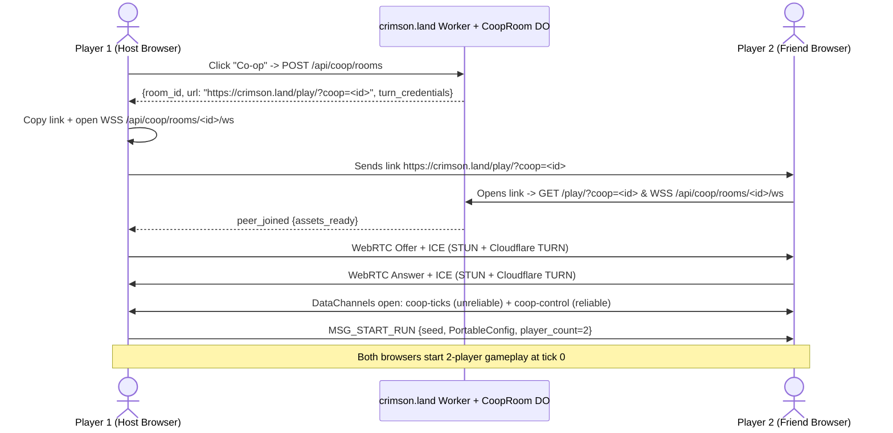

---
tags:
  - rewrite
  - contracts
---

# Network co-op specification

Design and feasibility specification for two-player online co-op
([issue #632](https://github.com/banteg/crimson/issues/632)): open `/play/`,
send a link (`https://crimson.land/play/?coop=<room>`), and play 2-player
Crimsonland together in the same arena.

---

## 1. Executive summary & architectural decision

Two-player online co-op is feasible directly on the `crimson-core` WASM game
module (`crimson-core/PORT.md`) without rewriting gameplay or streaming world
state. Both browsers run the same `game.wasm` binary at fixed 60 Hz simulation
ticks (`portable_step_many`) and exchange per-player `PortableInput` tuples.

### Historical lesson (`status.md`)

An earlier lockstep, rollback, and relay stack was removed (`bc45c5b6a`)
**because it never restored full state** ([status](status.md#intentional-differences)).
In `crimson-core`, `crimson-core/host/keyframes.inc` (`game_run_spans` +
`KeyframeHost` + `game_effect_overflow`) and `crimson-core/checks/game_seek.mjs` /
`crimson-core/checks/game_practice.mjs` now prove full-state restore and terrain
determinism for single-player runs. Therefore, **Milestone 0 (`checks/game_coop.mjs`)**
gates all networking work on a strict invariant: **restoring a 2-player rollback
slot and resimulating with corrected inputs must match a straight run bit-for-bit
across all 36,343 snapshot fields and the terrain render-target digest, even
when the two instances use different local presentation and audio settings.**

### Core architectural choices

1. **Simulation model — Adaptive-Delay Lockstep (M1) $\to$ Bounded Rollback Hybrid (M2) over 60 Hz `portable_step_many`**:

   - **Base input delay**: **2 ticks (33.3 ms)** at $\text{RTT} \le 60\text{ ms}$
     (adaptive 1–8 ticks in M1 lockstep). Mouse aim (`aim_scheme == 0`) converts
     the local screen cursor to world coordinates at input-sampling time and
     records the world point into `PortableInput`, which absorbs 1–2 ticks of
     delay cleanly while eliminating most rollbacks on stable links.

   - **Rollback window (M2)**: Up to **8 ticks (133.3 ms)** (hard cap **12 ticks
     / 200 ms**) using an uncompressed in-memory ring buffer (`RollbackSlot[16]`).
     Beyond 12 ticks of unconfirmed remote input, simulation stalls gracefully
     (lockstep wait) rather than diverging.

   - **Why M1 Lockstep then M2 Rollback?** Adaptive-delay lockstep is the
     simplest M1 baseline to validate transport, desync hashes, and latency
     telemetry in two browsers, while M2 rollback layers onto the exact same
     input log and confirmation machinery to keep input delay at 2 ticks under
     70–150 ms RTT and Wi-Fi jitter.

   - **Why not an authoritative host streaming state?** A single tick touches up
     to 384 creatures, 96 projectiles, 64 secondary projectiles, 128 particles,
     384 sprites, 2,559 effects, and 192 terrain decals/corpses (~229 KiB raw /
     ~55 KiB `zstd`). Streaming delta snapshots at 60 Hz requires custom entity
     interpolation and makes client-side hit and blood feedback lag for the guest.

2. **State & terrain rollback boundary — Uncompressed RAM ring + "Bake on Confirm" terrain**:

   - `keyframe_state()` in `crimson-core/host/keyframes.inc` already identifies
     the simulation memory (`game_run_spans` = 70 spans totaling **229,233 bytes**,
     `KeyframeHost` = **~1.9 KiB**, plus the active `game_effect_overflow` prefix).

   - **Optimization over `watch.inc`**: Omit `zstd_pack` (~1 ms/tick) and
     `string_arena` (~20 KiB, written only during `portable_init` and asserted
     invariant across ticks via `string_used`) inside the 16-slot rollback ring
     buffer. A raw `memcpy` snapshot/restore of ~231 KiB in WASM linear memory
     takes **~0.02–0.04 ms** `[ESTIMATE]`.

   - **Terrain render target (`terrain_render_target`, 1024×1024 RGBA8) — "Bake on Confirm"**:
     Instead of copying a 4 MiB GPU texture every frame or replaying 30 seconds
     of `PackedLog` bakes, **suppress `fx_queue_render` drawing during speculative
     ticks** and log each tick's `fx_queue` and `fx_queue_rotated` entries into a
     16-slot circular buffer (`CoopBakeSlot[16]`). Whenever `confirmed_tick`
     advances, replay newly confirmed slots through `game_effects_render_decals()`
     inside `live_enter_run()`. Each tick bakes into `terrain_render_target`
     **exactly once, in confirmed order**, with zero extra GPU render targets and
     zero 4 MiB texture blits.

3. **Signalling, transport & deployment — Cloudflare Worker + `CoopRoom` Durable Object + WebRTC DataChannels + Cloudflare TURN**:

   - **One `CoopRoom` Durable Object** handles room creation, `?coop=<room>` join
     handshakes, and WebRTC SDP/ICE signalling.

   - **Two WebRTC DataChannels on one `RTCPeerConnection`**:
     - `coop-ticks` (`ordered: false, maxRetransmits: 0`): 60 Hz unreliable
       packets carrying a redundant 8-tick sliding window of local `PortableInput`
       (~184 bytes/packet $\approx 11\text{ KB/s}$).
     - `coop-control` (`ordered: true`, reliable): low-frequency control messages
       (`MSG_START_RUN`, `MSG_PERK_DECISION`, `MSG_PAUSE`, `MSG_DESYNC`).

   - **NAT traversal**: The Worker issues short-lived TURN credentials via
     **Cloudflare Calls TURN**, keeping true UDP transport even when direct P2P
     fails, with `CoopRoom` WebSocket binary forwarding as a local-dev / TCP
     fallback.

4. **Deliberate patches to original 1.9.93 behavior**:

   - Original 2003 local co-op had single-keyboard limits, player-0-only gates,
     and a presentation-coupled music RNG draw. Sections 2.2–2.3 separate
     **mandatory desync/crash fixes for M0/M1** from **deferred gameplay-symmetry
     patches**.

---

## 2. Research question 1: Two-player determinism & seam audit

### 2.1 Cross-instance determinism in `wasm32`

Can two-player simulation reproduce bit-exact state across browser/native
instances with synchronized per-player inputs? **Yes, once the presentation-coupled
music latch (Section 2.2.2) and 2-player input/perk seams (Section 2.2.1) are patched.**

What `crimson-core` already guarantees across Chrome V8, Firefox SpiderMonkey,
Safari JSC, Wasmtime, and native `wasm2c`:

- **Identical 32-bit memory layout**: `game_data()` (`crimson-core/game.py`)
  places `crimsonland.exe` and `grim.dll` globals at their exact original offsets
  inside `game_image_exe` and `game_image_grim`. *(Add `-ffp-contract=off` to
  `crimson-core/client/build.py` when compiling `wasm2c` output natively so its
  flags match `crimson-core/build.py`.)*

- **Pinned transcendental & x87 PC24 math**: `crimson-core/host/musl/src/math`
  and `crimson-core/host/math.c` (`portable_round_pc24`, `D3DXVec2Normalize`,
  `portable_crt_pow_pc24`) plus `crimson-core/adapter.py`'s `x87()` pass
  eliminate host FPU/libm differences.

- **MSVC evaluation order**: `msvc_argument_order()` in `crimson-core/game.py`
  hoists multi-draw `crt_rand()` call arguments right-to-left.

- **Presentation isolation**: `SessionGrim` (`crimson-core/host/game.inc`) routes
  all input/time queries during `game_ticking = 1` to `HeadlessGrim`
  (`crimson-core/host/grim.inc`). `crt_rand_stream()` (`crimson-core/host/host.cpp`)
  routes between-tick menu/frame RNG draws to a separate `presentation` stream.

- **2-player schema readiness**: `crimson-core/schema.json` already exports
  `players` with `"count": 2` (`202` fields per player, `36,343` `u32` words
  total in `portable_snapshot()`).

### 2.2 Mandatory determinism & crash fixes for 2-player sessions (M0/M1)

#### 1. Perk command alive gate checks player 0 only (`crimson-core/host/host.cpp`, `crimson-core/host/session.inc`) — run-ending bug

- **Problem**: `portable_step_many` (`crimson-core/host/host.cpp:601`) refuses
  perk commands when `player_state_table[0].health <= 0`, and
  `live_perk_command_valid()` (`crimson-core/host/session.inc:346`) checks
  `player_state_table[0].health > 0`. Meanwhile, the recovered engine
  (`decomp/1.9/crimsonland/game/gameplay_update_and_render.cpp:235-237`) and
  Python (`src/crimson/sim/sessions.py:181`) allow opening and picking perks as
  long as **any** player is alive:

  ```cpp
  player_state_table[0].health > 0.0f
      || (config_blob.player_count == 2 && player_state_table[1].health > 0.0f)
  ```

  If Player 0 dies in 2P co-op and surviving Player 1 opens or picks a perk,
  `crimson-core/host/host.cpp:601` calls `refuse()`, setting `ready = false` and
  aborting the session.

- **Fix**: Check `any_alive` across `0..config_blob.player_count - 1` in both
  `crimson-core/host/host.cpp:601` and `crimson-core/host/session.inc:346`.

#### 2. First-hit music latch & presentation-coupled RNG desync (`music_play_exclusive.cpp`, `music_fade_out_all.cpp`) — desync hazard

- **Problem**: When the first projectile hits a creature outside Rush
  (`decomp/1.9/crimsonland/crimsonland/projectile_update.cpp`), it calls
  `music_play_exclusive(music_track_game_playlist)` followed by
  `music_fade_out_all(music_track_game_playlist)`:

  1. In `decomp/1.9/crimsonland/audio/music_play_exclusive.cpp`, if
     `music_playlist_randomized_latch == 0` **and** `music_playlist_entry_count != 0`,
     it draws `crt_rand() % music_playlist_entry_count` and sets
     `music_playlist_randomized_latch = 1`.

  2. Next, `decomp/1.9/crimsonland/audio/music_fade_out_all.cpp` checks every
     track `i`: if `music_fade_out_flags[i] == 0` (the track is currently playing),
     it sets `music_fade_out_flags[i] = 1` **and clears
     `music_playlist_randomized_latch = 0`** (`music_fade_out_all.cpp:25`).

  3. Because `music_fade_out_flags` and `music_track_volume` match `^music_` in
     `SESSION_KEEPS` (`crimson-core/game.py:322`), they are **outside
     `game_run_spans`**. Worse, `WatchUnheard` (`crimson-core/host/watch.inc:365`)
     saves and restores `music_fade_out_flags` and `music_track_volume` across a
     resimulation pass.

  4. **How this desyncs rollback**: If a speculative tick $T$ triggers the first
     hit and rolls track $A$ (`music_fade_out_flags[A] = 0`), and a rollback
     before $T$ causes the corrected first hit to roll track $B \ne A$,
     `music_fade_out_flags[A]` is still `0` from the rolled-back timeline.
     `music_fade_out_all(B)` sees track $A$ playing and **resets
     `music_playlist_randomized_latch = 0`**, causing the *next* projectile hit
     to draw `crt_rand()` a second time on the rolled-back peer while the peer
     that did not roll back draws nothing.

  5. Additionally, if one peer has `music_playlist_entry_count == 0`, it skips
     the `crt_rand()` draw completely.

- **Fix (deliberate patch to original behavior for session determinism)**:
  Match Python (`src/crimson/sim/world_state.py:87-94`) by making the gameplay
  RNG draw in `music_play_exclusive(music_track_game_playlist)` depend **only**
  on simulation state (`music_playlist_randomized_latch`):

  - At `portable_init`, set `music_playlist_randomized_latch = 0` and ensure
    `music_playlist_entry_count >= 1` during ticks.

  - During `game_session && game_ticking`, when
    `music_play_exclusive(music_track_game_playlist)` runs and
    `!music_playlist_randomized_latch`, always draw `crt_rand()` once and set
    `music_playlist_randomized_latch = 1`; **never allow `music_fade_out_all`
    during a tick to clear `music_playlist_randomized_latch`**.

  - Record the chosen tune ID in `KeyframeHost` and apply DirectSound music
    changes on confirmed ticks (as `watch_tune()` does in
    `crimson-core/host/watch.inc:420`).

#### 3. Distinct per-player virtual input codes (`crimson-core/host/api.h`, `crimson-core/host/host.cpp`, `crimson-core/host/grim.inc`)

- **Problem**: `current_player_index` is mutated not only in `player_update()`,
  but also in `bonus_update.cpp:45-63`, `perks_update_effects.cpp:66`,
  `survival_update.cpp:218`, `gameplay_render_world.cpp:92`, and
  `ui_render_hud.cpp:232`.

- **Solution**:

  - Expose `PortableInput in[2]` at `portable_input()` (so `portable_input()`
    still points to `in[0]` for 1P backward compatibility, and `in[1]` sits at
    `portable_input() + sizeof(PortableInput)`). Add
    `void portable_set_player_count(uint32_t count)` (default `1`).

  - Assign **distinct virtual key and axis codes** to `player_state_table[0].input`
    and `player_state_table[1].input` in `portable_init`:
    - **Player 0**: `fire_key = 100`, `axis_move_x = 0`, `axis_move_y = 1`,
      `move_key_forward..aim_key_right = 0x100..0x105`.
    - **Player 1**: `fire_key = 200`, `axis_move_x = 2`, `axis_move_y = 3`,
      `move_key_forward..aim_key_right = 0x110..0x115`.

  - For queries inside `player_update()` that do not read `player->input.*`
    (`config_key_reload = 101`, `0x22` G-key, `portable_aim_x/y()`,
    `portable_move_x/y()`, `portable_aim_turn_left/right()`, and
    `input_primary_just_pressed()`), index `in[current_player_index & 1]`.

  - **Supported schemes in co-op prototype**: Restrict co-op runs to
    `aim_scheme` $\in \{0 \text{ (mouse world point)}, 4 \text{ (dual-action pad)}\}$
    and `move_mode` $\in \{1 \text{ (relative)}, 2 \text{ (static)}, 3 \text{ (dual-action pad)}\}$,
    where `crimson-core/seams/mouse-aim.patch` and `crimson-core/seams/pad-aim.patch`
    write `portable_aim_x/y()` directly into `player->aim` without reading
    `ui_mouse_x` or `player_aim_screen_x`.

#### 4. Local state inside `game_run_spans` & speculative side effects (`crimson-core/host/session.inc`)

- **Problem A (local fields inside `game_run_spans`)**:
  `config_blob` (offset `507544`), `game_status_blob`, and
  `ui_mouse_x`/`player_aim_screen_x` (offset `535868`) lie inside `game_run_spans`.
  Between ticks, `live_step` (`crimson-core/host/session.inc:112-150`) installs
  `live.outside` (the local player's display/audio/key settings and local mouse
  cursor) into `config_blob` and `ui_mouse_x/y`, and swaps `live.run` in only
  during `live_enter_run()`. Capturing, restoring, or hashing spans outside
  `live_enter_run()` would include local display settings and cursor positions,
  causing false desync hashes and clobbering the local cursor on restore.

- **Problem B (irreversible side effects on speculative ticks)**:
  `live_carry()` (`crimson-core/host/session.inc:142-147`) adds status deltas to
  `live.outside.status` every tick; `live_append()` appends every tick to
  `live.replay`; `gameplay_update_and_render.cpp:201-204` starts the game-over
  music; and `game_state_set` writes `live.requested`.

- **Rule**:

  1. **Capture, restore, and hash `RollbackSlot` strictly inside the
     `live_enter_run()` scope** (with `ui_mouse_x/y` zeroed during span hashing
     and saved/restored around `rollback_restore()`).

  2. **Execute `live_carry()`, replay logging, and terminal/menu state
     transitions (`live.requested`, `live_end`) on confirmed ticks only.**

  3. **Run co-op on a detached save** (like `watch.inc` and `ranked_run`) so
     unranked co-op sessions never overwrite local single-player `game.cfg` or
     `crimson.cfg`.

### 2.3 Optional & Phase-2 gameplay symmetry patches (`preserve_bugs = 0`)

Because both browsers in online co-op run the **same `game.wasm` binary**,
original 2-player gameplay asymmetries in the 2003 executable are deterministic
on both peers and **do not cause desyncs**. We stage them as follows:

1. **Manual reload in 2-player (`decomp/1.9/crimsonland/gameplay/player_update_heading.cpp:1004` — M1 optional patch)**:

   - In 2003 local co-op, `config_key_reload` was a single shared binding in
     `crimson.cfg`, so `player_update_heading.cpp:1004` gated manual reload on
     `config_player_count == 1`. In network co-op each player has an independent
     reload bit in `in[p].flags`; removing `&& config_player_count == 1` when
     `!portable_preserve_bugs` lets both players manually reload.

2. **Co-op bug fixes from [original bugs](original-bugs.md) (Phase 2 / Python gate parity)**:

   - Extend existing `crimson-core/patches/01-weapon-drop-suppression.patch` and
     `crimson-core/patches/11-dead-player-perk-aim.patch` from P0-only to
     `0..config_player_count - 1`.

   - Port patches `06` (weapon drop proximity), `07` (Regeneration per alive
     player), `08` (HUD heart pulse), `09` (damage alive guard), `12` (Jinxed
     random victim), `13` (owner-aware Fire Bullets), `14` (Pyromaniac any
     player), `16` (pistol fallback any player), `19` (auto-target distance),
     and `23` (Plaguebearer all players).

   - *(Note: `Alternate Weapon`, `Fatal Lottery`, `Random Weapon`, `Grim Deal`,
     `Final Revenge`, and `Highlander` already have `PerkFlags.MULTIPLAYER_ALLOWED == 0`
     in `src/crimson/perks/availability.py:82` / `perk_can_offer.c:18` and are
     never offered when `player_count == 2`.)*

---

## 3. Research question 2: Lockstep vs. rollback vs. authoritative host

### 3.1 Measurements & estimates on `crimson-core` (Apple M1 Pro, WASM)

| Metric | Value | Source / Evidence |
| --- | --- | --- |
| Tick frequency | **60 Hz** ($\Delta t = 16.6667\text{ ms}$) | `crimson-core/host/host.cpp:626` |
| 2P input size per tick | **40 B** (`2 × sizeof(PortableInput)`) + **4 B** `count` + $8k\text{ B}$ commands | `crimson-core/host/api.h:53-54` |
| Uncompressed simulation state (`keyframe_state` minus `string_arena`) | **231,685 B (~226.3 KiB)** base + $188 \times \text{overflow\_extent}\text{ B}$ | `70` `game_run_spans` (`229,233 B`) + `KeyframeHost` (`1,940 B`) + `sfx_cooldown_table` (`512 B`) |
| Compressed keyframe size (`zstd` level 1) | **~55 KiB** | Measured ([replay viewer](replay-viewer.md#what-it-can-afford)) |
| Snapshot capture/restore time (raw `memcpy`, no `zstd`) | **~0.02–0.04 ms** `[ESTIMATE]` | 231 KiB `memcpy` in WASM linear memory |
| `game.wasm` step cost (9-min Survival avg, `grim_render_disabled = 1`) | **~0.028 ms / tick** (~36,000 ticks/s) | Measured ([replay viewer](replay-viewer.md#what-it-can-afford)) |
| `core.wasm` step cost (35-min Survival avg, 210,268 ticks) | **~0.126 ms / tick** (26,497 ms total) | Measured (`crimson-core/results/survival-spawn-profile.json`) |
| Late-game 2P Survival p99 step cost (20–35 min) | **Measured in M0 (`checks/game_coop.mjs`)** | 2P doubles `survival_spawn_cooldown` decrement (`frame_dt_ms * config_player_count`); worst-case frame is $R_{\max}$ resimulated ticks + up to 6 new ticks (`fminf(grim_frame_dt, 0.1f)`) |

### 3.2 Architecture comparison

| Criterion | Adaptive-Delay Lockstep (M1 Baseline) | Hybrid Delay + Rollback (M2 Target) | Authoritative Host (State Streaming) |
| --- | --- | --- | --- |
| **Bandwidth (per peer)** | ~6–11 KB/s | **~11 KB/s** (8-tick redundant input window) | 150–600 KB/s (creatures, projectiles, effects, decals) |
| **Feel at 30 ms RTT (LAN / Metro)** | Good (2 ticks / 33 ms delay) | **Excellent** (1–2 ticks delay, 0–1 tick rollback on jitter) | Asymmetric (Host 0 ms, Guest 30+ ms) |
| **Feel at 80–120 ms RTT (Continental)** | Fair (4–5 ticks / 67–83 ms aim/fire lag) | **Very Good** (2 ticks / 33 ms local delay + 2–4 ticks rollback) | Guest sees delayed blood/corpses or rubber-banding |
| **Feel at 150 ms RTT + ±30 ms Jitter** | Stalls/hitches on late packets | **Smooth** (absorbs up to 8–12 ticks / 133–200 ms without stalling) | High bandwidth stalls congestion window |
| **Implementation complexity** | **Low** (ideal for M1 prototype & latency/desync baseline) | **Medium** (adds 16-slot ring restore + unheard resimulation on top of M1) | **High** (custom entity snapshots, interpolation, no verifier reuse) |

### 3.3 Protocol mechanics (shared by M1 Lockstep & M2 Rollback)

- **Tick scheduling with input delay $D$**:

  - At tick $T$, the local client samples its hardware input via `live_input()`
    for its own player slot only and assigns it to **tick $T + D$** (seeding
    ticks $0 \dots D-1$ at run start with neutral rest input).

  - In **M1 (Adaptive-Delay Lockstep)**:
    $D = \text{clamp}(\lceil \text{RTT} / (2 \times 16.667) \rceil + 1, 1, 8)$.
    Tick $T$ steps only when both `in[0][T]` and `in[1][T]` have arrived.

  - In **M2 (Bounded Rollback)**: Fix $D = 2$ ticks (`33.3 ms`). If
    `in[remote][T]` has not arrived when tick $T$ is due and
    $T - T_{\text{confirmed}} \le R_{\max}$ ($R_{\max} = 8$, or $4$ in late
    Survival past 15 minutes):
    - Predict `in[remote][T]` from `in[remote][T_last_received]`, keeping
      movement/aim/held flags and **clearing edge flags**
      `FIRE_PRESSED_FLAG (1<<1)` and `RELOAD_PRESSED_FLAG (1<<2)`.
    - Save `RollbackSlot[T % 16]` before stepping tick $T$.
    - When a packet arrives with true `in[remote][t]` for $t \le T$: advance
      `confirmed_tick`. If any $t$ differed from the predicted input used when
      $t$ was stepped, restore `RollbackSlot[t_first_diff % 16]`, resimulate
      $t_{\text{first\_diff}} \dots T$ with `grim_render_disabled = 1` and
      `WatchUnheard`, and bake newly confirmed terrain slots.
    - Cap total ticks stepped per host frame (resimulated + new) to
      `MAX_TICKS_PER_FRAME = 14` so a late-game CPU spike cannot cause a spiral
      of death.

---

## 4. Research question 3: Keyframe machinery & state boundaries for frequent rollback

### 4.1 Fast rollback ring buffer (`RollbackSlot[16]`)

```text
+-----------------------------------------------------------------------+
| RollbackRing (16 preallocated slots in WASM linear memory, ~3.7 MiB)  |
|   slot[t % 16]:                                                       |
|     - tick: int32                                                     |
|     - spans[229233]: raw memcpy of game_run_spans[0..69]              |
|     - host: KeyframeHost + sfx_cooldown_table[128]                    |
|     - overflow: vector<effect_entry_t> (active extent prefix)         |
+-----------------------------------------------------------------------+
```

1. **No `zstd_pack` and no `string_arena` copy**:

   - `string_used` is asserted unchanged (`assert(string_used == init_string_used)`)
     on every tick.

   - Preallocating 16 uncompressed slots uses `3.7 MiB` of WASM memory and avoids
     ~1.2 ms of `zstd` pack/unpack per tick.

2. **Capture/restore inside `live_enter_run()`**:

   - Capture and restore run while `live.run` is installed in `config_blob` and
     `game_status_blob`, preserving local `ui_mouse_x/y` across restores.

### 4.2 Terrain boundary: "Bake on Confirm" (zero extra render targets)

In `crimson-core/host/keyframes.inc:275-284`, `fx_queue_render()` is called once
per tick inside `gameplay_render_world()`. In live 1P play, undrawn ticks
(`grim_render_disabled == 1`) skip baking into `terrain_render_target` unless
`terrain.baking == true`. For 2P network co-op:

1. **During `portable_step_many` (both speculative and confirmed ticks)**:

   - `fx_queue_render()` copies the tick's `fx_queue[0..fx_queue_count)`,
     `game_effect_overflow.decals[0..decal_count)`, and
     `fx_rotated_*[0..fx_queue_rotated)` into `coop_bakes[tick % 16]` and clears
     the counts (`fx_queue_count = 0; game_effect_overflow.decal_count = 0; fx_queue_rotated = 0;`),
     **without** drawing to `terrain_render_target`.

2. **When `confirmed_tick` advances from $T_0$ to $T_1$**:

   - Inside `live_enter_run()` with `grim_render_disabled = 0`, replay
     `coop_bakes[t % 16]` for each newly confirmed tick $t \in (T_0, T_1]$
     through `game_effects_render_decals()`.

3. **Why this beats rolling terrain textures**:

   - In M1 lockstep, every tick is confirmed before it steps, so
     `coop_bakes[t % 16]` bakes immediately (0 frames of delay).

   - In M2 rollback, each tick's blood splatters and corpse stamps bake into
     `terrain_render_target` **once and only once** when confirmed (1–4 ticks
     after simulation), requiring **zero `glBlitFramebuffer` texture copies**,
     **zero extra 4 MiB GPU textures**, and **zero `PackedLog` memory growth**.

### 4.3 Audio & effect overflow boundaries

- **Audio (`crimson-core/game/dsound.cpp`, `crimson-core/game/audio_timing.cpp`, `WatchUnheard`)**:

  - Save and restore `sfx_cooldown_table[128]` (`512 B`) in `RollbackSlot` so
    resimulated ticks see the exact cooldown state as of the rollback target.

  - Track `highest_heard_tick`: during a rollback resimulation, any tick
    $t \le \text{highest\_heard\_tick}$ runs under `WatchUnheard unheard(true)`
    (`sound_unheard = true`), suppressing duplicate `sfx_entry_start_playback`
    calls while advancing `sfx_cooldown_table` via `game_audio_tick(audio_dt)`.
    Any newly reached tick $t > \text{highest\_heard\_tick}$ runs with
    `sound_unheard = false` so all new ticks in a multi-tick frame play their
    sounds normally.

- **Effect overflow (`crimson-core/game/effect_overflow.cpp`)**:

  - `KeyframeHost` already captures `overflow_free`, `overflow_active`, and
    `overflow_extent`, plus `game_effect_overflow.entries[0..extent)`.

---

## 5. Research question 4: Shared perk menus, pause, death, and restart

### 5.1 Shared perk menu flow & out-of-band decision lockstep

In 2-player co-op, XP (`player_state_table[0].experience`), level,
`perk_pending_count`, and `perk_choice_ids[0..6]` are shared.

- **Opening the perk menu (`PortableCommand{2, 0}`)**:

  - To prevent invalid or duplicate commands from triggering `refuse()` in
    `portable_step_many`, apply the command filter from `live_tick`
    (`crimson-core/host/session.inc:371-376`) deterministically on both peers
    before calling `portable_step_many`:
    - At most **1 command per tick**.
    - If both players request `CMD_PERK_OPEN` (`{2, 0}`) on the same tick,
      deduplicate to a single `{2, 0}`.
    - Drop any perk command if `!live_perk_command_valid()` (e.g.,
      `perk_pending_count <= 0`, Rush mode, or both players dead).

  - If a late `CMD_PERK_OPEN` arrives from the remote peer for a tick
    $T_{\text{open}}$ that the local peer already stepped past speculatively,
    the local peer rolls back to $T_{\text{open}}$, steps $T_{\text{open}}$ with
    `{2, 0}`, sees `live.requested == GAME_STATE_PERK_SELECTION`, **stops
    simulating further ticks**, and enters `GAME_STATE_PERK_SELECTION` at tick
    $T_{\text{open}}$.

- **Picking or cancelling in `GAME_STATE_PERK_SELECTION` (out-of-band decision)**:

  - Because input delay $D$ means both peers have already queued and sent regular
    inputs for ticks $T_{\text{open}}+1 \dots T_{\text{open}}+D$ before the menu
    opened at $T_{\text{open}}$, **a perk pick cannot ride inside the pre-sent
    input window for $T_{\text{open}}+1$**.

  - Instead, while `GAME_STATE_PERK_SELECTION` is open at `menu_tick = T_open`:
    1. Both peers halt tick progression at $T_{\text{open}}$ (while the network
       pump continues running in `SDL_AppIterate` / `shell.html`).
    2. **Prototype rule**: Only **Player 0 (Host)** clicks a perk choice (or
       presses Cancel/Escape); Player 1 sees the open perk menu and closes it as
       soon as Host's decision arrives.
    3. When Host picks `choice` ($0..6$) or cancels (`choice = -1`), Host sends
       `MSG_PERK_DECISION { menu_tick: T_open, choice }` over the reliable
       `coop-control` channel.
    4. Once both peers have `MSG_PERK_DECISION` for `T_open`, they attach:
       - If `choice >= 0`: `commands[0] = {1, choice}`, `command_count = 1` on
         tick $T_{\text{open}} + 1$.
       - If `choice == -1` (Cancel): **`command_count = 0`** on tick
         $T_{\text{open}} + 1$ *(never `{0, 0}`, which
         `crimson-core/host/host.cpp:591` refuses as `"unknown command"`).*
    5. Both peers transition back to `GAME_STATE_GAMEPLAY` (`live.banked = 0`,
       `ui_transition_direction = 0`) and step tick $T_{\text{open}} + 1$.

### 5.2 Pause, death, and restart

- **Pause (`Escape` / `Start`)**:

  - Pressing `Escape` sends `MSG_PAUSE { pause: true, at_tick: confirmed_tick + D + 2 }`
    on the reliable `coop-control` channel.

  - Both peers stop banking ticks upon reaching `at_tick` and display a pause
    overlay (without entering Options/Controls submenus during co-op). Either
    player pressing `Escape` / `Resume` sends `MSG_PAUSE { pause: false }` to
    resume immediately.

- **Single-player death vs. team wipe**:

  - Handled natively by `gameplay_update_and_render.cpp:189-193` and
    `camera_update.cpp:60-78`: when one player dies, the camera follows the
    survivor; when both players have `health <= 0 && death_timer < 0`, the run
    ends after the 500 ms run-down and transitions to the end screen.

- **Restart / rematch**:

  - On the end screen, the Host clicking **Play Again** generates a fresh `seed`,
    sends `MSG_START_RUN { seed, config }` on `coop-control`, and both peers
    start the new run.

---

## 6. Research question 5: Invitation links, lobby, signalling & transport

### 6.1 End-to-end invite flow



1. **Create room**: Host clicks **Co-op** on `/play/`, calling
   `POST /api/coop/rooms` on the Cloudflare Worker and receiving
   `{ room_id, url: "https://crimson.land/play/?coop=<room_id>", turn_credentials }`.

2. **Join via link**: Friend opens `https://crimson.land/play/?coop=<room_id>`,
   loads cached IndexedDB assets (or fetches PAQs), and connects to
   `wss://crimson.land/api/coop/rooms/<room_id>/ws`.

3. **WebRTC + Cloudflare TURN connection**:
   - The two browsers exchange SDP Offer/Answer and ICE candidates through the
     `CoopRoom` Durable Object WebSocket, configured with
     `stun:stun.cloudflare.com:3478` + short-lived **Cloudflare Calls TURN**
     credentials (`turns:turn.cloudflare.com:443`).

   - Using Cloudflare TURN when direct P2P fails preserves **unreliable UDP/SCTP
     `RTCDataChannel` semantics** (`coop-ticks`, `ordered: false, maxRetransmits: 0`)
     without TCP head-of-line blocking.

   - For local/CI testing without TURN, the `CoopRoom` WebSocket also supports
     binary frame forwarding as a dev fallback after a 5-second ICE timeout.

4. **Run start**: Once `coop-ticks` and `coop-control` DataChannels open and
   both peers report `assets_ready`, Host sends `MSG_START_RUN` (260-byte
   `PortableConfig` + `uint32 player_count = 2` + optional 6,184-byte
   `PortableQuest`) on `coop-control`, and both peers enter `GAME_STATE_GAMEPLAY`.

### 6.2 Wire protocol

#### Channel 1: `coop-ticks` (`ordered: false, maxRetransmits: 0`, 60 Hz, 184 bytes)

| Offset | Type | Field | Description |
| --- | --- | --- | --- |
| `0` | `uint8` | `magic` | `0xC2` |
| `1` | `uint8` | `window_count` | Number of ticks in sliding window ($1..8$, typically $8$) |
| `2` | `uint16` | `client_send_ms` | Low 16 bits of sender `performance.now()` for RTT estimation |
| `4` | `uint32` | `head_tick` | Highest tick index in this packet ($T + D$) |
| `8` | `uint32` | `ack_tick` | Highest contiguous tick received from remote peer |
| `12` | `uint32` | `hash_tick` | Confirmed tick $T_h$ (multiple of 30) for `state_hash`, or `0` |
| `16` | `uint32` | `state_hash` | CRC32C / FNV-1a of canonical `portable_snapshot()` at `hash_tick` |
| `20` | `20B × W` | `inputs[W]` | Up to 8 `PortableInput` structs (`[head_tick - W + 1 .. head_tick]`) |
| `20+20W` | `uint8` | `open_req_mask` | Bit $i$ set if player requested `CMD_PERK_OPEN` (`{2, 0}`) on tick `head_tick - W + 1 + i` |

#### Channel 2: `coop-control` (`ordered: true`, reliable JSON or tagged binary)

- `MSG_START_RUN`: `{ type: "start", config_b64, quest_b64?, delay_ticks }`
- `MSG_PERK_DECISION`: `{ type: "perk_pick", menu_tick, choice }` (`choice`: `0..6` or `-1` for Cancel)
- `MSG_PAUSE`: `{ type: "pause", paused: boolean, at_tick: number }`
- `MSG_DESYNC`: `{ type: "desync", tick: number, local_hash: number, remote_hash: number }`

---

## 7. Research question 6: Disconnects, focus loss & desync detection

1. **Window blur (`SDL_EVENT_WINDOW_FOCUS_LOST`)**:

   - In `crimson-core/game/frame.cpp:125-137`, `game_activate(0)` currently sets
     `grim_timing_frozen = true`, which stops `game_frame()` completely.

   - **Co-op rule**: While `coop_active` is true, `game_activate(0)` must **not**
     set `grim_timing_frozen = true`. `crimson-core/client/main.cpp:839-844`
     still clears `in->keys` and `in->mouse_buttons` on focus loss, so an
     unfocused browser keeps ticking and sending neutral inputs (`move = 0, fire = 0`)
     at 60 Hz without freezing the partner's game.

   - Additionally, the network pump (`coop_pump()`) runs inside `SDL_AppIterate`
     **outside** `game_live_frame()`, so packets are processed in
     `GAME_STATE_PERK_SELECTION`, pause, and end screens as well as
     `GAME_STATE_GAMEPLAY`.

2. **Background tab (`document.hidden`) & disconnects**:

   - If a peer's tab is backgrounded (`requestAnimationFrame` throttled) or their
     connection drops, the active peer automatically stops advancing once
     `tick - confirmed_tick` reaches the 12-tick cap and shows a banner:
     *"Waiting for partner… (Ns)"*.

   - For the **M1/M2 prototype**, if no packets arrive for **15 seconds**, the
     session ends cleanly (`live_end("incomplete")`) with a notice
     *"Partner disconnected"*. (Mid-run state snapshot resync and solo takeover
     are deferred to Phase 2.)

3. **Canonical desync detection**:

   - Every 30 confirmed ticks (0.5 s), inside the `live_enter_run()` scope right
     after `portable_step_many` on tick $T_h$, each peer computes a 32-bit FNV-1a
     hash over `portable_snapshot()` (skipping presentation-only indices in
     `crimson-core/checks/game_compare.mjs` `PRESENTATION` and
     `players[*].input.*`).

   - If `local_hash != remote_hash` for the same `hash_tick`, both peers halt
     immediately, dump their `portable_snapshot()` and raw 2P `.rsi` input log,
     and report the exact first differing field name from
     `crimson-core/schema.json`.

---

## 8. Phased deliverable plan

### Milestone 0 (M0): Two-instance deterministic co-op & rollback gate (`checks/game_coop.mjs`)

Build the 2-player simulation seam and verify full-state rollback in Node before
adding WebRTC:

1. **Files**: `crimson-core/host/api.h`, `crimson-core/host/host.cpp`,
   `crimson-core/host/grim.inc`, `crimson-core/host/session.inc`,
   `crimson-core/host/keyframes.inc`, `checks/game_coop.mjs`.

2. **Changes**:
   - Add `portable_set_player_count(2)` and `PortableInput in[2]` with distinct
     P1 virtual codes (`0x110..0x115`, fire `200`, axes `2/3`).

   - Fix `crimson-core/host/host.cpp:601` / `crimson-core/host/session.inc:346`
     perk alive gate (`any_alive`) and `music_play_exclusive` RNG latch
     determinism.

   - Implement `RollbackSlot[16]` (uncompressed spans + `KeyframeHost` +
     `sfx_cooldown_table`) and "Bake on Confirm" terrain (`coop_bakes[16]`).

3. **Verification gate**:
   - Boots **two** `game.wasm` instances (`bootGame` from
     `crimson-core/checks/game_host.mjs`) with **different local presentation
     settings** (Instance A: smoke/glow/shadows ON, audio ON, 60 fps; Instance B:
     smoke/glow/shadows OFF, audio muted, uneven 20–120 fps frame dt).

   - Feeds synthetic 2P inputs (Survival, Rush, Quest 1.1, including P0 death +
     P1 perk pick, and a late-game 20-minute Survival wave) over a simulated pipe
     with 80 ms RTT, $\pm 30\text{ ms}$ jitter, and 2% packet loss.

   - **Acceptance**: At every confirmed tick and at run end, both instances'
     `portable_snapshot()` (all 36,343 fields minus `PRESENTATION`) and terrain
     SHA-256 digests (`crimson-core/checks/game_seek.mjs` hook) must match each
     other **and** match a single straight non-rolled-back `core.wasm` run. Logs
     p50/p99 tick and rollback times.

### Milestone 1 (M1): Minimal two-browser prototype with adaptive-delay lockstep

Deliver the playable *"send a link and play together"* browser prototype with
measured latency and desync telemetry:

1. **Files**: `service/src/coop.ts` (`CoopRoom` DO + TURN credentials),
   `service/src/index.ts`, `service/wrangler.jsonc`,
   `crimson-core/client/main.cpp`, `crimson-core/client/web/shell.html`,
   `host/coop.inc`.

2. **Behavior**:
   - `?coop=<room_id>` invite link, WebRTC `coop-ticks` + `coop-control`
     DataChannels (plus WS fallback), adaptive input delay $D \in [1, 8]$ ticks,
     Host-picks perk menu sync, mutual pause, focus-loss keep-alive, and
     every-30-tick `portable_snapshot()` hash verification.

   - Test with two separate browser profiles or machines across localhost, LAN,
     and WAN.

### Milestone 2 (M2): Enable in-memory rollback in the browser prototype

1. Switch `host/coop.inc` from pure lockstep wait to fixed $D = 2$ ticks + up to
   8-tick speculative execution using the M0-proven `RollbackSlot[16]`,
   `WatchUnheard` resimulation, and "Bake on Confirm" terrain.

2. Compare frame-time jitter, input responsiveness, and rollback depth
   histograms against M1 lockstep for the feasibility report.
