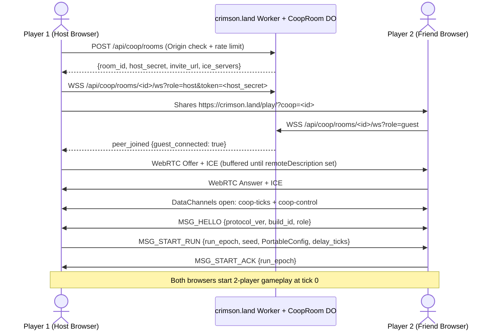

---
tags:
  - rewrite
  - contracts
---

# Network co-op specification

Design and feasibility specification for two-player online co-op
([issue #632](https://github.com/banteg/crimson/issues/632)): open `/play/`,
send a link (`https://crimson.land/play/?coop=<room>`), and play 2-player
Crimsonland together in the same arena.

---

## 1. Executive summary & architectural decision

Two-player online co-op is feasible on the `crimson-core` WASM game module
(`crimson-core/PORT.md`) without rewriting gameplay or streaming world state.
Both browsers run the same `game.wasm` binary at fixed 60 Hz simulation ticks
(`portable_step_many`) and exchange per-player `PortableInput` tuples.

Because [issue #632](https://github.com/banteg/crimson/issues/632) is a research
and prototype track, cross-browser determinism, rollback frame budgets, terrain
commit overhead, and WAN feel are treated as **explicit hypotheses gated by
automated milestones (`M0a`, `M0b`, `M1`, `M2`)** before committing to ranked or
4-player scope.

### Historical lesson (`status.md`)

An earlier lockstep, rollback, and relay stack was removed (`bc45c5b6a`)
**because it never restored full state** ([status](status.md#intentional-differences)).
In `crimson-core`, `crimson-core/host/keyframes.inc` (`game_run_spans` +
`KeyframeHost` + `game_effect_overflow`) and `crimson-core/checks/game_seek.mjs` /
`crimson-core/checks/game_practice.mjs` establish single-player seek and branch
restore, but **existing `portable_snapshot()` (`crimson-core/schema.json`) does
not cover all state that affects future 2-player ticks** (see Section 4.1).
Therefore, **Milestones `M0a` and `M0b` (`checks/game_coop.mjs`)** gate all
networking work on proving:

1. **2-player deterministic stepping (`M0a`)**: All 2-player undefined behavior
   (such as uninitialized `alternate_distance` in `creature_update_all.cpp`),
   input/camera seams, and presentation-coupled RNG draws are fixed and
   verified.

2. **Full rollback-state & side-effect equivalence (`M0b`)**: Restoring a
   2-player rollback slot and resimulating with corrected inputs in `game.wasm`
   matches a straight `game.wasm` run bit-for-bit across the **extended
   canonical rollback snapshot** (base `portable_snapshot` + `KeyframeHost` +
   `telekinetic_bonus_hover_timer_ms` + normalized `game_effect_overflow` pool)
   and the committed bake log / terrain digest, even when the two instances run
   at different frame rates and presentation settings.

### Core architectural choices

1. **Simulation model — Adaptive-Delay Lockstep (`M1`) $\to$ Bounded Rollback Hybrid (`M2`) over 60 Hz `portable_step_many`**:

   - **Decoupled input production and simulation frontiers**: A 60 Hz input
     clock samples local hardware input into immutable tick-indexed records at
     `input_produced_tick = sim_tick + D`, independent of whether simulation
     execution is temporarily stalled waiting on the network.

   - **Base input delay**: **2 ticks (33.3 ms)** at $\text{RTT} \le 60\text{ ms}$
     (adaptive 1–8 ticks in `M1` lockstep, changed only at negotiated epoch
     boundaries). Mouse aim (`aim_scheme == 0`) converts the local screen cursor
     to world coordinates at input-sampling time and records the world point into
     `PortableInput`.

   - **Rollback window (`M2`)**: Up to **8 speculative ticks (133.3 ms)** (hard
     cap **12 ticks / 200 ms**, enforced **before every individual tick step**)
     using an uncompressed 16-slot ring buffer (`RollbackSlot[16]`). Beyond 12
     ticks of unconfirmed remote input, simulation execution pauses (lockstep
     wait) while the network/input pump continues.

   - **Why not an authoritative host streaming state?** A single tick touches up
     to 384 creatures, 96 projectiles, 64 secondary projectiles, 128 particles,
     384 sprites, 2,559 effects, and 192 terrain decals/corpses (~229 KiB raw /
     ~55 KiB `zstd`). Streaming delta snapshots at 60 Hz requires custom entity
     interpolation and makes client-side hit and blood feedback lag for the guest.

2. **State & terrain rollback boundary — Uncompressed RAM ring + "Bake on Confirm" terrain**:

   - Each `RollbackSlot` holds `game_run_spans` (`70` spans = **229,233 B**),
     `KeyframeHost` (**~1.9 KiB**), `sfx_cooldown_table` (**512 B**), and
     preallocated capacity for `game_effect_overflow.entries` (up to `2,048 × 188 B`
     = **385,024 B**, copying only the active `extent` prefix per tick). Across
     16 slots, resident memory is **3.7 MiB base** (when `overflow_extent == 0`)
     and **9.8 MiB worst-case** (preallocated once at session start, with zero
     per-tick `zstd` compression and omitting `string_arena`, which is asserted
     invariant after `portable_init`).

   - **Terrain render target (`terrain_render_target`, 1024×1024 RGBA8) — "Bake on Confirm"**:
     During simulation ticks (`game_ticking == 1`), `fx_queue_render` consumes
     and clears the live decal and corpse queues into an immutable per-tick
     `CoopBakeSlot[tick % 16]` record without drawing to `terrain_render_target`.
     Once rollback corrections for a frame finish and `confirmed_through`
     advances, newly confirmed bake slots are rendered once in order into
     `terrain_render_target` while preserving live simulation queues and Grim
     state.

3. **Signalling, transport & deployment — Cloudflare Worker + `CoopRoom` Durable Object + WebRTC DataChannels + Cloudflare TURN**:

   - **One `CoopRoom` Durable Object** handles room creation, host/guest
     capability tokens, `?coop=<room>` join handshakes, and WebRTC SDP/ICE
     signalling.

   - **Two WebRTC DataChannels on one `RTCPeerConnection`**:

     - `coop-ticks` (`ordered: false, maxRetransmits: 0`): 60 Hz unreliable
       packets carrying up to 8 unacknowledged ticks of local `PortableInput`
       plus ping/echo timing and confirmed state hashes.

     - `coop-control` (`ordered: true`, reliable): control barriers
       (`MSG_START_RUN`, `MSG_INPUT_REPAIR`, `MSG_PERK_DECISION`, `MSG_PAUSE`,
       `MSG_DESYNC`) and automatic gap repair whenever unacknowledged input age
       exceeds the 8-tick unreliable window.

   - **NAT traversal**: The Worker issues short-lived **Cloudflare Calls TURN**
     credentials (`turn:turn.cloudflare.com:3478?transport=udp` and
     `turn:turn.cloudflare.com:443?transport=udp` preferred for true UDP without
     TCP head-of-line blocking; `turns:turn.cloudflare.com:443?transport=tcp` and
     `CoopRoom` WebSocket relay retained as reachability fallbacks with
     explicitly qualified latency).

---

## 2. Research question 1: Two-player determinism & seam audit

### 2.1 Cross-instance determinism in `wasm32`

Can two-player simulation reproduce bit-exact state across browser/native
instances with synchronized per-player inputs? **Hypothesis: Yes, once the
undefined auto-target read (Section 2.2.1), presentation-coupled music latch
(Section 2.2.3), between-tick world-render mutations (Section 2.2.5), and
2-player input/perk seams are patched.**

What `crimson-core` already provides across Chrome V8, Firefox SpiderMonkey,
Safari JSC, Wasmtime, and native `wasm2c`:

- **Identical 32-bit memory layout**: `game_data()` (`crimson-core/game.py`)
  places `crimsonland.exe` and `grim.dll` globals at their exact original offsets
  inside `game_image_exe` and `game_image_grim`. *(Add `-ffp-contract=off` to
  `crimson-core/client/build.py` when compiling `wasm2c` output natively so its
  flags match `crimson-core/build.py`.)*

- **Pinned transcendental & x87 PC24 math**: `crimson-core/host/musl/src/math`
  and `crimson-core/host/math.c` (`portable_round_pc24`, `D3DXVec2Normalize`,
  `portable_crt_pow_pc24`) plus `crimson-core/adapter.py`'s `x87()` pass
  eliminate host FPU/libm differences.

- **MSVC evaluation order**: `msvc_argument_order()` in `crimson-core/game.py`
  hoists multi-draw `crt_rand()` call arguments right-to-left.

- **Presentation isolation**: `SessionGrim` (`crimson-core/host/game.inc`) routes
  input/time queries during `game_ticking = 1` to `HeadlessGrim`
  (`crimson-core/host/grim.inc`). `crt_rand_stream()` (`crimson-core/host/host.cpp`)
  routes between-tick menu/frame RNG draws to a separate `presentation` stream.

### 2.2 Mandatory determinism, UB & crash fixes for 2-player sessions (`M0a`)

#### 1. Uninitialized `alternate_distance` in 2-player creature targeting (`creature_update_all.cpp`) — C++ UB & determinism bug

- **Problem**: In `decomp/1.9/crimsonland/crimsonland/creature_update_all.cpp:112-127`,
  `float alternate_distance;` is declared as an uninitialized stack variable:

  - On non-70th ticks (`creature_update_tick % 70 != 0`), when
    `config_player_count == 2` (`:198`), `alternate_distance` is assigned **only**
    inside `if (player_state_table[1 - target_player_index].health > 0.0f)`
    (`:199-208`).

  - At `:218-223`, `if (alternate_distance < vec2_distance(...))` reads
    `alternate_distance` unconditionally.

  - **Concrete failure**: If Player 1 is dead (`health <= 0.0f`) and the first
    active creature targets Player 0 on a non-70th tick, C++ evaluates an
    uninitialized stack local (`alternate_distance`), or on later creatures
    reuses stale stack residue from a previous creature iteration.

- **Fix (mandatory in `M0a`, porting [original bug 19](original-bugs.md#19-co-op-auto-target-replacement-reuses-mismatched-player-distances))**:
  Patch `creature_update_all.cpp` so 2-player target reevaluation and
  `auto_target` replacement always initialize candidate distances from the
  evaluated player's position and compare both the candidate creature and current
  `auto_target` against the final targeted player's own position (matching
  `src/crimson/creatures/runtime.py:446-470`). Also ensure
  `config_blob.player_count = 2` is set **before** `gameplay_reset_state()` in
  `portable_init` so `creature_pool[i].target_player = i % config_blob.player_count`
  (`decomp/1.9/crimsonland/gameplay/gameplay_reset_state.cpp:301-305`)
  initializes round-robin targets at run start.

#### 2. Perk command alive gate checks player 0 only (`crimson-core/host/host.cpp`, `crimson-core/host/session.inc`) — run-ending bug

- **Problem**: `portable_step_many` (`crimson-core/host/host.cpp:601`) refuses
  perk commands when `player_state_table[0].health <= 0`, and
  `live_perk_command_valid()` (`crimson-core/host/session.inc:346`) checks
  `player_state_table[0].health > 0`. Meanwhile, the recovered engine
  (`decomp/1.9/crimsonland/game/gameplay_update_and_render.cpp:235-237`) and
  Python (`src/crimson/sim/sessions.py:181`) allow opening and picking perks as
  long as **any** player is alive. If Player 0 dies in 2P co-op and surviving
  Player 1 opens or picks a perk, `crimson-core/host/host.cpp:601` calls
  `refuse()`, setting `ready = false` and aborting the session.

- **Fix**: Check `any_alive` across `0..config_blob.player_count - 1` in both
  `crimson-core/host/host.cpp:601` and `crimson-core/host/session.inc:346`.

#### 3. First-hit music latch & playback-gated RNG draw (`music_play_exclusive.cpp`, `music_fade_out_all.cpp`) — desync hazard

- **Problem**: Projectile hits outside Rush call
  `music_play_exclusive(music_track_game_playlist)`
  (`decomp/1.9/crimsonland/crimsonland/projectile_update.cpp:610-612, 848-850`):

  1. `decomp/1.9/crimsonland/audio/music_play_exclusive.cpp:8-10` returns early
     before touching RNG if `!music_ready || config_blob.music_disabled || config_blob.sound_disabled`.

  2. At `:14-21`, if `sfx_id == music_track_game_playlist`, it returns early if
     `music_playlist_randomized_latch || music_playlist_entry_count == 0`;
     otherwise it draws `crt_rand() % music_playlist_entry_count` and sets
     `music_playlist_randomized_latch = 1`.

  3. At `:27-30`, `music_play_exclusive` loops over all 128 tracks: if any track
     `i != sfx_id` satisfies `music_track_is_playing(i)` (`music_fade_out_flags[i] == 0`
     and `music_track_volume[i] > 0`), it calls `music_fade_out_all(i)`.

  4. `decomp/1.9/crimsonland/audio/music_fade_out_all.cpp:12` **unconditionally
     clears `music_playlist_randomized_latch = 0`** after its audio-enabled gate!

  5. Because `music_fade_out_flags` and `music_track_volume` match `^music_` in
     `SESSION_KEEPS` (`crimson-core/game.py:322`), they lie outside
     `game_run_spans`. If a speculative tick starts track $A$, and a rollback
     resimulates the first hit picking track $B \ne A$ while `music_fade_out_flags[A] == 0`
     and `music_track_volume[A] > 0`, `music_play_exclusive(B)` calls
     `music_fade_out_all(A)`, clearing `music_playlist_randomized_latch = 0` so
     the *next* projectile hit draws `crt_rand()` a second time! Likewise, any
     other call to `music_fade_out_all` or a peer with `music_disabled` /
     `sound_disabled` / `music_playlist_entry_count == 0` diverges on the RNG
     stream.

- **Fix (deliberate patch to original behavior for session determinism)**:
  Give the session a strictly simulation-owned `bool game_tune_started` latch
  (stored in `KeyframeHost` and reset only in `portable_init`, matching
  `src/crimson/sim/world_state.py:87-94`):

  - Inside `game_session && game_ticking`, intercept
    `music_play_exclusive(music_track_game_playlist)`: if `!game_tune_started`,
    always draw `int roll = crt_rand();` once, set `game_tune_started = true`,
    and record `chosen_tune = music_playlist_entry_count > 0 ? music_playlist[roll % music_playlist_entry_count] : -1`
    in `KeyframeHost` without calling `music_fade_out_all` or reading
    `music_disabled` / `sound_disabled`.

  - Apply actual DirectSound track playback and fades only on confirmed ticks
    outside the RNG path.

#### 4. Complete 2-player input, camera & replay seams (`host.cpp`, `grim.inc`, `game.inc`, `session.inc`, `replay.inc`)

- **Per-player virtual input codes & schemes**:

  - Keep `PortableInput in[2]` at `portable_input()` and add
    `portable_set_player_count(uint32_t count)` (or encode `player_count` in the
    co-op start handshake). Audit and update every `sizeof in` caller in
    `crimson-core/host/`.

  - In `portable_init` (`crimson-core/host/host.cpp:436-451, 487-497`), set
    `config_blob.player_count = player_count` **before** `gameplay_reset_state()`
    and initialize virtual controls for both players:

    - **Player 0**: `fire_key = 100`, `axis_move_x = 0`, `axis_move_y = 1`,
      `move_key_forward..aim_key_right = 0x100..0x105`.

    - **Player 1**: `fire_key = 200`, `axis_move_x = 2`, `axis_move_y = 3`,
      `move_key_forward..aim_key_right = 0x110..0x115`.

  - In `portable_step_many` (`crimson-core/host/host.cpp:564-582`), validate
    `in[p]` and install `config_blob.movement_schemes[p]` and
    `config_blob.aim_schemes[p]` for all $p \in [0, \text{player\_count})$.

  - For queries called inside `player_update()` (`config_key_reload = 101`,
    `0x22` G-key, `portable_aim_x/y()`, `portable_move_x/y()`,
    `portable_aim_turn_left/right()`, and `input_primary_just_pressed()` in both
    `crimson-core/host/host.cpp:161` and `crimson-core/host/game.inc:129-130`),
    assert that the call occurs while `0 <= current_player_index && current_player_index < config_blob.player_count`
    and read `in[current_player_index]`.

  - **Supported schemes in prototype**: Restrict co-op runs to `aim_scheme`
    $\in \{0 \text{ (mouse world point)}, 4 \text{ (dual-action pad)}\}$ and
    `move_mode` $\in \{1 \text{ (relative)}, 2 \text{ (static)}, 3 \text{ (dual-action pad)}\}$.

- **Tick-0 camera conversion (`crimson-core/host/session.inc:271-282`)**:

  - `live_input()` currently computes tick-0 `camera_x/y` from
    `player_state_table[0].position` alone. In 2-player mode, tick-0 camera
    conversion must use the 2-player midpoint
    `(player_state_table[0].position + player_state_table[1].position) * 0.5f`
    clamped to `[-1024 + W, -1] × [-1024 + H, -1]`, matching
    `decomp/1.9/crimsonland/game/camera_update.cpp:84-95`.

- **Isolation from 1P `replay.inc` and `watch.inc`**:

  - `crimson-core/host/replay.inc:162, 190-207` and `crimson-core/host/watch.inc:332-351`
    hardcode `player_count = 1` and parse `live.replay` with a single 20-byte
    `PortableInput` per tick. Calling `live_end()` -> `replay_payload()` on a
    2-player buffer would misparse Player 1's `move_x` float bits as
    `command_count`.

  - **Rule**: Co-op sessions never call 1P `replay_payload()`, `replay_save()`,
    or `ranked_finish()`. Co-op records a dedicated versioned 2P `.rsi` input
    stream (header + `in[0]`, `in[1]`, `count`, `commands` per confirmed tick)
    for `checks/game_coop.mjs` and desync diagnostics.

#### 5. Between-tick `gameplay_render_world()` side effects & local state in `game_run_spans`

- **Problem A (`gameplay_render_world` mutates simulation state)**:
  `decomp/1.9/crimsonland/game/gameplay_render_world.cpp` is not pure rendering:

  - `:34-52` revokes guarded weapons (`weapon_assign_player(0..1, 1)`).

  - `:92-108` mutates `current_player_index`.

  - `decomp/1.9/crimsonland/ui_render/creature_render_type.cpp:226-230, 303-307`
    deactivates dead creatures (`death_timer < -10.0f`) and clears
    `creature_spawn_slot_table[creature->link_index].owner = 0` (unless gated out
    when `ui_transition_alpha <= 0.0f` in `creature_render_all.cpp:20-26`).

  - `decomp/1.9/crimsonland/crimsonland/bonus_render.cpp:95-123, 264-280`
    increments `telekinetic_bonus_hover_timer_ms[0..1]` by `frame_dt_ms` whenever
    `game_state_id == GAME_STATE_GAMEPLAY` and calls `bonus_apply()` when
    `*hover_timer > 650`! It also advances `bonus_render_anim_phase += frame_dt * 1.3f`
    at `:144`.

  **Crucial rules**:

  1. **During tick simulation and rollback resimulation (`game_ticking == 1`)**:
     `gameplay_render_world()` **must** run on every tick (with
     `ui_transition_alpha = 1.0f` forced during `game_ticking == 1` so local
     `ui_elements_timeline` never skips `creature_render_all()`). `headless-effects.patch`
     already skips only `effects_render`'s vertex math when `grim_render_disabled == 1`.

  2. **Between ticks (`game_ticking == 0`)**: Guard all simulation writes inside
     `gameplay_render_world` (`weapon_assign_player`, `creature->active = 0`,
     `telekinetic_bonus_hover_timer_ms` updates, and `fx_queue_render`) with
     `if (game_ticking)` so menu redraws and network-wait overlays are strictly
     observational. During in-game co-op pause/wait overlays, re-show the saved
     backbuffer (`host_frame_hold(HOST_FRAME_SHOW)`, as `practice.inc:206` does)
     rather than re-invoking `gameplay_render_world()`.

- **Problem B (local settings inside `game_run_spans`)**:
  Even inside `live_enter_run()` (`crimson-core/host/session.inc:111-120`),
  `live.run.config` copies local presentation choices (`direction_arrow_flags`,
  `shadows_enabled`, `flame_glow_enabled`, `smoke_enabled`, `ui_info_texts`),
  and `game_run_ready()` (`crimson-core/host/game.inc:76-89`) restores local
  `music_volume` and `sfx_volume`. Furthermore, `bonus_render_anim_phase`
  advances during menu frames.

  - **Rule**: Raw `game_run_spans` bytes are suitable for **local rollback
    restore on the same machine** (preserving `ui_mouse_x/y` and `live.outside`),
    but **cross-peer desync hashes must never hash raw `game_run_spans`**. Cross-peer
    hashes use the canonical field serializer defined in Section 4.1.

### 2.3 Deliberately retained 2P behaviors vs. Phase-2 symmetry patches

To keep the prototype scope tight, the following recovered 2P behaviors are
explicitly classified:

| Behavior in Recovered 1.9.93 Code | Prototype (`M0`–`M2`) Disposition |
| --- | --- |
| Uninitialized `alternate_distance` in `creature_update_all.cpp:126, 198-223` | **Fixed in `M0a`** (mandatory C++ UB / determinism fix). |
| Player-0-only perk command gate (`host.cpp:601`, `session.inc:346`) | **Fixed in `M0a`** (`any_alive` across both players). |
| Manual reload gated on `config_player_count == 1` (`player_update_heading.cpp:1004`) | **Patched in `M0a`** (remove `config_player_count == 1` gate when `!portable_preserve_bugs` so both players can manually reload). |
| Shared XP (`player_state_table[0].experience`), level, and perk counts | **Retained by design** (core Crimsonland co-op mechanic). |
| Single-player-only perks (`Grim Deal`, `Alternate Weapon`, `Fatal Lottery`, `Random Weapon`, `Final Revenge`, `Highlander`) blocked via `PerkFlags.MULTIPLAYER_ALLOWED` (`perk_can_offer.c:18`) | **Retained by design**. |
| Same-tick dual bonus pickup when both players overlap an unpicked bonus (`bonus_update.cpp:44-64`) | **Retained in prototype** (deterministic on both peers; documented in `src/crimson/bonuses/pool.py:446`). |
| 1P-only Shrinkifier / Blade Gun Easter-egg handouts (`survival_update.cpp:60-89`) | **Retained by design** (`config_player_count == 1` check is intentional). |
| Remaining co-op symmetry bugs in [original bugs](original-bugs.md) (`01, 06, 07, 08, 09, 11, 12, 13, 14, 16, 23`) | **Deferred to Phase 2** (deterministic in `game.wasm`; needed only for Python 2P gate parity). |

---

## 3. Research question 2: Lockstep vs. rollback vs. authoritative host

### 3.1 Measurements & estimates on `crimson-core` (Apple M1 Pro, WASM)

| Metric | Value | Source / Evidence |
| --- | --- | --- |
| Tick frequency | **60 Hz** ($\Delta t = 16.6667\text{ ms}$) | `crimson-core/host/host.cpp:626` |
| 2P input size per tick | **40 B** (`2 × sizeof(PortableInput)`) + **4 B** `count` + $8k\text{ B}$ commands | `crimson-core/host/api.h:53-54` |
| Uncompressed base slot (`game_run_spans` + `KeyframeHost` + `sfx_cooldown_table`) | **231,685 B (~226.3 KiB)** | `70` spans (`229,233 B`) + `KeyframeHost` (`1,940 B`) + `sfx_cooldown_table` (`512 B`) |
| Uncompressed worst-case slot (with max 2,048 `effect_overflow` entries) | **616,709 B (~602.3 KiB)** | Base `231,685 B` + `2,048 × 188 B` (`385,024 B`, `crimson-core/game/include/effect_overflow.h`) |
| 16-slot ring resident memory | **3.7 MiB base / 9.8 MiB worst-case** (preallocated) | Includes 16 state slots + 16 bake slots |
| Snapshot capture/restore time (raw `memcpy`, no `zstd`) | **~0.02–0.04 ms base / ~0.08 ms full overflow** `[ESTIMATE]` | Measured in `M0b` (`checks/game_coop.mjs`) |
| `game.wasm` step cost (9-min 1P Survival avg, `grim_render_disabled = 1`) | **~0.028 ms / tick** (~36,000 ticks/s) | Measured ([replay viewer](replay-viewer.md#what-it-can-afford)) |
| `core.wasm` step cost (35-min 1P Survival avg, 210,268 ticks) | **~0.126 ms / tick** (26,497 ms total) | Measured (`crimson-core/results/survival-spawn-profile.json`) |
| Late-game 2P Survival p50/p99 step & rollback cost (20–35 min) | **Hypothesis: <0.6 ms/tick; gated by `M0b` benchmark** | 2P doubles `survival_spawn_cooldown` decrement (`survival_update.cpp:217`); `M0b` measures p50/p99 over 12-tick rollbacks with full effect overflow |

### 3.2 Architecture comparison

| Criterion | Adaptive-Delay Lockstep (`M1` Prototype) | Hybrid Delay + Rollback (`M2` Target) | Authoritative Host (State Streaming) |
| --- | --- | --- | --- |
| **Bandwidth (per peer)** | ~6–11 KB/s | **~11 KB/s** (8-tick sliding window + repair) | 150–600 KB/s (creatures, projectiles, effects, decals) |
| **Feel at 30 ms RTT (LAN / Metro)** | Good (2 ticks / 33 ms delay) | **Excellent** (2 ticks delay, 0–1 tick rollback on jitter) | Asymmetric (Host 0 ms, Guest 30+ ms) |
| **Feel at 80–120 ms RTT (Continental)** | Fair (4–5 ticks / 67–83 ms aim/fire lag) | **Very Good** (2 ticks / 33 ms local delay + 2–4 ticks rollback) | Guest sees delayed blood/corpses or rubber-banding |
| **Feel at 150 ms RTT + ±30 ms Jitter** | Stalls/hitches on late packets | **Smooth** (absorbs up to 8–12 ticks / 133–200 ms without stalling) | High bandwidth stalls congestion window |
| **Implementation complexity** | **Low** (validates transport, pacing, barriers & hashes in `M1`) | **Medium** (adds 16-slot ring restore + unheard resimulation on top of `M1`) | **High** (custom entity snapshots, interpolation, no verifier reuse) |

### 3.3 Decoupled frontier definitions & tick pacing

A fixed 60 Hz simulation step does not by itself synchronize two independent
browser `requestAnimationFrame` loops (e.g., a 60 Hz display paired with a
144 Hz display, or a tab recovering from a 100 ms stall). We define **six
monotonically non-decreasing tick frontiers**:

| Frontier | Definition |
| --- | --- |
| `input_produced_tick` | Highest tick $t$ for which this peer has sampled and frozen its own immutable `PortableInput` (`local_inputs[t]`). Seeded at run start for $t \in [0, D-1]$ with neutral rest input. |
| `remote_contiguous_tick` | Highest tick $t$ for which all remote inputs $0 \dots t$ have been received. |
| `peer_ack_tick` | Highest contiguous tick the remote peer has acknowledged receiving from us. |
| `confirmed_through` | Highest **executed** simulation tick $t \le \min(\text{input\_produced\_tick}, \text{remote\_contiguous\_tick})$ whose entire input and control-barrier history is final. |
| `next_sim_tick` | Next simulation tick to execute (`next_sim_tick == 0` at init; after executing tick $t$, `next_sim_tick = t + 1`). |
| `Menu / Pause Barrier` | Optional tick $T_{\text{barrier}}$ beyond which `next_sim_tick` may not advance until the barrier decision is resolved. |

#### Pacing & accumulator rules (`coop_frame`)

1. **Clock-drift micro-adjustment**:
   From incoming packets, estimate remote lead
   $\Delta T = (\text{remote\_head\_tick} - D) - \text{next\_sim\_tick} + \frac{\text{RTT}}{2 \times 16.667\text{ ms}}$.
   Scale `grim_frame_dt` clamping (`fminf(grim_frame_dt, 0.1f)`) by
   `clamp(1.0f + 0.01f * delta_T, 0.98f, 1.02f)` when accumulating `coop_banked_s`.

2. **Immutable input production**:
   While `input_produced_tick < next_sim_tick + D` **and**
   `input_produced_tick - peer_ack_tick < MAX_UNACKED_INPUTS (120)`, sample local
   hardware once via `live_input()` and write `local_inputs[++input_produced_tick]`.
   **Once written, `local_inputs[t]` is immutable** and is never overwritten if
   simulation stalls. During a lockstep stall (`next_sim_tick` blocked), the
   network pump continues retransmitting unacknowledged `local_inputs` at 60 Hz
   without advancing `input_produced_tick` past `next_sim_tick + D`.

3. **Unconsumed accumulator preservation**:
   Unlike `session.inc:449-450` (which subtracts `live.due / 60.0f` before ticks
   run), `coop_banked_s` subtracts `1.0f / 60.0f` **only as each new tick
   actually executes**, clamping `coop_banked_s` to at most `4.0f / 60.0f`
   whenever `next_sim_tick` is blocked by a network stall or menu barrier so
   resuming never triggers a burst of catch-up ticks.

4. **Changing input delay $D$ (`M1` adaptive lockstep)**:
   $D$ is never mutated mid-stream by one peer: if measured RTT + jitter stays
   outside the current $D$ band for 3 seconds, Host sends
   `MSG_SET_DELAY { effective_tick, new_delay }` on `coop-control`. If
   `new_delay > old_delay`, both peers duplicate their last produced input across
   the newly inserted delay slots at `effective_tick`; if `new_delay < old_delay`,
   both peers pause new input production for `old_delay - new_delay` ticks until
   `next_sim_tick` catches up.

---

## 4. Research question 3: Keyframe machinery & state boundaries for frequent rollback

### 4.1 Canonical rollback state vs. raw `RollbackSlot[16]`

```text
+--------------------------------------------------------------------------+
| RollbackRing (16 preallocated slots in WASM linear memory, <= 9.8 MiB)   |
|   slot[t & 15]:                                                          |
|     - run_epoch: uint32, tick: int32 (state S[t] BEFORE executing t)     |
|     - spans[229233]: raw memcpy of game_run_spans[0..69]                 |
|     - host: KeyframeHost + sfx_cooldown_table[128]                       |
|     - overflow_entries[2048]: preallocated; copies [0..overflow_extent)  |
|     - canonical_hash_after: uint32 (hash after executing tick t)         |
+--------------------------------------------------------------------------+
```

#### Per-tick retention invariant

- Slot `slot[n & 15]` stores state $S[n]$ **immediately before** executing tick
  $n$.

- **Strict per-tick lead gate**: Before stepping any new speculative tick $n$ in
  `M2`, assert:
  $$n - (\text{confirmed\_through} + 1) < R_{\max} \le 12 < 16$$
  Checking this **inside the per-tick loop** (rather than once per host frame)
  guarantees that `slot[(confirmed_through + 1) & 15]` is never overwritten even
  when a slow frame schedules multiple ticks. Every slot is tagged with
  `(run_epoch, tick)` and asserted on restore.

- When switching $R_{\max}$ from `8` to `4` in late-game Survival
  (`run_elapsed_ms > 900000`), new speculative ticks simply wait until
  `next_sim_tick - (confirmed_through + 1) < 4`; existing speculative history is
  never discarded early.

#### Canonical cross-peer snapshot & hash (`coop_canonical_hash`)

`portable_snapshot()` (`crimson-core/schema.json`) covers the base pools but
omits `KeyframeHost`, `telekinetic_bonus_hover_timer_ms[0..1]`, and
`game_effect_overflow`. Conversely, raw `game_run_spans` includes local
`config_blob` display flags (`session.inc:115-119`), local audio volumes
(`game.inc:88-89`), `ui_mouse_x/y`, and `bonus_render_anim_phase`.

Therefore, **cross-peer desync hashes and `M0b` state comparisons** run over
`coop_canonical_snapshot()`:

1. `portable_snapshot()` (`36,343` `u32` words) with `PRESENTATION` indices
   (`player_weapon_popup_timer`, weapon sound IDs) and `players[*].input.*`
   zeroed (`crimson-core/checks/game_compare.mjs:10-17`).

2. Authoritative `KeyframeHost` fields: `rng`, `tick`, `perk_menu_open`,
   `running_down`, `run_down_ms`, `game_tune_started`, `overflow_active`,
   `overflow_extent`, and normalized `overflow_free` index
   (`overflow_free ? int(overflow_free - game_effect_overflow.entries) : -1`).

3. `telekinetic_bonus_hover_timer_ms[0..1]` (`2 × int32`).

4. Active `game_effect_overflow.entries[0..overflow_extent)` with each entry's
   `next_free` pointer normalized to its pool index (`int(p - game_effect_overflow.entries)`
   or `-1`/`-2` for null/`effect_discard_entry`) and quad vertex scratch omitted.

Right after tick $t$ executes, its 32-bit FNV-1a / CRC32C `canonical_hash_after`
is stored in `slot[t & 15]`. If tick $t$ is later resimulated,
`slot[t & 15].canonical_hash_after` is overwritten with the corrected hash. A
peer only transmits `state_hash = slot[T_h & 15].canonical_hash_after` on the
wire once $T_h \le \text{confirmed\_through}$.

### 4.2 Terrain boundary: safe "Bake on Confirm" contract

In `decomp/1.9/crimsonland/crimsonland/fx_queue_render.cpp` and
`crimson-core/game/effect_overflow.cpp:70-91`, `fx_queue_render()` draws queued
decals and corpses into `terrain_render_target` and then clears `fx_queue_count = 0`,
`game_effect_overflow.decal_count = 0`, and `fx_queue_rotated = 0` (unless
`terrain_texture_failed != 0`, which `portable_init` forces to `0` at
`crimson-core/host/host.cpp:454`).

To ensure delayed terrain baking never corrupts live simulation queues or misses
resimulated bakes:

1. **Capture only during simulation ticks (`game_ticking == 1`)**:
   Inside `fx_queue_render()`, when `coop_active`:

   - If `!game_ticking`, return immediately without touching queues or drawing.

   - Record `fx_queue[0..fx_queue_count)`,
     `game_effect_overflow.decals[0..decal_count)`, and
     `fx_rotated_*[0..fx_queue_rotated)` into `coop_bakes[tick & 15]` (tagged
     with `run_epoch` and `tick`).

   - Clear `fx_queue_count = 0`, `game_effect_overflow.decal_count = 0`, and
     `fx_queue_rotated = 0` exactly as the executed bake path does, without
     issuing GPU draw calls during speculative execution.

2. **Strict correction-before-commit ordering on each frame**:

   - **Step 1**: Ingest all received packets and update `remote_contiguous_tick`.

   - **Step 2**: Find the earliest tick $t_{\text{diff}} \le \text{next\_sim\_tick} - 1$
     where newly received remote input or control barriers differ from what was
     used when $t_{\text{diff}}$ last executed.

   - **Step 3**: If $t_{\text{diff}}$ exists, restore `RollbackSlot[t_diff & 15]`
     and resimulate $t_{\text{diff}} \dots \text{next\_sim\_tick} - 1$, which
     overwrites `coop_bakes[t & 15]` and `canonical_hash_after` for every
     resimulated tick.

   - **Step 4**: Advance `confirmed_through` to
     $\min(\text{next\_sim\_tick} - 1, \text{remote\_contiguous\_tick})$.

   - **Step 5**: For each newly confirmed tick $t \in (\text{baked\_through}, \text{confirmed\_through}]$,
     assert `coop_bakes[t & 15].tick == t`, save any live queue state, copy
     `coop_bakes[t & 15]` into the renderer staging arrays inside
     `live_enter_run()` with `grim_render_disabled = 0`, call
     `game_effects_render_decals()`, and restore live state. Assert in debug/test
     builds that committing bakes leaves `coop_canonical_hash()` unchanged.

### 4.3 Audio isolation during rollback

- `WatchUnheard` (`crimson-core/host/watch.inc:365-382`) causes
  `sfx_entry_start_playback` (`crimson-core/host/game.inc:139-143`) to return
  buffer `0` without starting playback, but callers (`sfx_play.cpp:40-43`,
  `sfx_play_panned.cpp:54-57`) still call `buffers[0]->SetPan(...)` and
  `sfx_entry_set_volume(...)` on live buffer `0`!

- **Fix**: When `sound_unheard == true`, route `sfx_play` and `sfx_play_panned`
  to a no-op after updating `sfx_cooldown_table[sfx_id]` (which is saved/restored
  in `RollbackSlot`).

- In `crimson-core/game/audio_timing.cpp:25-32`, `game_audio_cooldowns(float dt)`
  currently skips aging cooldowns only when `game_state_id == GAME_STATE_GAMEPLAY`.
  Extend that guard to skip aging `sfx_cooldown_table` whenever `coop_active` is
  in `GAME_STATE_PERK_SELECTION` or a pause/network barrier so `sfx_cooldown_table`
  is driven exclusively by `game_audio_tick(audio_dt)` inside simulation ticks.

- **Accepted prototype compromise**: Using `highest_heard_tick` suppresses
  duplicate sounds on resimulated ticks $t \le \text{highest\_heard\_tick}$, at
  the cost that a newly discovered remote shot on a rolled-back tick is silent
  for that first packet window, and an already-mixed speculative one-shot sound
  cannot be un-played from the speaker. Terminal music (`shortie_monk` /
  `crimsonquest`) is gated by the terminal rollback barrier (Section 5.2) so it
  never triggers speculatively.

---

## 5. Research question 4: Shared perk menus, pause, death, and restart

### 5.1 Perk menu UI interception & out-of-band decision barrier

In the recovered game, the perk screen (`decomp/1.9/crimsonland/game/perk_selection_screen_update.cpp`)
and UI timeline (`decomp/1.9/crimsonland/ui_render/ui_elements_update_and_render.cpp:41-55`)
have local side effects that `crimson-core/game/changes/live-run.patch` only
partially intercepts:

- Clicking a perk choice (`perk_selection_screen_update.cpp:225`) calls
  `game_live_pick(perk_selection_index)` and immediately sets
  `ui_transition_direction = 0; game_state_pending = GAME_STATE_GAMEPLAY;`.

- Clicking **Cancel** (`:209-218`) sets `ui_transition_direction = 0; game_state_pending = GAME_STATE_GAMEPLAY;`
  directly **without** calling any `session.inc` hook.

- `ui_elements_update_and_render.cpp:41-55` decrements `ui_elements_timeline`
  when `ui_transition_direction == 0` and calls `game_state_set(game_state_pending)`
  once `ui_elements_timeline < 0`.

- Outside ticks, `SessionGrim` (`crimson-core/host/game.inc:12-40`) reads real
  local mouse/keyboard/pad input on both Host and Guest.

#### Required co-op perk screen rules

1. **Menu-open rollback barrier (`T_open`)**:

   - When a tick $T_{\text{open}}$ sets `perk_menu_open = true`
     (`game_state_pending == GAME_STATE_PERK_SELECTION` in `portable_step_many`),
     `next_sim_tick` stops advancing at $T_{\text{open}} + 1$ (**speculative
     barrier**).

   - Neither peer transitions `game_state_id` to `GAME_STATE_PERK_SELECTION`
     until `confirmed_through == T_open` (proving the menu-open tick was not
     invalidated by a rollback).

   - Once `confirmed_through == T_open`, both peers increment `menu_epoch`,
     compute `offered_count` (`5`, `6`, or `7` via `PERK_ID_PERK_EXPERT` /
     `PERK_ID_PERK_MASTER`, `crimson-core/host/host.cpp:611-613`) and
     `offered_hash` (`perk_choice_ids[0..offered_count - 1]`), and call
     `game_state_set_recovered(GAME_STATE_PERK_SELECTION)`.

2. **Full UI interception in `perk_selection_screen_update.cpp`**:

   - **On Guest**: Suppress choice activation and Cancel activation in
     `perk_selection_screen_update.cpp` (mouse, keyboard Enter/Space/Escape, and
     gamepad A/B) so the Guest cannot locally close the menu or queue a pick.

   - **On Host**: Intercept both choice activation (`choice = 0..offered_count - 1`)
     and Cancel / Escape (`choice = -1`) via `coop_propose_perk_decision(choice)`.
     Do **not** set `ui_transition_direction = 0` or `game_state_pending = GAME_STATE_GAMEPLAY`
     until the decision handshake completes.

3. **Two-way decision confirmation & resume**:

   - Host sends `MSG_PERK_DECISION { run_epoch, menu_epoch, menu_tick: T_open, offered_hash, choice }`
     on `coop-control`.

   - Guest validates `menu_epoch`, `menu_tick == T_open`, `offered_hash`, and
     `choice == -1 || (0 <= choice && choice < offered_count)`, records the
     command for tick $T_{\text{open}} + 1$ (`commands[0] = {1, choice}, count = 1`
     if `choice >= 0`, else `count = 0`), and replies with
     `MSG_PERK_ACK { run_epoch, menu_epoch }`.

   - Once Host receives `MSG_PERK_ACK` (and on Guest upon sending `MSG_PERK_ACK`),
     each peer calls `game_state_set_recovered(GAME_STATE_GAMEPLAY)` (which sets
     `ui_elements_timeline = 0` and `ui_transition_direction = 1` per
     `decomp/1.9/crimsonland/ui_elements/game_state_set.cpp:328-329`), resets
     `coop_banked_s = 0`, rebases `input_produced_tick = T_open` (discarding any
     stale pre-menu inputs for $T_{\text{open}} + 1 \dots T_{\text{open}} + D$
     and seeding fresh delay slots), and steps tick $T_{\text{open}} + 1$.

### 5.2 Run-down barrier, pause barrier, and restart

- **Run-down & terminal screen barrier**:

  - In `gameplay_update_and_render.cpp:189-205`, team wipe sets `run_active = 0`,
    `game_state_pending = GAME_STATE_GAME_OVER` (or `GAME_STATE_QUEST_FAILED`),
    and calls `music_play_exclusive(music_track_shortie_monk_id)`. Then
    `portable_step_many` counts `run_down_ms` down from `500` to `< 0` and
    refuses the next tick (`crimson-core/host/host.cpp:557, 650-653`).

  - **Co-op rule**: Suppress `shortie_monk` / `crimsonquest` playback inside
    speculative ticks. When `next_sim_tick` reaches `run_down_ms < 0`, stop
    speculating and wait until `confirmed_through` reaches the terminal tick
    before playing the end-screen music and calling `game_state_set_recovered(game_state_pending)`.

- **Sequenced pause barrier**:

  - Disable local immediate Escape handling in `live_poll`
    (`crimson-core/host/session.inc:247-251`) and `game_live_pause` (`:489-494`)
    during co-op.

  - Pressing `Escape` sends `MSG_PAUSE_REQ { run_epoch, pause_seq, paused: true, requested_at: next_sim_tick + D }`
    to the Host (or from Host to Guest with authoritative `pause_tick = max(host_next_sim_tick, req.requested_at)`).

  - If either peer has already speculated past `pause_tick`, it rolls back to
    `pause_tick` when `MSG_PAUSE_STATE { run_epoch, pause_seq, paused: true, pause_tick }`
    arrives. At `pause_tick`, both peers freeze simulation advancement and draw a
    lightweight pause banner over `host_frame_hold(HOST_FRAME_SHOW)` without
    leaving `GAME_STATE_GAMEPLAY`. Resuming increments `pause_seq` and unfreezes
    `pause_tick`.

- **Restart / rematch (`run_epoch` increment)**:

  - Clicking **Play Again** on the end screen increments `run_epoch` (so any
    in-flight packets from the previous `run_epoch` are ignored), distributes the
    new `seed` and `PortableConfig` in `MSG_START_RUN`, and waits for
    `MSG_START_ACK` before stepping tick `0`.

---

## 6. Research question 5: Invitation links, lobby, signalling & transport

### 6.1 End-to-end invite flow & Durable Object security



#### `CoopRoom` Durable Object & Worker requirements (`service/`)

- **Bindings & migrations (`service/wrangler.jsonc`)**: Add `CoopRoom` Durable
  Object binding (`COOP_ROOMS`) and migration class, plus environment variables
  for Cloudflare Calls TURN key ID and secret token.

- **Capability separation & seat enforcement**:

  - `POST /api/coop/rooms` returns a secret `host_token` (kept in Host memory /
    `sessionStorage`, never in the shared URL) and a public `room_id`.

  - Only the socket authenticated with `host_token` is assigned `role = 0`
    (Host); the first guest socket without `host_token` is assigned `role = 1`
    (Guest); a third connection receives HTTP `409 Room full`.

  - Enforce `Origin` header validation, message size caps ($\le 16\text{ KiB}$),
    rate limits, and a 60-second idle room expiry alarm.

- **Cloudflare Calls TURN credentials & transport truthfulness**:

  - The Worker requests short-lived TURN credentials (TTL $\ge 3600\text{ s}$,
    refreshed via `coop-control` / DO WebSocket + WebRTC `restartIce()` before
    expiry) for **both** Host and Guest.

  - **Transport qualification**:
    `turn:turn.cloudflare.com:3478?transport=udp` and
    `turn:turn.cloudflare.com:443?transport=udp` preserve true UDP transport
    without TCP head-of-line blocking.
    `turns:turn.cloudflare.com:443?transport=tcp` and the `CoopRoom` WebSocket
    relay run over TCP/TLS and therefore **do** experience TCP head-of-line
    blocking under packet loss; they are fallback reachability paths, and the
    client logs the selected `RTCIceCandidatePair` (`host` / `srflx` /
    `relay-udp` / `relay-tcp` / `ws-relay`) in its latency telemetry.

  - Any fallback from WebRTC to `ws-relay` is coordinated via an explicit
    `MSG_SWITCH_TRANSPORT { transport_epoch }` message through the Durable Object
    so both peers always read/write the same active transport.

### 6.2 Wire protocol & gap-repair guarantee

#### Preventing >8-tick burst-loss deadlocks

An unreliable packet carrying only the newest 8 ticks (`inputs[head_tick - 7 .. head_tick]`)
will permanently deadlock `remote_contiguous_tick` if a burst of packet loss or a
temporary stall drops 9 consecutive packets while later packets (`head_tick > lost_tick + 8`)
keep arriving.

**Mandatory recovery rule**:

1. Each peer retains its produced `local_inputs[t]` in a 256-tick circular buffer
   (4 seconds of history, **never** overwritten until `peer_ack_tick >= t`).

2. Whenever the sender sees `input_produced_tick - peer_ack_tick > 8`, or
   receives a packet whose `ack_tick` has not advanced for 3 frames while
   `ack_tick < input_produced_tick`, the sender immediately transmits
   `MSG_INPUT_REPAIR { run_epoch, start_tick: peer_ack_tick + 1, count, inputs[] }`
   over the reliable `coop-control` channel.

3. If `remote_contiguous_tick` fails to advance for **5 seconds** despite packet
   liveness (**progress timeout**), or no packets arrive for **15 seconds**
   (**liveness timeout**), the session aborts cleanly.

#### Channel 1: `coop-ticks` (`ordered: false, maxRetransmits: 0`, little-endian, 192 bytes at $W = 8$)

| Offset | Type | Field | Description |
| --- | --- | --- | --- |
| `0` | `uint8` | `magic_ver` | `0xC3` (Crimson Co-op v3) |
| `1` | `uint8` | `window_count` | Number of contiguous ticks in `inputs` ($1..8$) |
| `2` | `uint8` | `open_req_mask` | Bit $i$ set if sender requested `CMD_PERK_OPEN` (`{2, 0}`) on tick `head_tick - W + 1 + i` (immutable per tick) |
| `3` | `uint8` | `flags` | Bit `0`: `has_hash` (`hash_tick` valid); Bit `1`: `is_focused` |
| `4` | `uint32` | `run_epoch` | Monotonic run counter (`1..N`); packets with `run_epoch != current` are dropped |
| `8` | `uint32` | `ping_seq` | Monotonic sender packet sequence number |
| `12` | `uint32` | `echo_ping_seq` | Highest `ping_seq` received from remote peer (`0` if none) |
| `16` | `uint16` | `echo_hold_ms` | Milliseconds elapsed between receiving `echo_ping_seq` and sending this packet |
| `18` | `uint16` | `reserved` | `0` (4-byte alignment) |
| `20` | `uint32` | `head_tick` | Highest tick index in `inputs` |
| `24` | `uint32` | `ack_tick` | `remote_contiguous_tick` (`0xFFFFFFFF` sentinel when no tick $\ge 0$ received yet) |
| `28` | `uint32` | `hash_tick` | Confirmed tick $T_h \le \text{confirmed\_through}$ for `state_hash` (valid iff `flags & 1`) |
| `32` | `uint32` | `state_hash` | `slot[hash_tick & 15].canonical_hash_after` |
| `36` | `20B × W` | `inputs[W]` | $W$ `PortableInput` structs (`[head_tick - W + 1 .. head_tick]`) |

*RTT calculation*: Upon receiving a packet echoing `echo_ping_seq == s`,
$\text{RTT} = \max(0, t_{\text{recv}} - t_{\text{sent}}[s] - \text{echo\_hold\_ms})$.
This requires no shared clock origin and never suffers 16-bit wraparound.

*Remote input prediction rule*: When predicting missing remote input for tick
$t > \text{remote\_contiguous\_tick}$, always copy from the highest received
tick $t_{\text{src}} \le t$ (specifically `remote_contiguous_tick`), **never**
from a future tick $> t$.

#### Channel 2: `coop-control` (`ordered: true`, reliable)

- `MSG_HELLO`: `{ type: "hello", protocol_ver: 3, build_id: string, role: 0 | 1 }`
- `MSG_START_RUN`: `{ type: "start", run_epoch: number, player_count: 2, delay_ticks: number, config_b64: string, quest_b64?: string }`
- `MSG_START_ACK`: `{ type: "start_ack", run_epoch: number }`
- `MSG_INPUT_REPAIR`: `{ type: "repair", run_epoch: number, start_tick: number, open_req_bits: number, inputs_b64: string }`
- `MSG_PERK_DECISION`: `{ type: "perk_pick", run_epoch: number, menu_epoch: number, menu_tick: number, offered_hash: number, choice: number }`
- `MSG_PERK_ACK`: `{ type: "perk_ack", run_epoch: number, menu_epoch: number }`
- `MSG_PAUSE_REQ` / `MSG_PAUSE_STATE`: `{ type: "pause", run_epoch: number, pause_seq: number, paused: boolean, pause_tick: number }`
- `MSG_DESYNC`: `{ type: "desync", run_epoch: number, tick: number, local_hash: number, remote_hash: number, snapshot_b64?: string }` (exchanges compressed `coop_canonical_snapshot()` at `tick` so both peers log the exact first differing `schema.json` / host / overflow field).

---

## 7. Research question 6: Focus loss, suspension & desync diagnostics

1. **Window blur (`SDL_EVENT_WINDOW_FOCUS_LOST`) & gamepad gating**:

   - In `crimson-core/game/frame.cpp:125-137`, `game_activate(0)` must **not** set
     `grim_timing_frozen = true` while `coop_active` is true.

   - In `crimson-core/client/main.cpp:836-845, 948`, focus loss clears
     `in->keys` and `in->mouse_buttons`, but `pad(input())` (`:273-304`)
     currently re-polls physical SDL gamepad axes and triggers every frame
     without checking `SDL_WINDOW_INPUT_FOCUS`.

   - **Co-op rule**: Track `bool window_focused`. While `!window_focused`,
     `pad(input())` is skipped (leaving pad axes/buttons zeroed) **and**
     `coop_sample_local_input()` emits an explicit neutral `PortableInput`
     (`move_x = 0, move_y = 0, aim = prev_aim, flags = scheme_bits_only`),
     clearing `live.fire_pressed`, `live.reload_pressed`, and
     `live.open_requested`.

2. **Background tab (`document.hidden`) vs. unfocused visible window**:

   - An unfocused but visible window continues running `requestAnimationFrame` at
     60 Hz and sending neutral inputs.

   - A hidden background tab (`document.hidden === true`) has
     `requestAnimationFrame` throttled by the browser; once `next_sim_tick - confirmed_through`
     hits $R_{\max}$, the partner automatically enters the lockstep wait banner
     until the tab returns or the 15-second liveness timeout ends the session.

---

## 8. Phased deliverable plan & acceptance matrix

### Milestone `M0a`: 2-player deterministic stepping & seam fixes

1. **Files**: `decomp/1.9/crimsonland/crimsonland/creature_update_all.cpp` (via
   `crimson-core/patches/`), `crimson-core/host/api.h`, `crimson-core/host/host.cpp`,
   `crimson-core/host/grim.inc`, `crimson-core/host/game.inc`,
   `crimson-core/host/session.inc`.

2. **Changes**:
   - Fix uninitialized `alternate_distance` UB in `creature_update_all.cpp:126, 198-223`.
   - Fix player-0-only perk command alive gate (`any_alive`), simulation-owned
     `game_tune_started` latch, distinct P1 virtual codes (`0x110..0x115`, fire
     `200`, axes `2/3`), 2P tick-0 midpoint camera conversion, and 2P manual
     reload.

   - Guard between-tick `gameplay_render_world()` simulation writes with
     `if (game_ticking)`.

3. **Gate**: Native `core` and `game.wasm` agree bit-for-bit on straight 2-player
   Survival, Rush, and Quest runs (when effect overflow is inactive).

### Milestone `M0b`: Rollback ring, side-effect isolation & `checks/game_coop.mjs` gate

1. **Files**: `crimson-core/host/keyframes.inc`, `host/coop.inc`,
   `checks/game_coop.mjs`.

2. **Changes**:
   - Implement 16-slot `RollbackRing`, `coop_canonical_snapshot()`, per-tick lead
     gate, "Bake on Confirm" (`coop_bakes[16]`), unheard audio buffer-0 protection,
     and menu/terminal rollback barriers.

3. **Verification gate (`node crimson-core/checks/game_coop.mjs`)**:
   - Compares two rollback-enabled `game.wasm` instances (running with asymmetric
     local presentation settings, audio mute/volume, and 60 Hz vs 144 Hz frame
     stepping over a simulated 80 ms RTT / $\pm 30\text{ ms}$ jitter / 2% loss
     pipe) against a **single straight `game.wasm` oracle**.

   - **Fault-injection check**: Explicitly verifies that corrupting a field in
     `portable_snapshot`, `KeyframeHost`, `telekinetic_bonus_hover_timer_ms`, or
     `game_effect_overflow` trips `coop_canonical_hash()`.

### Milestone `M1`: Two-browser adaptive-delay lockstep prototype

1. **Files**: `service/src/coop.ts`, `service/src/index.ts`,
   `service/wrangler.jsonc`, `crimson-core/client/main.cpp`,
   `crimson-core/client/web/shell.html`, `host/coop.inc`.

2. **Deliverable**: Playable `?coop=<room_id>` two-browser session using
   `coop-ticks` + `coop-control` over WebRTC + Cloudflare Calls TURN (and WS
   fallback), with reliable `MSG_INPUT_REPAIR`, host-authoritative perk menu
   interception, sequenced pause barrier, and measured RTT / candidate-type /
   desync telemetry.

### Milestone `M2`: Bounded rollback in the browser prototype

1. Enable fixed $D = 2$ + bounded rollback ($R_{\max} = 8$, or `4` past 15 min
   Survival) on top of the `M1` transport and `M0b` rollback ring.

2. Record frame-time distributions, rollback depth histograms, and late-game CPU
   costs across direct P2P, TURN UDP, TURN TCP, and WS relay for the final
   #632 feasibility report.

### Mandatory acceptance matrix (`checks/game_coop.mjs` & `M1`/`M2`)

- **P0 dead / P1 alive (and vice versa)**: First active creature targets the
  survivor on non-70th ticks (`alternate_distance` initialized); survivor levels
  up, opens the perk menu, and applies a shared perk (`Bandage`, `Death Clock`).

- **Simultaneous bonus & Telekinetic**: Both players overlapping one bonus;
  each player hovering a bonus with `Telekinetic` (`telekinetic_bonus_hover_timer_ms[0..1]`).

- **Boundary collisions**: Perk menu open/pick/cancel on the same tick as player
  death, level-up, or quest completion; `MSG_PERK_DECISION` arriving on
  `coop-control` before the delayed `open_req_mask` on `coop-ticks`.

- **Pause races**: `MSG_PAUSE_STATE` arriving when the receiver has already
  speculated 8 ticks past `pause_tick`; simultaneous pause/resume requests.

- **Burst loss > 8 ticks**: Drop 12 consecutive `coop-ticks` packets while later
  packets arrive; verify `MSG_INPUT_REPAIR` recovers `remote_contiguous_tick`
  without deadlock.

- **Frame-rate & stall torture**: 60 Hz peer paired with 144 Hz peer; 300 ms
  frame hitch scheduling 6 due ticks when speculative lead is already 11; window
  reduction from $R_{\max} = 8$ to `4`.

- **Maximum effect overflow & world-render cleanup**: Freeze shatter + Bloody
  Mess filling all 511 base effects and overflowing into `game_effect_overflow`;
  corpse slot reclamation (`death_timer < -10.0f`) and spawner owner clearing
  across rollback; guarded weapon revocation (`gameplay_render_world.cpp:34-52`).

- **Audio & presentation divergence**: Peer A with music/SFX enabled and full
  detail vs. Peer B with `music_disabled = 1`, `sound_disabled = 1`,
  `music_playlist_entry_count = 0`, and low detail; active music fade across a
  rolled-back first hit.

- **Rematch & transport**: Rematch (`run_epoch + 1`) while stale packets from
  `run_epoch` are in flight; forced runs over direct P2P, TURN UDP, TURN TLS/TCP,
  and coordinated `ws-relay` switch.
